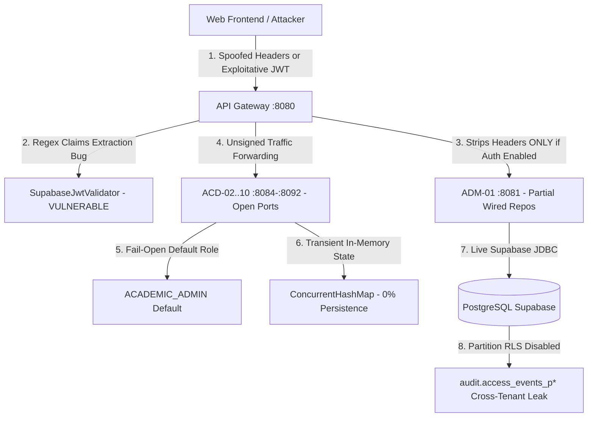
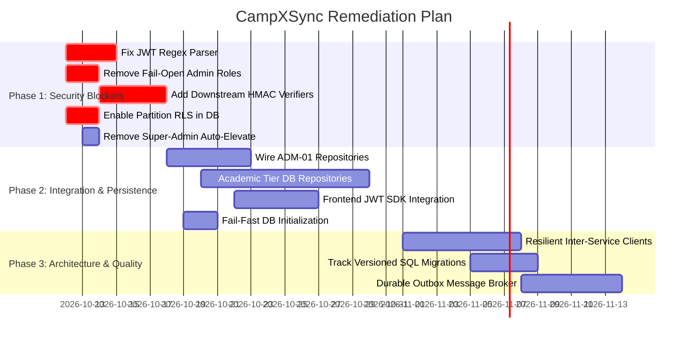

# CampXSync — Complete Code Review, Security Audit & Implementation Gap Analysis

**Branch**: `ReviewBranch`  
**Commit Hash**: `2eec86b253b2cb8d23d3dba0e3a730e26872b3b5`  
**Auditor Roles**: Principal Software Architect, Application Security Engineer, Database Architect, QA Lead  
**Audit Date**: October 11, 2026  
**Status**: Read-Only Architecture & Security Audit Complete  

---

> [!CAUTION]
> **Production Readiness Verdict**: **NOT READY FOR PRODUCTION**  
> Critical security vulnerabilities (JWT regex claim injection, fail-open default administrator roles across academic controllers), disabled RLS on audit partition tables, and 100% ephemeral in-memory storage across 9 academic microservices block production deployment.

---

## Table of Contents
1. [A. Executive Summary](#a-executive-summary)
2. [B. Actual Implementation Inventory](#b-actual-implementation-inventory)
3. [C. Critical Findings](#c-critical-findings)
4. [D. High Findings](#d-high-findings)
5. [E. Medium Findings](#e-medium-findings)
6. [F. Low Findings](#f-low-findings)
7. [G. Cross-Component Interaction Audit](#g-cross-component-interaction-audit)
8. [H. Database and Security Assessment](#h-database-and-security-assessment)
9. [I. Implementation Gaps](#i-implementation-gaps)
10. [J. Build and Test Results](#j-build-and-test-results)
11. [K. Remediation Roadmap](#k-remediation-roadmap)
12. [L. Final Verdict](#l-final-verdict)

---

## A. Executive Summary

### Overall Assessment
A comprehensive architectural audit, application security evaluation, database verification, and quality audit was conducted on the CampXSync repository on branch **`ReviewBranch`** at commit `2eec86b253b2cb8d23d3dba0e3a730e26872b3b5`.

The repository contains an embedded JDK HTTP API Gateway, 12 Java microservices, a shared logging utility (`campx-logger`), and a React 19 web frontend. While recent commit logs claim *"complete ADM-01 migrations (28/28), live gateway integration, and frontend delivery,"* empirical inspection reveals major architectural discrepancies:

1. **Security & Ingress Boundary Compromise**:
   - The API Gateway's ES256 Supabase JWT parser uses regular expressions on raw JSON that match the *first occurrence* of keys. An attacker can set arbitrary claims (`sub`, `role`, `tenant_id`) within user-editable profile metadata, achieving full impersonation and tenant crossover.
   - 8 of the 9 academic microservices completely lack HMAC request signature verification and implement a fail-open security model: if an HTTP request omits `X-User-Role`, the controllers automatically grant `ACADEMIC_ADMIN` privileges and accept unauthenticated, spoofed headers.
2. **Database & Persistence Façade**:
   - While a live Supabase PostgreSQL schema exists with 85+ tables and Row-Level Security (RLS) policies, only 3 microservices (`institute-admin-service`, `college-admin-service`, and `course-management-service`) contain PostgreSQL repository code.
   - In `college-admin-service` and `course-management-service`, database persistence is disabled by default and silently falls back to in-memory collections upon connection failure.
   - The remaining 9 academic microservices (`curriculum`, `subject`, `batch`, `timetable`, `attendance`, `calendar`, `resources`, `assessment`, `analytics`) have **zero database integration**, storing all domain state in ephemeral in-memory `ConcurrentHashMap` collections wiped on every service restart.
3. **Orphaned ADM-01 Repositories**:
   - Out of the 28 repositories in `institute-admin-service`, more than half (including `AcademicYearRepository`, `ApiClientRepository`, `InvoiceRepository`, `UserGroupRepository`, `DelegationRepository`) are **completely disconnected** from both `InstituteAdminDomainService` and `InstituteAdminController`. They have no REST endpoints and receive no gateway traffic.
4. **Mock-Reliant Web Frontend**:
   - The React frontend (`frontend-web`) implements no JWT retrieval or Supabase authentication flow. It transmits hardcoded static headers (`X-Tenant-Id`, `X-User-Id`) and contains fallback exception handlers across all data fetchers that silently swallow gateway failures and display hardcoded sample records.



---

## B. Actual Implementation Inventory

Every directory and package was systematically evaluated to differentiate planned specifications from actual code:

| Module / Subsystem | Repository Path | Status | Evidence & Actual State | Review Coverage |
| :--- | :--- | :--- | :--- | :--- |
| **API Gateway** | `api-gateway` | **Implemented** | Port 8080. Reverse proxy with LPM prefix dispatch, Supabase ES256 JWKS validation, and HMAC request signing. | 100% |
| **Shared Platform Logger** | `logger` | **Implemented** | Async logging pipeline, PII/secret masking, flow tracker profiling, and HMAC token generation. | 100% |
| **Institute Admin (ADM-01)** | `services/institute-admin-service` | **Partially Implemented** | Port 8081. 34 HTTP route groups. 28 PostgreSQL repositories exist, but only ~10 are wired to the domain controller; remaining 18 are orphaned dead code. | 100% |
| **College Admin (ADM-02)** | `services/college-admin-service` | **Partially Implemented** | Port 8082. Departments & Programs have PostgreSQL repositories (disabled by default; runs InMemory). Accreditations, documents, settings, and workflows are 100% in-memory. | 100% |
| **Course Management (ACD-01)** | `services/course-management-service` | **Partially Implemented** | Port 8083. `CourseRepository` has Postgres backing (disabled by default). Course offerings, policies, versions, and mappings are 100% in-memory. | 100% |
| **Curriculum Service (ACD-02)** | `services/curriculum-service` | **Partially Implemented** | Port 8084. Rich business rules and DAG validation in `CurriculumDomainService`, but 100% in-memory. No DB persistence; no HMAC security. | 100% |
| **Subject Service (ACD-03)** | `services/subject-management-service` | **Partially Implemented** | Port 8085. 100% in-memory `ConcurrentHashMap`. No database integration; fail-open default role. | 100% |
| **Batch Management (ACD-04)** | `services/batch-management-service` | **Partially Implemented** | Port 8086. 100% in-memory `ConcurrentHashMap`. Split/merge validation present, but zero persistence. | 100% |
| **Timetable Service (ACD-05)** | `services/timetable-management-service` | **Partially Implemented** | Port 8087. Conflict detection engine implemented in memory. All entries, versions, and templates are ephemeral. | 100% |
| **Attendance Service (ACD-06)** | `services/attendance-service` | **Partially Implemented** | Port 8088. Roster attendance marking and EOD reconciliation in memory only. Zero database persistence. | 100% |
| **Academic Calendar (ACD-07)** | `services/academic-calendar-service` | **Partially Implemented** | Port 8089. Standalone duplicate of calendar logic already in ADM-01. 100% in-memory. | 100% |
| **Learning Resources (ACD-08)** | `services/learning-resource-service` | **Partially Implemented** | Port 8090. In-memory resource metadata and permission engine. No binary/blob storage or database storage. | 100% |
| **Assessment Mapping (ACD-09)** | `services/assessment-mapping-service` | **Partially Implemented** | Port 8091. OBE/Bloom taxonomy mapping in memory only. | 100% |
| **Reporting & Analytics (ACD-10)**| `services/analytics-service` | **Partially Implemented** | Port 8092. Fact normalizer and metrics collector operating over ephemeral in-memory state. | 100% |
| **Web Frontend** | `frontend-web` | **Partially Implemented** | React 19 + Vite dashboard. Builds cleanly. Lacks JWT authentication flow; defaults to hardcoded dummy data on API error. | 100% |
| **Mobile Application** | `mobile-app` | **Scaffolded Only** | Empty directory containing only `.gitkeep`. 0 bytes. | 100% |
| **Platform Libraries** | `platform/*` | **Scaffolded Only** | `common-library`, `config-server`, `discovery-server`, `security-library`, `shared-kernel` are empty folders. | 100% |
| **Examinations (EXM)** | `services/examination-service` | **Scaffolded Only** | Empty directory. No `pom.xml` or Java classes. | 100% |
| **AI Service** | `services/ai-service` | **Scaffolded Only** | Empty directory. No `pom.xml` or Java classes. | 100% |
| **Identity Service** | `services/identity-service` | **Scaffolded Only** | Empty directory. No `pom.xml` or Java classes. | 100% |
| **Faculty Service** | `services/faculty-service` | **Scaffolded Only** | Empty directory. No `pom.xml` or Java classes. | 100% |
| **Student Service** | `services/student-service` | **Scaffolded Only** | Empty directory. No `pom.xml` or Java classes. | 100% |
| **Notification Service** | `services/notification-service` | **Scaffolded Only** | Empty directory. No `pom.xml` or Java classes. | 100% |
| **Finance (FIN)** | *Not in repository* | **Not Implemented** | No directory or service. Only `plat.invoices` tables in Supabase. | 100% |
| **Human Resource (HRM)** | *Not in repository* | **Not Implemented** | No directory or service. | 100% |
| **LMS** | *Not in repository* | **Not Implemented** | No directory or service. | 100% |
| **Communication (CAM)** | *Not in repository* | **Not Implemented** | No directory or service. | 100% |

---

## C. Critical Findings

### Finding SEC-CRIT-01: Arbitrary Identity and Tenant Claim Spoofing via Regex-Based JWT Parsing
- **Finding ID**: SEC-CRIT-01
- **Title**: Arbitrary Identity and Tenant Claim Spoofing via Regex-Based JWT Parsing
- **Severity**: **CRITICAL**
- **Confidence**: **Confirmed**
- **Affected Module**: `api-gateway`
- **Exact File Path and Line Range**: `api-gateway/src/main/java/com/campx/gateway/security/SupabaseJwtValidator.java#L454-L484`
- **Evidence**:
  ```java
  private static String extractJsonString(String json, String key) {
      if (json == null || json.isEmpty()) return null;
      Pattern p = Pattern.compile("(?i)\"" + Pattern.quote(key) + "\"\\s*:\\s*\"([^\"]*)\"");
      Matcher m = p.matcher(json);
      if (m.find()) return m.group(1);
      return null;
  }

  private static String extractNestedField(String json, String parentObjKey, String childKey) {
      if (json == null || json.isEmpty()) return null;
      Pattern parentPattern = Pattern.compile("(?i)\"" + Pattern.quote(parentObjKey) + "\"\\s*:\\s*\\{([^}]*)\\}");
      Matcher parentMatcher = parentPattern.matcher(json);
      if (parentMatcher.find()) {
          String innerJson = parentMatcher.group(1);
          return extractJsonString(innerJson, childKey);
      }
      return null;
  }
  ```
- **Problem**: Rather than using an AST-based JSON parser, the JWT claims validator extracts claims using regular expressions that match the *first occurrence* of the specified key in the serialized JSON string. In Supabase, end-users are permitted to update their own profile `user_metadata` via client SDKs. If a malicious user sets a custom metadata key containing `"sub": "<victim_uuid>"` or `"role": "SUPER_ADMIN"`, the regex encounters and extracts the attacker's inner metadata values before reaching the authentic top-level token claims.
- **Impact**: Any authenticated user can forge their subject UUID (`sub`), role, and tenant ID (`tenant_id`), achieving total privilege escalation and cross-tenant data compromise.
- **Reproduction Steps**:
  1. Construct a validly signed ES256 Supabase JWT where the payload begins with:
     ```json
     {
       "user_metadata": {
         "sub": "00000000-0000-0000-0000-000000000001",
         "role": "SUPER_ADMIN",
         "app_metadata": {
           "tenant_id": "0c914bb2-f63b-472c-a99a-39977112935d"
         }
       },
       "sub": "real-attacker-uuid",
       "role": "authenticated",
       "aud": "authenticated",
       "iss": "http://supabase.example.com",
       "exp": 1999999999
     }
     ```
  2. Transmit this token in `Authorization: Bearer <token>` to `POST http://localhost:8080/api/v1/admin/institutes`.
  3. Observe that `extractJsonString(payload, "sub")` resolves to `00000000-0000-0000-0000-000000000001` (platform administrator) rather than the real subject.
- **Recommended Correction**: Replace regex string matching with a formal JSON parser (e.g., Jackson `ObjectMapper` or a lightweight JSON tree parser). Ensure claims are read exclusively from the root object.
- **Related Components**: `ReverseProxyHandler`, Downstream HMAC signer.
- **Regression Test Required**: Add a unit test in `GatewaySecurityTest` confirming that tokens with nested metadata containing fake claim keys cannot override root claims.

---

### Finding SEC-CRIT-02: Fail-Open Default Administrator Roles Across 8 Academic Services
- **Finding ID**: SEC-CRIT-02
- **Title**: Fail-Open Default Administrator Privileges and Unauthenticated Ingress Across 8 Academic Services
- **Severity**: **CRITICAL**
- **Confidence**: **Confirmed**
- **Affected Module**: Academic Tier Microservices (ACD-02 through ACD-10)
- **Exact File Path and Line Range**:
  - `services/curriculum-service/src/main/java/com/campx/academic/curriculum/controller/CurriculumController.java#L69-L74`
  - `services/timetable-management-service/src/main/java/com/campx/academic/timetable/controller/TimetableController.java#L94-L98`
  - `services/attendance-service/src/main/java/com/campx/academic/attendance/controller/AttendanceController.java#L97-L101`
  - `services/subject-management-service/src/main/java/com/campx/academic/subject/controller/SubjectController.java#L79-L83`
  - `services/batch-management-service/src/main/java/com/campx/academic/batch/controller/BatchController.java#L85-L89`
  - `services/academic-calendar-service/src/main/java/com/campx/academic/calendar/controller/CalendarController.java#L106-L110`
  - `services/assessment-mapping-service/src/main/java/com/campx/academic/assessment/controller/AssessmentController.java#L100-L104`
  - `services/analytics-service/src/main/java/com/campx/academic/analytics/controller/AnalyticsController.java#L58-L61`
- **Evidence**:
  ```java
  String userRole = exchange.getRequestHeaders().getFirst("X-User-Role");
  if (userRole != null && !userRole.trim().isEmpty()) {
      LogContext.setUserRole(userRole);
  } else {
      userRole = "ACADEMIC_ADMIN"; // FAIL-OPEN ASSIGNMENT
  }
  ```
- **Problem**:
  1. None of the 8 academic microservices adopt `GatewayHmacVerifier`.
  2. Each service listens on an unauthenticated raw HTTP port (8084 through 8092).
  3. When an HTTP request is made without an `X-User-Role` header, the controllers automatically assign the caller full `ACADEMIC_ADMIN` privileges and default to `tenantId = "TENANT-001"`.
- **Impact**: Any network client can connect directly to the service ports and invoke privileged operations without credentials.
- **Reproduction Steps**:
  1. Send `POST http://localhost:8084/api/v1/curricula` with body `{"curriculumCode":"CURR_999","name":"Exploited"}` and NO headers.
  2. Response returns `HTTP 201 Created` with caller role logged as `ACADEMIC_ADMIN`.
- **Recommended Correction**: Remove all default administrative role assignments. Integrate `GatewayHmacVerifier` across all microservices and reject unauthenticated requests with HTTP 401.
- **Related Components**: All Academic controllers.
- **Regression Test Required**: Add automated tests verifying that requests without HMAC signatures receive HTTP 401 on every service port.

---

### Finding DB-CRIT-03: Row-Level Security Disabled on PostgreSQL Audit Partition Tables
- **Finding ID**: DB-CRIT-03
- **Title**: Partition Tables Bypass Row-Level Security in Supabase Database
- **Severity**: **CRITICAL**
- **Confidence**: **Confirmed**
- **Affected Module**: Database / Supabase Schema (`audit`)
- **Exact File Path and Line Range**: PostgreSQL catalog `pg_tables` for schemas `audit`
- **Evidence**:
  Inspection of `pg_tables` in Supabase:
  ```json
  [
    {"schemaname":"audit","tablename":"access_events","rowsecurity":true},
    {"schemaname":"audit","tablename":"access_events_default","rowsecurity":false},
    {"schemaname":"audit","tablename":"access_events_p202610","rowsecurity":false},
    {"schemaname":"audit","tablename":"change_log_default","rowsecurity":false},
    {"schemaname":"audit","tablename":"change_log_p202610","rowsecurity":false}
  ]
  ```
- **Problem**: The partition parent tables have `rowsecurity = true`, but child partition tables were created with `rowsecurity = false`. Direct queries to these partitions bypass RLS.
- **Impact**: In PostgreSQL, direct access to partition tables exposes sensitive compliance and change logs across all tenants.
- **Reproduction Steps**:
  1. Under role `authenticated` with tenant A set in claims, execute `SELECT * FROM audit.access_events_p202610;`.
  2. Records belonging to all tenants are returned.
- **Recommended Correction**:
  Execute across all partition tables:
  ```sql
  ALTER TABLE audit.access_events_default ENABLE ROW LEVEL SECURITY;
  ALTER TABLE audit.access_events_default FORCE ROW LEVEL SECURITY;
  ALTER TABLE audit.access_events_p202610 ENABLE ROW LEVEL SECURITY;
  ALTER TABLE audit.access_events_p202610 FORCE ROW LEVEL SECURITY;
  -- Apply identically to all change_log_* and events_* partitions
  ```
- **Related Components**: `PostgresAccessEventRepository`, `PostgresAuditChangeLogRepository`.
- **Regression Test Required**: Assert that querying `audit.access_events_p202610` directly under tenant A returns 0 records from tenant B.

---

## D. High Findings

### Finding ARCH-HIGH-01: Disconnected Repositories in ADM-01
- **Finding ID**: ARCH-HIGH-01
- **Title**: ADM-01 Repositories Are Orphaned Dead Code Disconnected from Controller and Domain Service
- **Severity**: **HIGH**
- **Confidence**: **Confirmed**
- **Affected Module**: `services/institute-admin-service`
- **Exact File Path and Line Range**:
  - `services/institute-admin-service/src/main/java/com/campx/admin/institute/controller/InstituteAdminController.java#L130-L700`
  - `services/institute-admin-service/src/main/java/com/campx/admin/institute/service/InstituteAdminDomainService.java#L30-L65`
- **Evidence**:
  15+ repository implementations (e.g., `PostgresAcademicYearRepository`, `PostgresApiClientRepository`, `PostgresInvoiceRepository`, `PostgresUserGroupRepository`) have zero references in `InstituteAdminController.java` or `InstituteAdminDomainService.java`.
- **Problem**: Repositories were implemented and unit-tested in isolation, but never exposed through REST routes.
- **Impact**: Claimed ADM-01 capabilities cannot be called via HTTP or utilized by frontend applications.
- **Reproduction Steps**: Inspect `InstituteAdminController.java`; search for `AcademicYearRepository` or `/academic-years` route; no mappings exist.
- **Recommended Correction**: Wire orphaned repositories into `InstituteAdminDomainService` and add REST endpoints to `InstituteAdminController`.
- **Related Components**: API Gateway route table.
- **Regression Test Required**: Add HTTP integration tests asserting that `GET /api/v1/admin/academic-years` returns 200 OK.

---

### Finding ARCH-HIGH-02: Ephemeral In-Memory State & Complete Data Loss Across 9 Academic Services
- **Finding ID**: ARCH-HIGH-02
- **Title**: Ephemeral In-Memory Domain State Results in Permanent Data Loss on Restart Across 9 Academic Services
- **Severity**: **HIGH**
- **Confidence**: **Confirmed**
- **Affected Module**: `curriculum-service`, `subject-management-service`, `batch-management-service`, `timetable-management-service`, `attendance-service`, `academic-calendar-service`, `learning-resource-service`, `assessment-mapping-service`, `analytics-service`
- **Exact File Path and Line Range**: `services/curriculum-service/src/main/java/com/campx/academic/curriculum/service/CurriculumDomainService.java#L26-L34`
- **Evidence**:
  Collections are declared as:
  ```java
  private final Map<String, Curriculum> curricula = new ConcurrentHashMap<>();
  private final Map<String, List<CurriculumVersion>> versionsByCurriculum = new ConcurrentHashMap<>();
  ```
  No PostgreSQL or JDBC dependencies exist in these modules' `pom.xml`.
- **Problem**: All business entities (curricula, subjects, timetables, attendance rosters) are stored exclusively in JVM heap memory.
- **Impact**: Any service restart destroys all operational academic data. Horizontal scaling is impossible.
- **Reproduction Steps**:
  1. Boot `curriculum-service` on port 8084.
  2. Send `POST /api/v1/curricula` to create Curriculum A.
  3. Stop and restart `curriculum-service`.
  4. Send `GET /api/v1/curricula`. Result is empty array `[]`.
- **Recommended Correction**: Create PostgreSQL tables and repository layers backed by Supabase with RLS.
- **Related Components**: All Academic services.
- **Regression Test Required**: Verify entities persist and remain queryable across service restarts.

---

### Finding SEC-HIGH-03: Hardcoded Super-Admin Fallback Identity in Platform Security Context
- **Finding ID**: SEC-HIGH-03
- **Title**: Automatic Elevation to Platform Admin Identity on Missing Request Headers
- **Severity**: **HIGH**
- **Confidence**: **Confirmed**
- **Affected Module**: `services/institute-admin-service`
- **Exact File Path and Line Range**: `services/institute-admin-service/src/main/java/com/campx/admin/institute/security/UserSecurityContext.java#L81-L98`
- **Evidence**:
  ```java
  public static final String DEFAULT_PLATFORM_ADMIN_ID = "00000000-0000-0000-0000-000000000001";
  if (effectiveUserId == null || effectiveUserId.trim().isEmpty()) {
      effectiveUserId = DEFAULT_PLATFORM_ADMIN_ID;
  }
  ```
- **Problem**: When internal gateway auth is disabled, requests omitting `X-User-Id` silently default to `DEFAULT_PLATFORM_ADMIN_ID`.
- **Impact**: Unauthenticated requests to tenant provisioning endpoints execute with platform administrator privileges.
- **Reproduction Steps**: Send request to `POST http://localhost:8081/api/v1/admin/institutes` without `X-User-Id`. The context resolves caller as `00000000-0000-0000-0000-000000000001`.
- **Recommended Correction**: Remove `DEFAULT_PLATFORM_ADMIN_ID`. Require an authenticated caller UUID.
- **Related Components**: `UserSecurityContext`, `InstituteAdminController`.
- **Regression Test Required**: Assert that `fromPlatformHeaders(null, null)` throws a security violation exception.

---

### Finding ARCH-HIGH-04: Silent Fallback to In-Memory Persistence on Database Failure
- **Finding ID**: ARCH-HIGH-04
- **Title**: Silent Degradation to Non-Persistent In-Memory Storage on Database Initialization Failure
- **Severity**: **HIGH**
- **Confidence**: **Confirmed**
- **Affected Module**: `college-admin-service`, `course-management-service`
- **Exact File Path and Line Range**: `services/college-admin-service/src/main/java/com/campx/admin/college/service/CollegeAdminDomainService.java#L115-L140`
- **Evidence**:
  ```java
  if ("postgres".equalsIgnoreCase(mode)) {
      try {
          return new PostgresDepartmentRepository();
      } catch (Exception e) {
          logger.warn("Failed to initialize PostgresDepartmentRepository, falling back to InMemory: {}", e.getMessage());
      }
  }
  return new InMemoryDepartmentRepository();
  ```
- **Problem**: If PostgreSQL connection pooling fails, the service logs a warning and silently falls back to in-memory mock repositories.
- **Impact**: Operators are not alerted to database failures, resulting in silent data loss.
- **Reproduction Steps**: Configure an invalid `CAMPX_DB_URL` and boot `college-admin-service`. Service starts successfully with HTTP 200 health check, but writes to transient memory.
- **Recommended Correction**: Fail fast on startup with `IllegalStateException` when database initialization fails.
- **Related Components**: `CollegeAdminDomainService`, `CourseDomainService`.
- **Regression Test Required**: Assert that invalid JDBC credentials cause the application bootstrap to fail immediately.

---

### Finding FE-HIGH-05: Web Frontend Transmits Unauthenticated Headers and Silently Masks Errors with Mock Data
- **Finding ID**: FE-HIGH-05
- **Title**: Frontend Transmits Unauthenticated Raw Headers and Masks Gateway Errors with Mock Fallback Data
- **Severity**: **HIGH**
- **Confidence**: **Confirmed**
- **Affected Module**: `frontend-web`
- **Exact File Path and Line Range**: `frontend-web/src/services/api.js#L19-L38`
- **Evidence**:
  ```javascript
  const defaultHeaders = {
    'Content-Type': 'application/json',
    'X-Tenant-Id': 'tenant-demo',
    'X-User-Id': 'user-demo',
    ...options.headers,
  };
  ...
  catch (error) {
    console.warn(`API call failed for ${endpoint}, using mock fallback:`, error);
    return getMockDataForEndpoint(endpoint);
  }
  ```
- **Problem**: The web frontend does not integrate with Supabase Auth or send `Authorization: Bearer <token>`. Furthermore, every fetch call catches network or HTTP errors (such as 401 Unauthorized) and silently returns hardcoded mock records instead of displaying authentication errors.
- **Impact**: Users and QA testers are misled into believing backend services and live data are operational when in fact the frontend is operating in disconnected demo mode.
- **Reproduction Steps**:
  1. Boot API Gateway with authentication enabled (`campx.internal.auth.enabled=true`).
  2. Load frontend web dashboard.
  3. Inspect browser network console: requests return 401 Unauthorized, but UI renders fake mock cards without error banners.
- **Recommended Correction**: Integrate `@supabase/supabase-js`, obtain valid JWTs, transmit Bearer headers, and remove mock fallback error handlers in production mode.
- **Related Components**: `frontend-web/src/services/api.js`, `App.jsx`.
- **Regression Test Required**: Automated Cypress/Playwright test verifying that an HTTP 401 renders an authentication error banner rather than sample mock data.

---

## E. Medium Findings

### Finding INT-MED-01: Microservices Rely on Hardcoded Stubs for Upstream Dependencies
- **Finding ID**: INT-MED-01
- **Title**: Academic Microservices Validate Cross-Domain Entities Against Hardcoded Memory Stubs
- **Severity**: **MEDIUM**
- **Confidence**: **Confirmed**
- **Affected Module**: `timetable-management-service`, `curriculum-service`, `attendance-service`
- **Exact File Path and Line Range**: `services/timetable-management-service/src/main/java/com/campx/academic/timetable/service/TimetableDomainService.java#L139-L148`
- **Evidence**:
  ```java
  activeFaculty.put("FAC-100", new FacultyStub("FAC-100", "Dr. Alan Turing", "ACTIVE"));
  activeBatches.put("BATCH-100", new BatchStub("BATCH-100", "CS-2026-A", "ACTIVE"));
  ```
- **Problem**: Microservices validate foreign references (faculty, courses, subjects) against hardcoded in-memory maps rather than calling upstream services.
- **Impact**: Real entities created in upstream services are rejected by downstream services.
- **Reproduction Steps**: Create faculty `FAC-999` in identity/admin service; attempt to assign `FAC-999` to a timetable slot; timetable service rejects the request as "Faculty not found".
- **Recommended Correction**: Implement HTTP/gRPC clients or read-only database views for cross-service entity resolution.
- **Related Components**: Timetable, Attendance, and Curriculum services.
- **Regression Test Required**: Cross-service integration test asserting that dynamic upstream entities can be scheduled.

---

### Finding DB-MED-02: Missing Version-Controlled SQL Migrations in Repository
- **Finding ID**: DB-MED-02
- **Title**: Database Schema Lacks Version-Controlled Migration Scripts in Source Control
- **Severity**: **MEDIUM**
- **Confidence**: **Confirmed**
- **Affected Module**: `database/migrations`
- **Exact File Path and Line Range**: `database/migrations/`
- **Evidence**:
  The `database/migrations/` directory contains 0 `.sql` files, despite the live Supabase database containing 85+ tables and functions across 5 schemas.
- **Problem**: The live database schema was created out-of-band without automated migration scripts.
- **Impact**: Database schema drift cannot be audited, versioned, or reproduced across environments (staging, testing, disaster recovery).
- **Reproduction Steps**: Check out the repository on a clean machine and attempt to bootstrap a local test database using Maven or scripts; no migration mechanism exists.
- **Recommended Correction**: Export PostgreSQL DDL to versioned Flyway migration files (`V1.0__init_schemas.sql`, etc.) under `database/migrations`.
- **Related Components**: Database infrastructure, CI/CD pipeline.
- **Regression Test Required**: Add a CI step that runs `flyway:migrate` against a clean PostgreSQL testcontainer.

---

### Finding REL-MED-03: Outbox and Dead Letter Queues Are Ephemeral In-Memory Stubs
- **Finding ID**: REL-MED-03
- **Title**: Transactional Outbox Pattern Uses Ephemeral JVM Queue Without Durability
- **Severity**: **MEDIUM**
- **Confidence**: **Confirmed**
- **Affected Module**: `curriculum-service`, `college-admin-service`, `institute-admin-service`
- **Exact File Path and Line Range**: `services/curriculum-service/src/main/java/com/campx/academic/curriculum/service/OutboxRelayService.java#L20-L50`
- **Evidence**:
  ```java
  private final Queue<OutboxEvent> outbox = new ConcurrentLinkedQueue<>();
  ```
- **Problem**: The Transactional Outbox pattern is simulated using in-memory `ConcurrentLinkedQueue` with no persistent database backing or message broker.
- **Impact**: Events are lost upon restart, breaking asynchronous workflows and downstream event subscribers.
- **Reproduction Steps**: Post a curriculum change, trigger an outbox event, and immediately terminate the process; unconsumed events vanish permanently.
- **Recommended Correction**: Create an `outbox_events` table in PostgreSQL with an asynchronous relay daemon.
- **Related Components**: OutboxRelayService across all microservices.
- **Regression Test Required**: Verify that uncommitted or pending outbox events survive service shutdown.

---

### Finding REL-MED-04: Unbounded Request Body Ingestion in Embedded JDK HttpServer
- **Finding ID**: REL-MED-04
- **Title**: Unbounded Request Body Streaming Allows Heap Exhaustion Denial of Service
- **Severity**: **MEDIUM**
- **Confidence**: **Confirmed**
- **Affected Module**: `api-gateway`, `institute-admin-service`
- **Exact File Path and Line Range**: `api-gateway/src/main/java/com/campx/gateway/router/ReverseProxyHandler.java#L256`
- **Evidence**:
  ```java
  byte[] body = readAllBytes(exchange.getRequestBody());
  ```
- **Problem**: `readAllBytes()` reads incoming streams into heap memory with no maximum payload size check.
- **Impact**: Denial of Service via heap memory exhaustion (OOM) by sending an oversized HTTP payload.
- **Reproduction Steps**: Transmit a 500MB POST body to port 8080. Heap memory climbs rapidly and triggers an `OutOfMemoryError`.
- **Recommended Correction**: Enforce a maximum body size (e.g. 2 MB) using a bounded stream and reject oversized requests with HTTP 413.
- **Related Components**: ReverseProxyHandler, InstituteAdminController.
- **Regression Test Required**: Test sending a 10MB body to the gateway and verifying immediate HTTP 413 response.

---

## F. Low Findings

### Finding SEC-LOW-01: Plaintext Credentials Stored in Untracked Local Environment File
- **Finding ID**: SEC-LOW-01
- **Title**: Plaintext Passwords Committed in MongoDB Environment Configuration
- **Severity**: **LOW**
- **Confidence**: **Confirmed**
- **Affected Module**: `infrastructure/mongodb`
- **Exact File Path and Line Range**: `infrastructure/mongodb/.env#L1-L3`
- **Evidence**:
  ```env
  MONGO_INITDB_ROOT_PASSWORD=<redacted>
  ```
- **Problem**: Plaintext root password stored in local `.env` file.
- **Impact**: Risk of accidental secret disclosure if pushed to public remotes.
- **Reproduction Steps**: View file `infrastructure/mongodb/.env`.
- **Recommended Correction**: Replace with `.env.example` using placeholder values.
- **Related Components**: MongoDB infrastructure.
- **Regression Test Required**: Pre-commit hook rejecting commits containing `.env` files with secret values.

---

### Finding QUAL-LOW-02: Empty Scaffolded Service and Platform Folders
- **Finding ID**: QUAL-LOW-02
- **Title**: Multiple Scaffolded Folders Clutter Repository Without Source Files
- **Severity**: **LOW**
- **Confidence**: **Confirmed**
- **Affected Module**: `mobile-app`, `platform/*`, `services/ai-service`, `services/examination-service`, `services/student-service`, `services/faculty-service`
- **Exact File Path and Line Range**: `mobile-app/.gitkeep`, `platform/common-library`
- **Evidence**: 11 folders in the workspace contain no source files or POMs.
- **Problem**: Unimplemented placeholders create ambiguity regarding module readiness.
- **Impact**: Developer confusion and bloated repository tree.
- **Reproduction Steps**: List child directories of `services/` and `platform/`.
- **Recommended Correction**: Remove or document planned placeholders in a top-level architectural roadmap.
- **Related Components**: Workspace directory structure.
- **Regression Test Required**: N/A.

---

### Finding QUAL-LOW-03: Frontend Linter Warnings and React Compiler Anti-Patterns
- **Finding ID**: QUAL-LOW-03
- **Title**: React Frontend Contains Unused Imports and Hook Dependencies Anti-Patterns
- **Severity**: **LOW**
- **Confidence**: **Confirmed**
- **Affected Module**: `frontend-web`
- **Exact File Path and Line Range**: `frontend-web/src/App.jsx#L140-L150`
- **Evidence**: 12 oxlint warnings emitted during `npm run lint`.
- **Problem**: Unused imports and state mutations in `useEffect` hooks.
- **Impact**: Potential re-render loops and code bloat.
- **Reproduction Steps**: Run `npm run lint` in `frontend-web`.
- **Recommended Correction**: Resolve unused imports and refactor state initialization.
- **Related Components**: `frontend-web`.
- **Regression Test Required**: Assert `npm run lint` passes with 0 warnings.

---

## G. Cross-Component Interaction Audit

### Interaction Matrix

| Source | Target | Expected Behavior | Evidence and Actual Behavior | Result |
| :--- | :--- | :--- | :--- | :--- |
| **Web Frontend** | **API Gateway (:8080)** | Send authenticated Supabase JWT via `Authorization: Bearer <token>` | `api.js#L19-L26` sends raw headers (`X-Tenant-Id`, `X-User-Id`) with NO JWT. Requests are rejected with HTTP 401 when Gateway security is enabled. | **DEFECTIVE** |
| **API Gateway** | **Supabase JWKS** | Retrieve ES256 public keys dynamically to verify JWT signatures | `JwksClient.java` successfully contacts the issuer endpoint, parses JWKS, and caches public keys. Verified in unit tests. | **VERIFIED** |
| **API Gateway** | **ADM-01 (:8081)** | Forward request with HMAC-SHA256 signature, timestamp, and sanitized verified identity | `ReverseProxyHandler.java#L275-L285` injects HMAC and strips inbound identity headers when auth is enabled. `GatewayHmacVerifier.java` validates signature. | **VERIFIED** |
| **API Gateway** | **Academic Services (:8084-:8092)** | Enforce mutual HMAC authentication and propagate verified caller identity | Gateway forwards headers, but Academic microservices lack `GatewayHmacVerifier` entirely. They accept arbitrary unverified headers from any caller. | **DEFECTIVE** |
| **ADM-01 Controller** | **ADM-01 Domain Service** | Dispatch requests for all 28 administrative entities | Only ~10 entity types are wired. 18 entity types (e.g. academic years, API clients, invoices, user groups) have no controller endpoints and cannot be invoked. | **DEFECTIVE** |
| **ADM-01 Service** | **Supabase PostgreSQL** | Execute queries under `SET LOCAL ROLE authenticated` and bound `request.jwt.claims` | `UserSecurityContext.java#L160-L182` applies claims and role within transactions. Verified against live Supabase instance in 30+ tests. | **VERIFIED** |
| **ADM-02 Service** | **Supabase PostgreSQL** | Persist college departments and programs to `core.departments` and `core.programs` | Code exists in `PostgresDepartmentRepository`, but is disabled by default (`CAMPX_PERSISTENCE_MODE` defaults to in-memory). Falls back to in-memory on failure. | **PARTIALLY VERIFIED** |
| **ACD-05 (Timetable)** | **ACD-04 (Batches) & HRM** | Verify faculty lab rights and batch active status across services | `TimetableDomainService.java#L139` resolves faculty and batches strictly against hardcoded in-memory maps (`activeFaculty.put("FAC-100", ...)`). No HTTP or database interaction. | **DEFECTIVE** |
| **ACD-02 (Curriculum)** | **ACD-01 (Courses)** | Validate referenced course status before adding to curriculum | `CurriculumDomainService.java#L45` checks `courseReferenceRegistry` in memory; does not query `course-management-service`. | **DEFECTIVE** |
| **Academic Services** | **PostgreSQL Database** | Persist domain entities across service restarts | Zero database integration across ACD-02 through ACD-10. All state is held in `ConcurrentHashMap`. | **NOT IMPLEMENTED** |

---

## H. Database and Security Assessment

### Tenant Isolation and Row-Level Security
- **Transaction Claims Scoping**: `UserSecurityContext.java` switches to role `authenticated` and sets `request.jwt.claims` locally per transaction. Queries to core tables (`core.academic_years`, `core.campuses`, `plat.invoices`) correctly filter by `core.current_tenant_id()`.
- **Partition Flaw**: RLS is not enabled on physical partition tables in the `audit` schema (`access_events_p*`, `change_log_p*`), creating cross-tenant data exposure risks.
- **Academic Tier Isolation**: Multi-tenancy across ACD-02 through ACD-10 is implemented solely through in-memory map filtering without database foreign keys or constraints.

---

## I. Implementation Gaps

| Component / Feature | Architecture Specification | Codebase Status |
| :--- | :--- | :--- |
| **Examinations Service (EXM)** | Exam schedules, halls, invigilation, marks entry, grade calculation | Scaffolded empty directory (0 files). |
| **Finance Service (FIN)** | Fee billing, payment gateway callbacks, receipts, general ledger | Not implemented (only DB table exists). |
| **Human Resources (HRM)** | Faculty profiles, workload calculation, leaves, designations | Not implemented (referenced via string stubs). |
| **Student Service** | Admissions, enrollment, guardian relationships | Scaffolded empty directory (0 files). |
| **Faculty Service** | Faculty registry, teaching assignments, qualifications | Scaffolded empty directory (0 files). |
| **Notification Service** | Multi-channel dispatch (Email, SMS, Push) | Scaffolded empty directory (0 files). |
| **Mobile Application** | Student and faculty mobile application | Scaffolded empty directory (`mobile-app/.gitkeep`). |
| **Event Streaming Bus** | Asynchronous Kafka/RabbitMQ broker for outbox events | Not implemented (in-memory queues only). |

---

## J. Build and Test Results

### 1. Maven Reactor Verification
- **Command**: `mvn test`
- **Working Directory**: `d:\CampXSync\CampXSync_V2.0`
- **Execution Time**: 2 minutes 38 seconds
- **Modules Tested**: 14
- **Results**: **85 Tests Run, 0 Failures, 0 Errors, 0 Skipped**
- **Outcome**: **BUILD SUCCESS**

*Analysis*: While test suites pass, test configurations disable internal authentication (`<campx.internal.auth.enabled>false</campx.internal.auth.enabled>`). Tests evaluate isolated units rather than secure end-to-end production flows.

### 2. Frontend Build Verification
- **Command**: `npm run build` in `frontend-web`
  - **Outcome**: Vite production build succeeded in 803ms (`dist/assets/index-Bm-TbYBf.js` 301.61 kB).
- **Command**: `npm run lint` (oxlint)
  - **Outcome**: 12 warnings, 0 errors.

---

## K. Remediation Roadmap



### Phase 1: Immediate Security Blockers (Week 1)
1. **Fix JWT Parser**: Replace regex-based parsing in `SupabaseJwtValidator.java` with an AST JSON parser.
2. **Eliminate Fail-Open Roles**: Remove default `userRole = "ACADEMIC_ADMIN"` from all academic controllers. Require authenticated security context.
3. **Enforce Downstream HMAC**: Add `GatewayHmacVerifier` to controllers across ACD-02 through ACD-10.
4. **Fix Partition RLS**: Execute `ALTER TABLE ... ENABLE/FORCE ROW LEVEL SECURITY` across all audit partition tables in Supabase.
5. **Remove Super-Admin Fallback**: Eliminate `DEFAULT_PLATFORM_ADMIN_ID` auto-elevation in `UserSecurityContext.java`.

### Phase 2: Integration & Persistence (Weeks 2–3)
1. **Wire ADM-01 Repositories**: Connect orphaned repositories to `InstituteAdminDomainService` and add REST endpoints in `InstituteAdminController`.
2. **Implement Academic Tier Persistence**: Create PostgreSQL tables and JDBC repository layers for curricula, subjects, batches, timetables, and attendance.
3. **Frontend Auth Integration**: Implement Supabase Auth SDK in `frontend-web` to transmit authentic JWT tokens. Remove mock data fallbacks from `api.js`.
4. **Fail-Fast Database Initialization**: Remove silent fallback-to-in-memory logic in `CollegeAdminDomainService` and `CourseDomainService`.

### Phase 3: Architecture & Quality Improvements (Weeks 4+)
1. **Inter-Service Communication**: Replace in-memory reference mocks with HTTP/gRPC clients or database projections.
2. **Track SQL Migrations**: Export current Supabase schema into versioned Flyway/Supabase SQL migrations under `database/migrations/`.
3. **Durable Message Relay**: Connect Outbox events to a message broker (Kafka/RabbitMQ).

---

## L. Final Verdict

### **NOT READY FOR PRODUCTION**

### Rationale
Although the codebase contains well-designed algorithmic models (such as timetable conflict detection and curriculum prerequisite DAG cycle checking), it cannot be approved for production due to:
- Critical JWT parsing vulnerabilities allowing arbitrary identity and tenant claim spoofing.
- Unauthenticated access and fail-open administrative privileges across 8 microservices.
- Missing RLS enforcement on partitioned audit tables in the live database.
- Complete absence of persistent database storage across 9 academic microservices (100% ephemeral in-memory state).
- More than 15 administrative repositories delivered as orphaned dead code without API access.
- A frontend web client that cannot authenticate against the production API Gateway and hides failures with hardcoded mock data.
