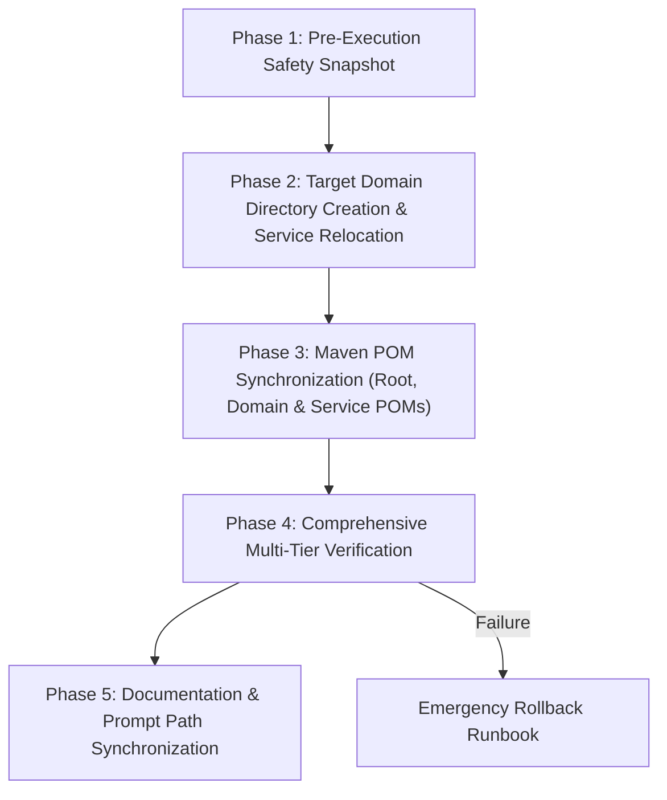

# CampXSync — Microservices Directory Restructuring Execution Plan & Runbook (Executed & Verified)
**Document:** `RESTRUCTURING_EXECUTION_PLAN.md`  
**Monorepo:** `CampXSync_V2.0`  
**Target Branch:** `feature/java-backend-integration`  
**Execution Timestamp:** 30 October 2026, 12:50–13:00 IST  
**Execution Status:** **EXECUTED & FULLY VERIFIED (ALL GATES A–I PASSED)**  

---

> [!NOTE]
> **RUNBOOK EXECUTION SUMMARY:**
> This runbook was successfully executed on 30 October 2026. All 18 microservice directories were relocated into 11 domain directories under `services/`, 6 domain aggregator POMs were created, root POM updated, 13 child POMs synchronized, and all 9 verification gates (Gates A through I) passed with 100% test success and 0 regressions. Full details are recorded in [`docs/architecture/SERVICES_DIRECTORY_RESTRUCTURING_COMPLETION_REPORT.md`](file:///d:/CampXSync/CampXSync_V2.0/docs/architecture/SERVICES_DIRECTORY_RESTRUCTURING_COMPLETION_REPORT.md).  

---

## 1. Safety Guardrails & Pre-Execution Mandates

> [!CAUTION]
> **STOP CONDITION ENFORCEMENT:**
> This execution plan is an approved operational blueprint. **No file moves, directory renames, or POM modifications may occur until explicit user authorization is provided.**
> 
> When authorized, the restructuring must be executed with zero data loss, zero regression on uncommitted student-service/frontend files, and zero interruption to API Gateway route contracts.

### 1.1 Non-Negotiable Pre-Flight Safeguards:
1. **Preserve Current Branch:** Remain strictly on `feature/java-backend-integration`. Do not switch branches, reset, stash, or rebase.
2. **Preserve Uncommitted Work:** Wave 4 and Wave 10 changes in `services/student-service/` (10 modified files, 35+ untracked files) and `frontend/` must be preserved in place.
3. **Preserve Service Identity:** Zero changes to Java package names (`com.campx.*`), Maven `artifactId`s, database schemas (`acd`, `adm`, `stu`, `core`, `plat`, `sys`), or HTTP API endpoints.
4. **Step-by-Step Validation:** Every phase must pass its specific validation checkpoint before moving to the next phase.

---

## 2. Phased Execution Sequence



---

### Phase 1: Pre-Execution Safety Baseline Snapshot

Before touching any files, verify that the current baseline compiles and passes tests cleanly.

#### Step 1.1: Verify Current Maven Compilation
```powershell
# From repository root D:\CampXSync\CampXSync_V2.0
mvn clean test-compile
```
*Expected Result:* `BUILD SUCCESS` across all 15 existing modules.

#### Step 1.2: Snapshot Git Status & Untracked Files
```powershell
# Record uncommitted file list for verification
git status -s > pre_restructure_git_status.txt
Get-ChildItem -Path services\student-service -Recurse | Select-Object FullName > pre_restructure_student_files.txt
```
*Expected Result:* Baseline records saved; confirms all 45+ student-service files are accounted for.

---

### Phase 2: Domain Directory Creation & Service Relocation

Execute service moves using Git to preserve file commit history.

#### Step 2.1: Create Proposed Domain Directories
```powershell
New-Item -ItemType Directory -Force -Path `
    "services\academic-services", `
    "services\student-services", `
    "services\administration-services", `
    "services\attendance-services", `
    "services\lms-services", `
    "services\analytics-services", `
    "services\ai-services", `
    "services\examination-services", `
    "services\faculty-services", `
    "services\identity-services", `
    "services\communication-services"
```

#### Step 2.2: Move Academic Domain Services (7 Services)
```powershell
git mv services/academic-calendar-service services/academic-services/academic-calendar-service
git mv services/assessment-mapping-service services/academic-services/assessment-mapping-service
git mv services/batch-management-service services/academic-services/batch-management-service
git mv services/course-management-service services/academic-services/course-management-service
git mv services/curriculum-service services/academic-services/curriculum-service
git mv services/subject-management-service services/academic-services/subject-management-service
git mv services/timetable-management-service services/academic-services/timetable-management-service
```

#### Step 2.3: Move Student Domain Service (Careful Handling for Untracked Files)
Because `services/student-service` contains both tracked and untracked files:
```powershell
# Move tracked files via git
git mv services/student-service services/student-services/student-service

# Move any remaining untracked files that git mv did not capture
if (Test-Path "services\student-service") {
    Get-ChildItem -Path "services\student-service" -Recurse | ForEach-Object {
        $target = $_.FullName.Replace("services\student-service", "services\student-services\student-service")
        if (-not (Test-Path (Split-Path $target))) { New-Item -ItemType Directory -Force -Path (Split-Path $target) }
        if (-not $_.PSIsContainer -and -not (Test-Path $target)) { Move-Item $_.FullName $target -Force }
    }
    Remove-Item -Recurse -Force "services\student-service"
}
```

#### Step 2.4: Move Administration Services (2 Services)
```powershell
git mv services/college-admin-service services/administration-services/college-admin-service
git mv services/institute-admin-service services/administration-services/institute-admin-service
```

#### Step 2.5: Move Attendance, LMS, and Analytics Services (3 Services)
```powershell
git mv services/attendance-service services/attendance-services/attendance-service
git mv services/learning-resource-service services/lms-services/learning-resource-service
git mv services/analytics-service services/analytics-services/analytics-service
```

#### Step 2.6: Move Scaffolded Placeholder Directories (5 Directories)
```powershell
git mv services/ai-service services/ai-services/ai-service
git mv services/examination-service services/examination-services/examination-service
git mv services/faculty-service services/faculty-services/faculty-service
git mv services/identity-service services/identity-services/identity-service
git mv services/notification-service services/communication-services/notification-service
```

#### Step 2.7: Phase 2 Verification
```powershell
# Verify no orphaned services remain in services root
Get-ChildItem -Path services -Depth 0 -Directory | Select-Object Name
```
*Expected Result:* Only `*-services` domain directories exist directly under `services/`.

---

### Phase 3: Maven POM Synchronization

#### Step 3.1: Update Child Service POMs (`relativePath`)
Update the `<parent><relativePath>` in all 13 active microservice POM files:
From:
```xml
<relativePath>../../pom.xml</relativePath>
```
To (under Pattern B with domain aggregators):
```xml
<relativePath>../pom.xml</relativePath>
```
*(Or `../../../pom.xml` if Pattern A direct-root aggregator is selected).*

Files to update:
1. `services/academic-services/academic-calendar-service/pom.xml`
2. `services/academic-services/assessment-mapping-service/pom.xml`
3. `services/academic-services/batch-management-service/pom.xml`
4. `services/academic-services/course-management-service/pom.xml`
5. `services/academic-services/curriculum-service/pom.xml`
6. `services/academic-services/subject-management-service/pom.xml`
7. `services/academic-services/timetable-management-service/pom.xml`
8. `services/student-services/student-service/pom.xml`
9. `services/administration-services/college-admin-service/pom.xml`
10. `services/administration-services/institute-admin-service/pom.xml`
11. `services/attendance-services/attendance-service/pom.xml`
12. `services/lms-services/learning-resource-service/pom.xml`
13. `services/analytics-services/analytics-service/pom.xml`

#### Step 3.2: Create Domain Aggregator POMs (Pattern B Implementation)
Create a domain aggregator `pom.xml` in each domain directory housing active services:
- `services/academic-services/pom.xml` (packaging: `pom`, listing all 7 academic services)
- `services/student-services/pom.xml` (packaging: `pom`, listing `student-service`)
- `services/administration-services/pom.xml` (packaging: `pom`, listing `college-admin-service`, `institute-admin-service`)
- `services/attendance-services/pom.xml` (packaging: `pom`, listing `attendance-service`)
- `services/lms-services/pom.xml` (packaging: `pom`, listing `learning-resource-service`)
- `services/analytics-services/pom.xml` (packaging: `pom`, listing `analytics-service`)

#### Step 3.3: Update Root `pom.xml`
Update `<modules>` in `D:\CampXSync\CampXSync_V2.0\pom.xml`:
```xml
    <modules>
        <module>logger</module>
        <module>api-gateway</module>
        <module>services/academic-services</module>
        <module>services/student-services</module>
        <module>services/administration-services</module>
        <module>services/attendance-services</module>
        <module>services/lms-services</module>
        <module>services/analytics-services</module>
    </modules>
```

---

### Phase 4: Comprehensive Multi-Tier Verification

Execute these verification gates strictly in order:

#### Gate 4.1: Maven Multi-Module Compilation Gate
```powershell
mvn clean test-compile
```
*Pass Criteria:* `BUILD SUCCESS` across all domain aggregators and child microservices. Zero compilation errors.

#### Gate 4.2: Domain Microservice Unit Test Suite Gate
```powershell
# Verify student service unit tests (including uncommitted Wave 4 work)
mvn test -pl services/student-services/student-service "-Dtest=!Live*"

# Verify timetable service unit tests
mvn test -pl services/academic-services/timetable-management-service "-Dtest=!Live*"

# Verify attendance service unit tests
mvn test -pl services/attendance-services/attendance-service "-Dtest=!Live*"

# Verify batch management service unit tests
mvn test -pl services/academic-services/batch-management-service "-Dtest=!Live*"

# Verify administration services
mvn test -pl services/administration-services/college-admin-service "-Dtest=!Live*"
mvn test -pl services/administration-services/institute-admin-service "-Dtest=!Live*"
```
*Pass Criteria:* 100% of unit tests pass; zero failures, zero errors.

#### Gate 4.3: API Gateway Ingress & Integration Test Suite Gate
```powershell
mvn test -pl api-gateway
```
*Pass Criteria:* All 154 gateway unit and route integration tests pass (`StudentGatewayRouteTest`, `TimetableGatewayRouteTest`, `GatewayAttendanceIntegrationTest`, `GatewayBatchIntegrationTest`, etc.).

#### Gate 4.4: Full Repository Non-Live Test Suite Gate
```powershell
mvn test "-Dtest=!Live*"
```
*Pass Criteria:* All ~950+ unit and mock integration tests across the entire monorepo pass cleanly.

#### Gate 4.5: Frontend TypeScript & Direct Ingress Verification
```powershell
cd frontend
npx tsc --noEmit
```
*Pass Criteria:* 0 errors.

---

### Phase 5: Documentation & Tooling Synchronization

#### Step 5.1: Update Active Task Documentation
- Update `docs/project-control/PROGRESS.md`: Update test command references from `services/<service>` to `services/<domain>-services/<service>`.
- Update `prompts/NEXT_ANTIGRAVITY_TASK.md`: Update target paths for Wave 11.

#### Step 5.2: Verification Checklist Confirmation
- [ ] 13 active microservices relocated to domain subdirectories.
- [ ] 5 scaffolded placeholder directories relocated.
- [ ] All student-service uncommitted files verified intact (no files lost).
- [ ] Root `pom.xml` and all child/domain POMs compile cleanly.
- [ ] API Gateway tests pass (154/154).
- [ ] Frontend TypeScript compilation passes (0 errors).

---

## 3. Emergency Rollback Runbook (Under 60 Seconds)

If any verification gate in Phase 4 fails, execute this immediate rollback procedure:

```powershell
# 1. Check current git status
git status

# 2. Revert git moves and staged index changes
git reset HEAD services/ pom.xml

# 3. Clean untracked domain aggregator POM files if created
Remove-Item -Force `
    "services\academic-services\pom.xml", `
    "services\student-services\pom.xml", `
    "services\administration-services\pom.xml", `
    "services\attendance-services\pom.xml", `
    "services\lms-services\pom.xml", `
    "services\analytics-services\pom.xml" -ErrorAction SilentlyContinue

# 4. Checkout modified POMs back to clean state
git checkout -- pom.xml services/*/pom.xml

# 5. Move services back to root services/ directory if git mv was uncommitted
# (Using git checkout -- services/ will restore tracked paths cleanly)
git checkout -- services/

# 6. Verify full restoration against pre-execution snapshot
git status -s
```

*Rollback Assurance:* Because no commits were made and no database operations occurred, executing `git checkout --` and cleaning new aggregator POMs completely restores the repository to its exact pre-restructuring state within 60 seconds with zero data loss.

