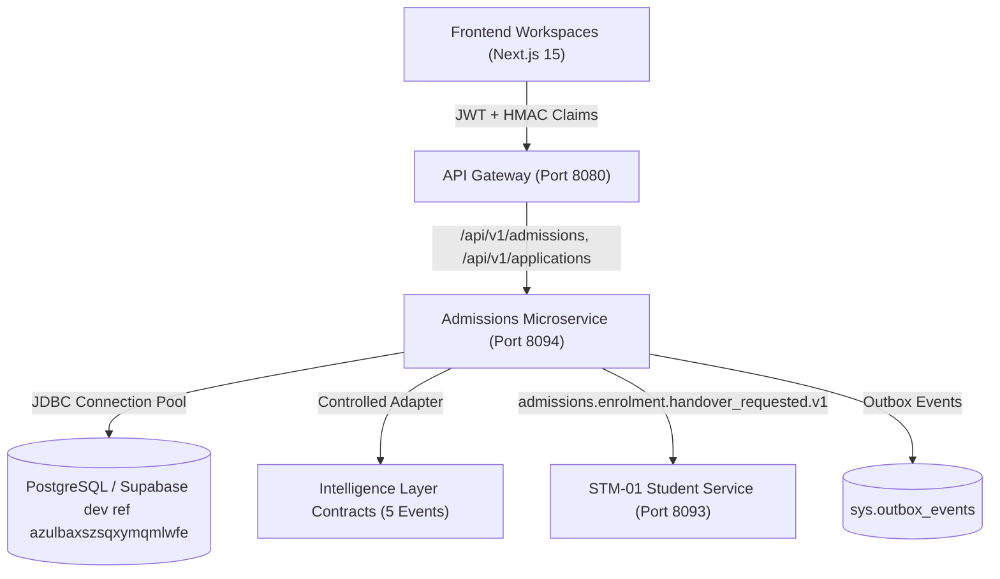

# CampXSync — STM-02 Admissions & Application Management Architecture Specification

**Module:** STM-02 Admissions & Application Management  
**Release:** V2.0 / V3.0  
**Package:** `com.campx.admissions`  
**Port:** 8094  
**Target Repository:** `D:\CampXSync\CampXSync_V2.0`  
**Governing ADR:** `STM-02_ARCHITECTURAL_DECISIONS.md`  

---

## 1. Architectural Scope and Responsibilities

The **STM-02 Admissions & Application Management** microservice manages the complete prospective student lifecycle, from intake cohort creation, qualification eligibility rule evaluation, applicant draft generation, document submission, and verification, to faculty rubric scoring, segregated executive decision approvals, formal offer generation, and automated matriculation handover into STM-01 Student Foundation.



---

## 2. Component Structure and Class Responsibilities

```
services/student-services/admissions-service/
├── src/main/java/com/campx/admissions/
│   ├── AdmissionsApplication.java             # Spring Boot Application entrypoint
│   ├── config/
│   │   ├── DatabaseConfig.java                # HikariCP configuration with fail-closed defaults
│   │   └── DatabaseConnectionManager.java     # Connection lifecycle and transaction boundary manager
│   ├── controller/
│   │   └── ApplicationController.java         # REST endpoints for intakes, applications, offers
│   ├── exception/
│   │   ├── AdmissionsException.java           # Base domain exception
│   │   ├── AdmissionsConflictException.java   # 409 Conflict (e.g. duplicate applications)
│   │   ├── AdmissionsLifecycleException.java  # 422 Unprocessable (invalid state machine transitions)
│   │   ├── AdmissionsNotFoundException.java   # 404 Not Found
│   │   ├── AdmissionsSecurityViolationException.java # 403 Forbidden
│   │   ├── AdmissionsValidationException.java # 400 Bad Request
│   │   ├── ProblemDetails.java                # RFC 7807 problem details container
│   │   └── AdmissionsExceptionHandler.java    # Global RFC 7807 exception handler
│   ├── intelligence/
│   │   └── AdmissionsIntelligenceService.java # CampXSync Intelligence Layer telemetry producer
│   ├── logging/
│   │   └── AdmissionsLoggingService.java      # PII-sanitized structured logger with MDC tracking
│   ├── model/                                 # Domain entities, DTOs, and lifecycle enums
│   │   ├── AdmissionDecisionEntity.java
│   │   ├── AdmissionHandoverEntity.java
│   │   ├── AdmissionIntakeEntity.java
│   │   ├── AdmissionOfferEntity.java
│   │   ├── ApplicationDocumentEntity.java
│   │   ├── ApplicationEntity.java
│   │   ├── ApplicationReviewEntity.java
│   │   ├── ApplicationStatus.java
│   │   ├── ApplicationStatusHistoryEntity.java
│   │   ├── DecisionType.java
│   │   ├── DocumentVerificationStatus.java
│   │   ├── EligibilityRuleEntity.java
│   │   ├── FeeTiming.java
│   │   ├── OfferStatus.java
│   │   ├── PaymentStatus.java
│   │   └── ReviewRecommendation.java
│   ├── repository/                            # Real PostgreSQL JDBC Repositories & In-Memory harnesses
│   │   ├── PostgresAdmissionDecisionRepository.java
│   │   ├── PostgresAdmissionHandoverRepository.java
│   │   ├── PostgresAdmissionIntakeRepository.java
│   │   ├── PostgresAdmissionOfferRepository.java
│   │   ├── PostgresApplicationDocumentRepository.java
│   │   ├── PostgresApplicationRepository.java
│   │   ├── PostgresApplicationReviewRepository.java
│   │   ├── PostgresEligibilityRuleRepository.java
│   │   └── PostgresStatusHistoryRepository.java
│   ├── security/
│   │   ├── AdmissionsPermissionEvaluator.java # Fine-grained role & scope validation
│   │   ├── GatewayHmacVerifier.java           # Cryptographic gateway trust boundary verification
│   │   └── UserSecurityContext.java           # ThreadLocal security context & RLS claims binding
│   ├── server/
│   │   └── AdmissionsServer.java              # Embedded HTTP server binding
│   └── service/
│       ├── AdmissionsEventPublisher.java      # Transactional outbox event dispatcher
│       ├── AdmissionsStateEngine.java         # Finite State Machine for application transitions
│       ├── ApplicationDomainService.java      # Core orchestrator for application lifecycle
│       ├── EligibilityEvaluationEngine.java   # Deterministic cutoff and rule evaluator
│       ├── HandoverOrchestrationService.java  # STM-01 handover & idempotency manager
│       ├── RateLimiter.java                   # Token-bucket rate limiter per caller/tenant
│       └── ReviewAndDecisionService.java      # SoD approvals, rubric scoring, and offer generation
```

---

## 3. Database Schema Specification (9 Tables in `stu`)

All 9 physical tables are defined under the `stu` schema in `database/migrations/20261101000100_create_stu_admissions_tables.sql`:

1. `stu.admission_intakes`: Program intake windows, cohort capacities, fee timings, and scoring rubrics.
2. `stu.admission_eligibility_rules`: Versioned criteria (minimum qualification grades, age thresholds, prerequisites).
3. `stu.applications`: Primary application master record with state machine transitions, fee statuses, and consent tracking.
4. `stu.application_status_history`: Append-only immutable transition log capturing from_status, to_status, actor_id, actor_role, and correlation_id.
5. `stu.application_documents`: Uploaded document metadata, MIME types, SHA-256 fingerprints, and officer verification states.
6. `stu.application_reviews`: Departmental faculty scoring, rubric criterion breakdowns, recommendations, and confidential remarks.
7. `stu.admission_decisions`: Binding institutional executive decisions (`OFFER_APPROVED`, `REJECTED`, `WAITLISTED`, `DEFERRED`) with SoD checks.
8. `stu.admission_offers`: Formal binding offers, offer codes, validity expiration timestamps, and acceptance state.
9. `stu.admission_handovers`: Downstream student creation ledger ensuring idempotent matriculation into STM-01.

### Row Level Security (RLS) & Tenant Isolation
Every table enforces:
- `ENABLE ROW LEVEL SECURITY;`
- `FORCE ROW LEVEL SECURITY;`
- RLS policy verifying `tenant_id = (current_setting('request.jwt.claims', true)::jsonb ->> 'tenant_id')::uuid`.
- Composite primary keys `(tenant_id, id)`.

---

## 4. Finite State Machine (FSM) Lifecycle

```
[DRAFT] ──> [SUBMITTED] ──> [UNDER_REVIEW] ──> [OFFERED] ──> [ACCEPTED] ──> [HANDED_OVER]
   │             │                 │              │              │
   │             ├──> [RETURNED]   ├──> [WAITLIST]└──> [DECLINED]└──> [FAILED] (retryable)
   │             │         │       │              │
   │             │         └──> (resubmit)        └──> [EXPIRED]
   ▼             ▼                 ▼
[WITHDRAWN]  [REJECTED]        [REJECTED]
```

---

## 5. Intelligence Layer Event Contracts

All five events are governed by versioned JSON schema contracts:

1. `AdmissionsFunnelCalculated.v1`: Conversion metrics across draft, submission, review, offer, acceptance, and matriculation.
2. `ApplicationDemandAnalyzed.v1`: Intake capacity vs. applicant volume per program and quota category.
3. `AdmissionsOperationsAnalyzed.v1`: Verification cycle time, review backlog, and SLA tracking.
4. `AdmissionsDecisionAnalyzed.v1`: Approval rates, rubric score distributions, and exception override metrics.
5. `EnrolmentConversionCalculated.v1`: Offer acceptance ratios and drop-off reasons.

---

## 6. Observability, Logging, and Correlation

- **MDC Context:** Injects `correlationId`, `tenantId`, `userId`, `role`, and `path`.
- **PII Sanitization:** Masks email addresses (`j***e@example.com`), phone numbers (`******1234`), and government identification numbers.
- **Auditing:** All privileged actions emit records into `audit.events` and `sys.outbox_events` in the same database transaction.

