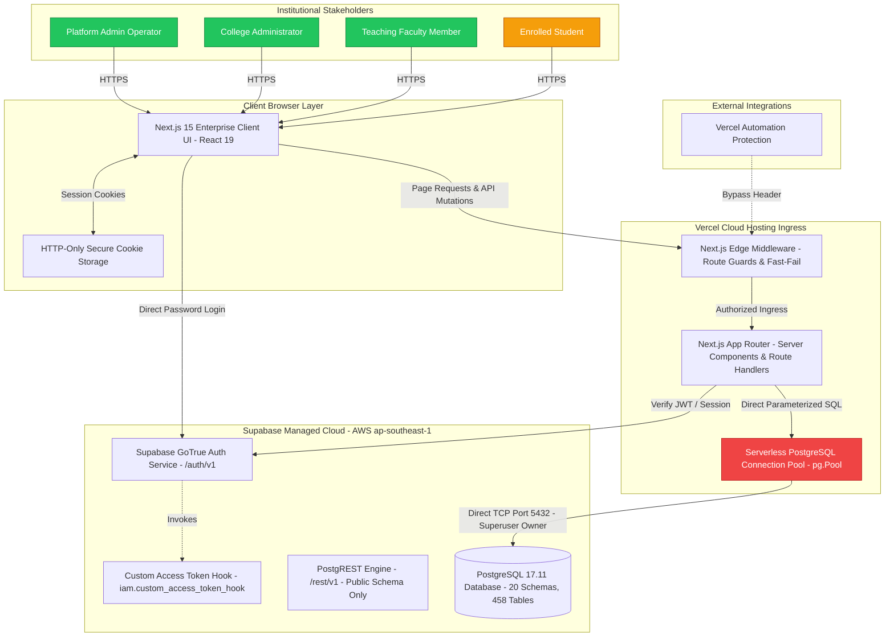
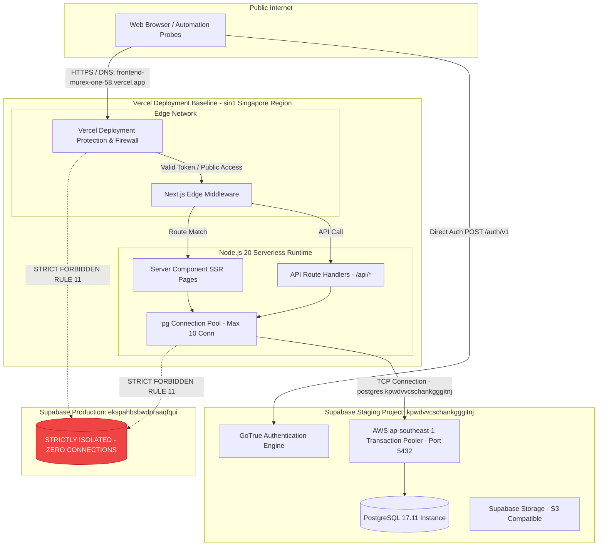
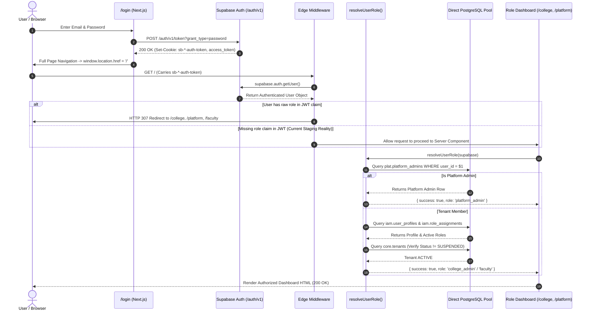
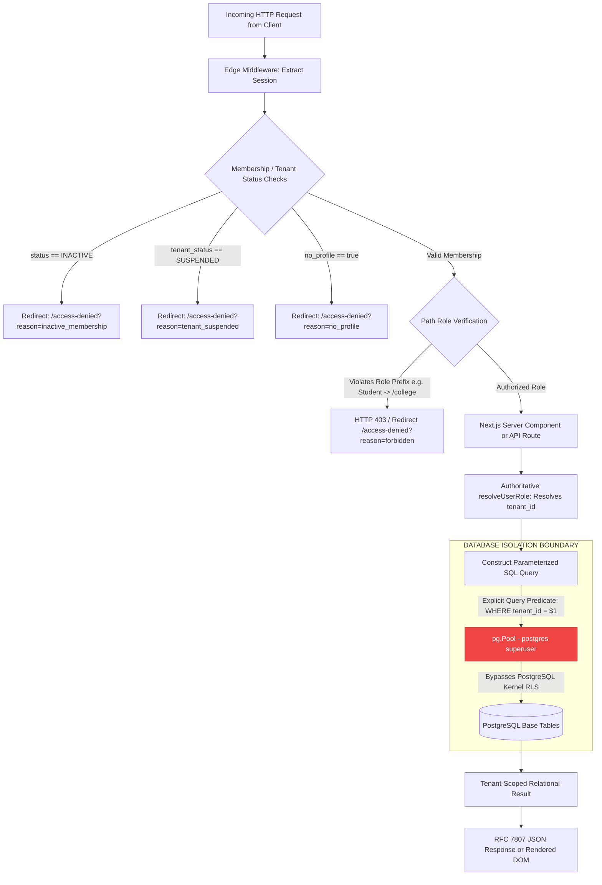
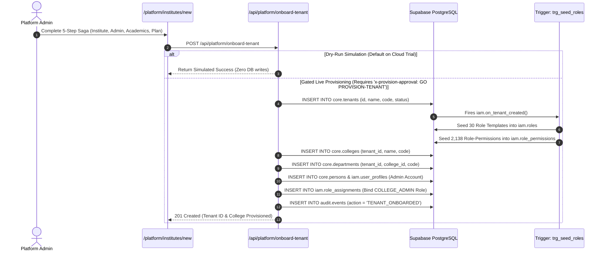
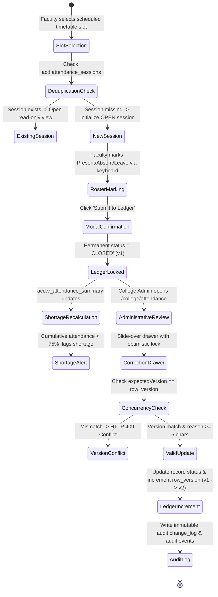
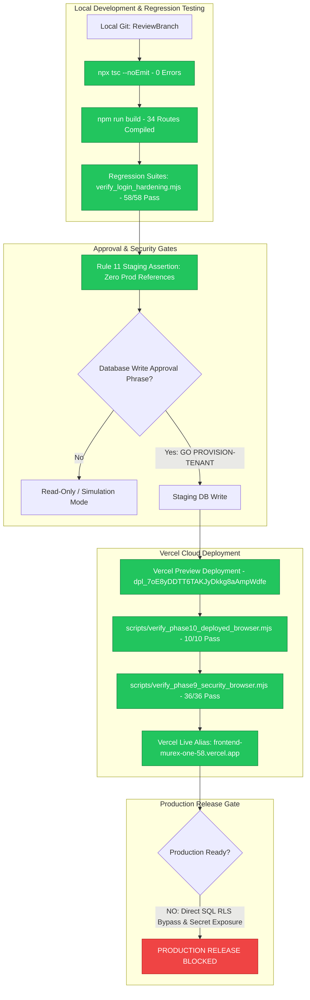

# CampXSync — System Architecture Diagrams & End-to-End Workflows

**Document Identifier**: `docs/audit/CAMPXSYNC_ARCHITECTURE_FLOWS.md`  
**Audit Date**: October 19, 2026  
**Auditor**: Antigravity Autonomous Agent (Google DeepMind)  
**Governing Baseline**: Git HEAD (`ReviewBranch` commit `b307149`)  
**Cross-Reference Evidence Index**: [CAMPXSYNC_EVIDENCE_INDEX.md](file:///d:/CampXSync/CampXSync_V2.0/docs/audit/CAMPXSYNC_EVIDENCE_INDEX.md)

---

## 1. Executive Summary & Diagram Conventions

This document provides editable text-based diagrams using **Mermaid** representing the actual, empirical architecture and end-to-end workflows of CampXSync.

To avoid presenting hypothetical designs as working code:
- **Solid lines & filled boxes** represent `CODE VERIFIED` and `STAGING VERIFIED` components.
- **Dotted lines (`-.->`) & hollow boxes** represent `PLANNED`, `DOCUMENTED ONLY`, or inactive historical prototypes.
- Security boundaries, tenant isolation checkpoints, and known RLS bypass paths are explicitly highlighted.

---

## 2. Diagram A: System Context Diagram



**Explanation**: Shows the active cloud MVP. Browser users interact with the Next.js 15 UI on Vercel. Authenticated requests pass through Edge Middleware to Server Components and Route Handlers. Direct database queries use `pg.Pool` directly connecting to PostgreSQL on port 5432, bypassing PostgREST.

---

## 3. Diagram B: Deployment & Runtime Architecture



**Explanation**: Illustrates the Vercel cloud serverless boundary and staging database target. The application is isolated from production Supabase (`ekspahbsbwdpraaqfqui`) via strict `TestEnvironmentGuard` checks in code and environment configurations.

---

## 4. Diagram C: Authentication & Authorization Sequence Flow



**Explanation**: Details the actual two-phase authentication flow. Because the Supabase Custom Access Token hook was observed to omit roles during staging tests, Next.js Server Components invoke `resolveUserRole()` which authoritatively queries `plat.platform_admins`, `iam.user_profiles`, `iam.role_assignments`, and `core.tenants` directly over PostgreSQL.

---

## 5. Diagram D: Multi-Tenant Request & Data Isolation Flow



**Explanation**: Demonstrates tenant isolation enforcement. While application-level checks and query predicates (`WHERE tenant_id = $1`) strictly filter data, database kernel RLS is bypassed because the connection pool executes under the `postgres` table-owner role.

---

## 6. Diagram E: API Ingress & Service Call Flow

```mermaid
graph LR
    subgraph Clients
        Browser[Web Browser]
        MobileApp[Mobile App - Future]
    end

    subgraph ActiveCloudIngress [Active Vercel Cloud Architecture]
        VercelEdge[Next.js Edge Middleware]
        APIRoutes[Next.js API Routes - 13 Endpoints]
        DirectPG[Direct pg.Pool Connection]
    end

    subgraph InactiveJavaCluster [Legacy Inactive Java Services - Inactive on Cloud]
        JavaGW[Java API Gateway :8080 - Superseded]
        ADM01[Institute Admin :8081]
        ADM02[College Admin :8082]
        ACD01[Course Mgmt :8083]
        ACD_Other[ACD 02..10 Microservices :8084-8092 - In-Memory State]
    end

    subgraph DatabaseBoundary [Supabase Staging Database]
        PG[(PostgreSQL 17.11 Instance - 20 Schemas)]
    end

    Browser -->|Active Cloud Ingress| VercelEdge
    VercelEdge --> APIRoutes
    APIRoutes --> DirectPG
    DirectPG -->|Direct SQL| PG

    Browser -.->|Local Dev Only| JavaGW
    JavaGW -.-> ADM01
    JavaGW -.-> ADM02
    JavaGW -.-> ACD01
    JavaGW -.-> ACD_Other
    ADM01 -.->|JDBC| PG
    ADM02 -.->|JDBC (Disabled by Default)| PG
    ACD01 -.->|JDBC (Disabled by Default)| PG

    classDef inactive fill:#6b7280,stroke:#374151,color:#ffffff;
    class JavaGW,ADM01,ADM02,ACD01,ACD_Other inactive;
```

**Explanation**: Directly compares the active Next.js cloud ingress against the legacy Java microservices. The Java microservices are inactive on Vercel and do not participate in cloud request handling.

---

## 7. Diagram F: Tenant Provisioning & Migration Data Flow



**Explanation**: Shows the multi-step transactional tenant provisioning saga. Live execution creates the tenant in `core.tenants`, which automatically triggers `trg_seed_roles` to instantiate standard roles and permission bindings.

---

## 8. Diagram G: Major Business Workflows

### Attendance Capture & Audited Correction Workflow


**Explanation**: Documents the full lifecycle of faculty attendance marking, ledger locking, statutory 75% shortage calculation, and audited administrative corrections.

---

## 9. Diagram H: Deployment & Validation Pipeline



**Explanation**: Documents the existing validation, staging promotion, and deployment gates leading up to the production blocker verdict.
