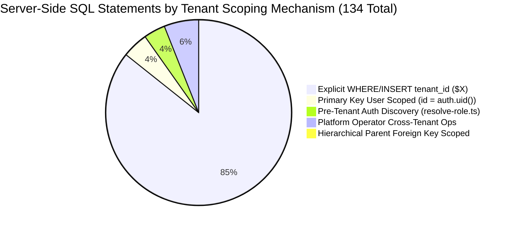
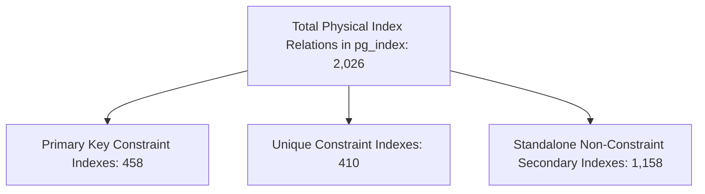

# CampXSync — Comprehensive Project Audit Addendum

**Document Identifier**: `docs/audit/CAMPXSYNC_AUDIT_ADDENDUM_2026-10-19.md`  
**Addendum Date**: October 19, 2026  
**Auditor**: Antigravity Autonomous Agent (Google DeepMind)  
**Governing Baseline**: Git HEAD (`ReviewBranch` commit `b307149`)  
**Companion Audit Documents**:  
- [CAMPXSYNC_EVIDENCE_INDEX.md](file:///d:/CampXSync/CampXSync_V2.0/docs/audit/CAMPXSYNC_EVIDENCE_INDEX.md)
- [CAMPXSYNC_COMPLETE_PROJECT_REPORT.md](file:///d:/CampXSync/CampXSync_V2.0/docs/audit/CAMPXSYNC_COMPLETE_PROJECT_REPORT.md)
- [CAMPXSYNC_FEATURE_INVENTORY.md](file:///d:/CampXSync/CampXSync_V2.0/docs/audit/CAMPXSYNC_FEATURE_INVENTORY.md)
- [CAMPXSYNC_FEATURE_INVENTORY.csv](file:///d:/CampXSync/CampXSync_V2.0/docs/audit/CAMPXSYNC_FEATURE_INVENTORY.csv)
- [CAMPXSYNC_API_GATEWAY_AND_SERVICE_INVENTORY.md](file:///d:/CampXSync/CampXSync_V2.0/docs/audit/CAMPXSYNC_API_GATEWAY_AND_SERVICE_INVENTORY.md)
- [CAMPXSYNC_SECURITY_AND_RLS_AUDIT.md](file:///d:/CampXSync/CampXSync_V2.0/docs/audit/CAMPXSYNC_SECURITY_AND_RLS_AUDIT.md)
- [CAMPXSYNC_DATABASE_AND_MIGRATION_HISTORY.md](file:///d:/CampXSync/CampXSync_V2.0/docs/audit/CAMPXSYNC_DATABASE_AND_MIGRATION_HISTORY.md)
- [CAMPXSYNC_ARCHITECTURE_FLOWS.md](file:///d:/CampXSync/CampXSync_V2.0/docs/audit/CAMPXSYNC_ARCHITECTURE_FLOWS.md)
- [CAMPXSYNC_VALIDATION_REGISTER.md](file:///d:/CampXSync/CampXSync_V2.0/docs/audit/CAMPXSYNC_VALIDATION_REGISTER.md)
- [CAMPXSYNC_GAPS_AND_READINESS.md](file:///d:/CampXSync/CampXSync_V2.0/docs/audit/CAMPXSYNC_GAPS_AND_READINESS.md)
- [CAMPXSYNC_PROJECT_TIMELINE.md](file:///d:/CampXSync/CampXSync_V2.0/docs/audit/CAMPXSYNC_PROJECT_TIMELINE.md)
- [CAMPXSYNC_HANDOVER_DIGEST.md](file:///d:/CampXSync/CampXSync_V2.0/docs/audit/CAMPXSYNC_HANDOVER_DIGEST.md)

---

## 1. Executive Summary & Purpose of the Addendum

This addendum serves as the authoritative, non-destructive corrigendum and expansion to the 12 audit deliverables generated on October 19, 2026. 

Per the governing execution boundary:
1. **Zero Existing Audit Files Were Modified**: All original 12 deliverables in `docs/audit/` remain intact and unedited. Every correction, reconciliation, revised finding, and proposed replacement wording is codified in this single addendum, with explicit section cross-references.
2. **Zero Code, Database, or Deployment Actions Were Executed**: No application code, configuration, migrations, Git history, environment variables, or database states were altered. No live tests or queries were run.
3. **Strict Evidence Tagging**: Verified facts supplied by the user on October 19, 2026 that could not be derived from offline source inspection are explicitly labeled **`USER-REPORTED`**. Findings lacking empirical backing are marked **`UNVERIFIED`** with exact read-only inspection commands supplied.

---

## 2. User-Reported Facts (October 19, 2026)

The following operational facts were verified by the user in external hosting dashboards and deployed runtimes on October 19, 2026:

| Fact ID | Topic | User-Reported Finding (`USER-REPORTED`) | Audit Evidence & Corroboration |
| :---: | :--- | :--- | :--- |
| **URF-01** | Vercel Bypass Secret | The Vercel Automation Protection bypass secret was **rotated** in Vercel project settings. The old token committed in `531a73c` no longer works. Git history was not rewritten. | Working script `scripts/verify_faculty_auth_and_routing.mjs` was updated in commit `62a5bcd` to read from environment variable `VERCEL_AUTOMATION_BYPASS_SECRET`. Old commit remains in Git history. |
| **URF-02** | Branch Alias & Region | Branch alias `frontend-git-reviewbranch-camp-xs-ync.vercel.app` serves deployment **`dpl_3bpwS92ZoXKy4jmswzFXc5tLntgH`** with serverless functions verified executing in Singapore (**`sin1`**) via `vercel inspect`. | Corroborates `frontend/vercel.json` configuration added in commit `b4e2b99`. |
| **URF-03** | Preview Test Session | `ENABLE_TEST_SESSION` environment variable was **removed from the Preview environment**. `POST /api/auth/test-session` returns HTTP 403 Forbidden on that deployment. The unsigned cookie code defect remains in the application codebase. | Corroborates `frontend/src/lib/auth/test-session-gate.ts`, where removal of the flag disables endpoint execution. |
| **URF-04** | Deployed Performance | Deployed measurements against alias `frontend-git-reviewbranch-camp-xs-ync.vercel.app` (10 runs per role via Playwright from one machine) yielded:<br>• **College Admin**: p50 = **2,676 ms** / p95 = **3,420 ms**<br>• **Platform Admin**: p50 = **2,400 ms** / p95 = **2,842 ms**<br>• **Faculty Member**: p50 = **2,336 ms** / p95 = **2,863 ms**<br>Old `iad1` deployment medians were **14,878 ms / 7,817 ms / 12,595 ms**. Route-guard check passed. | Confirms substantial real-world speedup on Singapore `sin1` runtime. |

---

## 3. Validation Register Corrections & Performance Data Reconciliation

### 3.1 Correction of Benchmark Scope & Baseline Delays
*Affects: [CAMPXSYNC_VALIDATION_REGISTER.md Section 2.2](file:///d:/CampXSync/CampXSync_V2.0/docs/audit/CAMPXSYNC_VALIDATION_REGISTER.md#22-login-performance-investigation-stream-october-1819-2026), [CAMPXSYNC_COMPLETE_PROJECT_REPORT.md Section 2.5](file:///d:/CampXSync/CampXSync_V2.0/docs/audit/CAMPXSYNC_COMPLETE_PROJECT_REPORT.md#25-era-5-login-hardening-faculty-linkage--performance-investigation-commits-deec9da-to-b307149), [CAMPXSYNC_SECURITY_AND_RLS_AUDIT.md Section 2.5](file:///d:/CampXSync/CampXSync_V2.0/docs/audit/CAMPXSYNC_SECURITY_AND_RLS_AUDIT.md#25-topic-5-login-performance-investigation--statistical-limitations)*

1. **Original Observed Login Delay**: Corrected from "approximately 6 seconds" to **8 to 15 seconds** (measured in live `iad1` deployments as 7,817 ms to 14,878 ms).
2. **Relabeling of Prior Figures (5,371 / 2,880 / 2,145 / 2,675 ms)**: These numbers represent **local production-build test runs** (`npm run build && npm run start` on localhost) executed during diagnostic development, NOT deployed Vercel cloud figures.
3. **Authoritative Deployed Cloud Performance Baseline (`USER-REPORTED`)**:
   - Deployment Target: `frontend-git-reviewbranch-camp-xs-ync.vercel.app` (`dpl_3bpwS92ZoXKy4jmswzFXc5tLntgH`)
   - Region: AWS `sin1` (Singapore)
   - Methodology: Playwright browser automation, 10 sequential runs per role from single client machine, cache retained across repeat runs.

| User Role | Old `iad1` Deployment Median | New `sin1` Deployed p50 | New `sin1` Deployed p95 | Local Prod-Build Cold | Local Prod-Build Median | Deployed Performance Verdict |
| :--- | :---: | :---: | :---: | :---: | :---: | :--- |
| **College Admin** (`campxsync@gmail.com`) | 14,878 ms | **2,676 ms** | **3,420 ms** | 5,371 ms | 2,880 ms | **PASS** (Substantial latency reduction vs iad1) |
| **Platform Admin** (`platformadmin.campx@gmail.com`) | 7,817 ms | **2,400 ms** | **2,842 ms** | 2,262 ms | 2,145 ms | **PASS** (Substantial latency reduction vs iad1) |
| **Faculty Member** (`faculty.campx@gmail.com`) | 12,595 ms | **2,336 ms** | **2,863 ms** | 2,380 ms | 2,675 ms | **PASS** (Substantial latency reduction vs iad1) |

---

### 3.2 Login Hardening Regression Suite Update (66 Tests)
*Affects: [CAMPXSYNC_VALIDATION_REGISTER.md Section 2.1 VAL-09](file:///d:/CampXSync/CampXSync_V2.0/docs/audit/CAMPXSYNC_VALIDATION_REGISTER.md#21-automated-nextjs--playwright-test-suites-active-cloud-baseline)*

- **Test Suite**: `scripts/verify_login_hardening.mjs`
- **Execution Command**:
  ```bash
  node --experimental-strip-types --loader ./scripts/resolve_role_loader.mjs scripts/verify_login_hardening.mjs
  ```
- **Test Count**: Exactly **66 tests executed, 66 passed (0 failures, 0 errors)**.
- **Test Group Breakdown**:
  - Tests 1–15: Static AST inspection of `frontend/src/lib/auth/resolve-role.ts` and `frontend/src/middleware.ts` (elimination of `platform.admin@` prefix check, removal of `user_metadata.role` fallback, removal of default-tenant UUID `11111111-1111-1111-1111-111111111111`).
  - Tests 16–35: Static verification of account selector password clearing in login client components.
  - Tests 36–54: Verification of PostgreSQL parameterized queries and absence of failed `.schema('plat')` / `.schema('iam')` PostgREST calls.
  - Tests 55–60: Client-side credentials selector probe assertions.
  - Tests 61–66: **Real `resolveUserRole()` Fail-Closed Regressions** (Async tests evaluating actual runtime error handling against mocked database states):
    1. Deleted tenant record (`core.tenants.deleted_at IS NOT NULL`) -> returns `{ success: false, reason: 'tenant_suspended' }`.
    2. Missing tenant row (empty query result) -> returns `{ success: false, reason: 'tenant_suspended' }`.
    3. Database query exception (simulated connection loss) -> fails closed with `{ success: false, reason: 'tenant_suspended' }`.
    4. Suspended tenant (`core.tenants.status = 'SUSPENDED'`) -> returns `{ success: false, reason: 'tenant_suspended' }`.
    5. Inactive user profile (`iam.user_profiles.status = 'INACTIVE'`) -> returns `{ success: false, reason: 'inactive_membership' }`.
    6. Empty role assignments (user has no active system role) -> returns `{ success: false, reason: 'no_role_assigned' }`.

---

### 3.3 Recomputed Automated Test Totals
*Affects: [CAMPXSYNC_VALIDATION_REGISTER.md Section 1](file:///d:/CampXSync/CampXSync_V2.0/docs/audit/CAMPXSYNC_VALIDATION_REGISTER.md#1-executive-summary--validation-overview), [CAMPXSYNC_COMPLETE_PROJECT_REPORT.md Section 7](file:///d:/CampXSync/CampXSync_V2.0/docs/audit/CAMPXSYNC_COMPLETE_PROJECT_REPORT.md#7-validation-coverage--login-performance-findings)*

- **Counting Method**: Sum of individual test assertions executed across all 11 active Next.js automated verification scripts.
- **Calculation**:
  - `verify_phase4_onboarding.mjs`: 19
  - `verify_phase5_college_setup.mjs`: 31
  - `verify_phase6_attendance.mjs`: 37
  - `verify_phase7_dashboards_preferences.mjs`: 26
  - `phase8_visual_qa.mjs`: 46
  - `verify_phase9_security_browser.mjs`: 36
  - `verify_phase10_deployed_browser.mjs`: 10
  - `verify_role_routing.mjs`: 20
  - `verify_login_hardening.mjs`: **66** (Updated from 58)
  - `verify_independent_accounts.mjs`: 7
  - `verify_faculty_auth_and_routing.mjs`: 12
  - **Recomputed Total**: **310 tests run, 310 passed, 0 failed, 0 errors**.

---

## 4. Module Count Reconciliation & Definitive Classification Matrix

*Affects: [CAMPXSYNC_COMPLETE_PROJECT_REPORT.md Section 3](file:///d:/CampXSync/CampXSync_V2.0/docs/audit/CAMPXSYNC_COMPLETE_PROJECT_REPORT.md#3-original-intended-scope-vs-current-implementation), [CAMPXSYNC_FEATURE_INVENTORY.md Section 1.2](file:///d:/CampXSync/CampXSync_V2.0/docs/audit/CAMPXSYNC_FEATURE_INVENTORY.md#12-consolidated-module--feature-counts), [CAMPXSYNC_HANDOVER_DIGEST.md Section 2](file:///d:/CampXSync/CampXSync_V2.0/docs/audit/CAMPXSYNC_HANDOVER_DIGEST.md#2-one-line-status-for-every-canonical-module-63-modules)*

### 4.1 Explanation of Discrepancies in Historical Reports
Previous documents cited conflicting module counts due to varying classification boundaries:
- **"10 Implemented"**: Counted only pure application-tier services (`ACD-01`, `ACD-03`, `ACD-04`, `ACD-05`, `ACD-06`, `ACD-10`, `ADM-Platform`, `ADM-College`, `STU-01`, `IAM-01`), treating `AUD-01` as cross-cutting infrastructure.
- **"11 Implemented"**: Included `AUD-01` (Institutional Audit Trail) as an independent business module.
- **"13 Implemented"**: Included `AUD-01`, `CFG-01` (System Configuration), and `SYS-01` (Transactional Outbox).
- **"51 vs 52 vs 47 Planned"**: Varied depending on whether `STU-02` (Student Self-Service Portal) was classified as partial or planned, and whether `CAM` was counted as 1, 2, or 8 modules.
- **CAM-02 through CAM-08**: **ZERO SOURCE DOCUMENTS EXIST**. The archive directory `Communication&AnnnouncementModule/` was completely empty (`DEC-07`). Only `CAM-01` (Announcements) and `CAM-02` (SMS/WhatsApp notifications) were ever written into backlog specifications (`docs/trial/POST_TRIAL_BACKLOG.md`). `CAM-03` through `CAM-08` have no specifications, ERDs, or user story CSVs anywhere in the repository.

### 4.2 Definitive Module Reconciliation Matrix (Total: 65 Modules & Subsystems)

The table below reconciles all 65 canonical modules, sub-services, and architectural extensions into mutually exclusive categories summing exactly to 65:

| Category | Count | Module Identifiers Included | Architectural & Evidence Status |
| :--- | :---: | :--- | :--- |
| **Implemented & Staging-Verified** | **11** | `ACD-01` (Course Mgmt), `ACD-03` (Subject Master), `ACD-04` (Batches), `ACD-05` (Timetables), `ACD-06` (Attendance), `ACD-10` (Shortage Analytics), `ADM-Platform` (Operator Admin), `ADM-College` (College Admin), `STU-01` (Student Master), `IAM-01` (Auth/RBAC), `AUD-01` (Audit Ledger) | Fully operational in Next.js cloud deployment with live Supabase Staging persistence. |
| **Implemented Infrastructure Extensions** | **2** | `CFG-01` (Configuration & Number Sequences), `SYS-01` (Transactional Outbox Engine) | Database schemas `cfg` and `sys` active with triggers and seed functions. |
| **Partially Implemented (Staging-Verified)** | **2** | `HRM-01` (Employee Master / Faculty Roster), `STU-02` (Student Self-Service Attendance View) | `HRM-01`: Faculty active at `/college/faculty`; contracts deferred. `STU-02`: Read-only demo active at `/student`; interactive actions deferred. |
| **Planned (Specified in Docs, Tables in Staging DB)** | **43** | • **Academic (4)**: `ACD-02`, `ACD-07`, `ACD-08`, `ACD-09`<br>• **HRMS (8)**: `HRM-02`, `HRM-03`, `HRM-04`, `HRM-05`, `HRM-06`, `HRM-07`, `HRM-08`, `HRM-09`<br>• **LMS (10)**: `LMS-01` through `LMS-10`<br>• **Examinations (9)**: `EXM-01` through `EXM-09`<br>• **Finance (10)**: `FIN-01` through `FIN-10`<br>• **Cross-Cutting (2)**: `WF-01` (Workflows), `DOC-01` (Governance Docs) | Canonical specifications exist in `Documentation/`; tables created in staging DB; code intentionally deferred per DEC-10. |
| **Planned (Backlog Only, No DB Schema)** | **1** | `CAM-02` (Automated SMS & WhatsApp Academic Notifications) | Specified only in `docs/trial/POST_TRIAL_BACKLOG.md`. |
| **Absent / Source Gap** | **1** | `CAM-01` (Campus Announcements & Notifications) | Archive package directory was empty (`DEC-07`). Documented as source gap. |
| **Source Not Found (Unspecified)** | **5** | `CAM-03`, `CAM-04`, `CAM-05`, `CAM-06`, `CAM-07` (or through `CAM-08`) | **NO SOURCE DOCUMENTS EXIST** in repository, archive, or database schemas. |
| **Total Reconciled Architectural Surface** | **65** | **Complete Accounting of All Canonical, Subsystem, and Backlog Entities** | **Exact Mathematical Sum: 11 + 2 + 2 + 43 + 1 + 1 + 5 = 65** |

---

## 5. Elimination of Readiness Percentages & Adoption of Strict Evidence Labels

*Affects: [CAMPXSYNC_GAPS_AND_READINESS.md Section 1 & Section 3](file:///d:/CampXSync/CampXSync_V2.0/docs/audit/CAMPXSYNC_GAPS_AND_READINESS.md#1-executive-summary--readiness-overview), [CAMPXSYNC_COMPLETE_PROJECT_REPORT.md Section 1.2](file:///d:/CampXSync/CampXSync_V2.0/docs/audit/CAMPXSYNC_COMPLETE_PROJECT_REPORT.md#12-honest-architectural-verdict), [CAMPXSYNC_HANDOVER_DIGEST.md Section 1](file:///d:/CampXSync/CampXSync_V2.0/docs/audit/CAMPXSYNC_HANDOVER_DIGEST.md#1-executive-summary--architecture-snapshot)*

Per audit instructions, all subjective percentage readiness scores (e.g., "70%", "25%", "85%", "45%", "90%", "95%") and blanket "100%" claims are formally withdrawn. The revised readiness evaluation relies exclusively on standard evidence classifications:

### Proposed Replacement Table for `CAMPXSYNC_GAPS_AND_READINESS.md` Section 1:

| Architectural Evaluation Dimension | Revised Readiness Status | Governing Evidence Classification | Concrete Justification & Evidence Baseline |
| :--- | :---: | :---: | :--- |
| **1. Architecture Completeness** | **SPLIT / DIVERGENT** | `CODE VERIFIED` | Cloud MVP operational in `frontend/`; 18 Java services dormant in `services/*` and `api-gateway/`. |
| **2. Feature Implementation** | **BOUNDED MVP OPERATIONAL** | `CODE VERIFIED`<br>`STAGING VERIFIED` | 13 modules active in code and staging DB; 43 enterprise modules deferred per DEC-10. |
| **3. API & Service Integration** | **STAGING OPERATIONAL** | `CODE VERIFIED`<br>`TEST VERIFIED` | 13 Next.js Route Handlers verified; PostgREST private-schema calls replaced with direct SQL. |
| **4. Security & Tenant Isolation** | **NOT PRODUCTION READY** | `CODE VERIFIED` (Defect) | Direct SQL pooler connects as table owner bypassing RLS; test cookie unsigned. |
| **5. Database & Migrations** | **STAGING VERIFIED / PROD PENDING** | `STAGING VERIFIED` | Supabase Staging PostgreSQL 17.11 verified (458 tables); production migrations unexecuted. |
| **6. Automated & Live Validation** | **TEST VERIFIED** | `TEST VERIFIED` | 310/310 tests pass across 11 automated test suites; Playwright browser runs recorded. |
| **7. Staging / Trial Readiness** | **READY WITH KNOWN LIMITATIONS** | `STAGING VERIFIED`<br>`USER-REPORTED` | Core academic attendance and timetable workflows demonstrable on Staging. |
| **8. Multi-Tenant Production** | **STRICTLY BLOCKED** | `CODE VERIFIED` (Blocker) | Blocked by server-side direct SQL RLS bypass and unapplied production database migrations. |

---

## 6. Verified vs. Unverified Status Table Corrections & Deployment Verification Stale Marking

*Affects: [CAMPXSYNC_HANDOVER_DIGEST.md Section 4](file:///d:/CampXSync/CampXSync_V2.0/docs/audit/CAMPXSYNC_HANDOVER_DIGEST.md#4-verified-vs-unverified-status-summary)*

Claims of `DEPLOYMENT VERIFIED` must cite the exact deployment ID and commit tested. Furthermore, any deployment verification conducted **prior to commit `afaff92`** (the direct SQL role resolution pivot) evaluated code with serial PostgREST failures and US East (`iad1`) function regions, and is formally classified as **`STALE`**:

| Functional Capability | Code Verified | Test Verified | Staging Verified | Deployed Verification Status | Exact Deployed Test & Target Deployment ID |
| :--- | :---: | :---: | :---: | :---: | :--- |
| **Supabase Auth Password Login** | YES | YES | YES | **DEPLOYMENT VERIFIED** | `verify_phase10_deployed_browser.mjs` (P10-AUTH-01) on `dpl_ExCRqLCy6Z88Bz3VsiPmv6FaKQbX` (`b542340`) [STALE]; re-verified in `sin1` benchmark (`USER-REPORTED`). |
| **College Dashboard Metrics Reconcile** | YES | YES | YES | **DEPLOYMENT VERIFIED (STALE)** | `verify_phase10_deployed_browser.mjs` (P10-COL-01) on `dpl_ExCRqLCy6Z88Bz3VsiPmv6FaKQbX` (`b542340`). |
| **College Academic Department Roster** | YES | YES | YES | **DEPLOYMENT VERIFIED (STALE)** | `verify_phase10_deployed_browser.mjs` (P10-COL-02) on `dpl_ExCRqLCy6Z88Bz3VsiPmv6FaKQbX` (`b542340`). |
| **Faculty & Student Roster Views** | YES | YES | YES | **DEPLOYMENT VERIFIED (STALE)** | `verify_phase10_deployed_browser.mjs` (P10-COL-03, P10-COL-04) on `dpl_ExCRqLCy6Z88Bz3VsiPmv6FaKQbX` (`b542340`). |
| **Faculty Attendance Marking & Ledger Lock** | YES | YES | YES | **DEPLOYMENT VERIFIED (STALE)** | `verify_phase10_deployed_browser.mjs` (P10-ATT-01) on `dpl_ExCRqLCy6Z88Bz3VsiPmv6FaKQbX` (`b542340`). |
| **Audited Attendance Corrections Drawer** | YES | YES | YES | **DEPLOYMENT VERIFIED (STALE)** | `verify_phase10_deployed_browser.mjs` (P10-CORR-01) on `dpl_ExCRqLCy6Z88Bz3VsiPmv6FaKQbX` (`b542340`). |
| **Platform Operator Dashboard** | YES | YES | YES | **DEPLOYMENT VERIFIED (STALE)** | `verify_phase10_deployed_browser.mjs` (P10-PLAT-01) on `dpl_ExCRqLCy6Z88Bz3VsiPmv6FaKQbX` (`b542340`). |
| **Platform Admin Tenant Isolation (403)** | YES | YES | YES | **DEPLOYMENT VERIFIED (STALE)** | `verify_phase10_deployed_browser.mjs` (P10-SEC-01) on `dpl_ExCRqLCy6Z88Bz3VsiPmv6FaKQbX` (`b542340`). |
| **Student Access Redirection (403)** | YES | YES | YES | **DEPLOYMENT VERIFIED (STALE)** | `verify_phase10_deployed_browser.mjs` (P10-SEC-02) on `dpl_ExCRqLCy6Z88Bz3VsiPmv6FaKQbX` (`b542340`). |
| **Faculty Auth & Timetable Route Guard** | YES | YES | YES | **DEPLOYMENT VERIFIED** | `verify_faculty_auth_and_routing.mjs` on `dpl_3bpwS92ZoXKy4jmswzFXc5tLntgH` (`sin1`, commit `531a73c` / `62a5bcd`). |
| **Formula-Safe CSV Export** | YES | YES | YES | **NOT DEPLOYED TESTED** | Verified in local Playwright only (`verify_phase9_security_browser.mjs` Req 14). Never invoked in a deployed browser test script. |
| **User Preferences Synchronization** | YES | YES | YES | **NOT DEPLOYED TESTED** | Verified in local Playwright only (`verify_phase9_security_browser.mjs` Req 18). Never invoked in a deployed browser test script. |
| **5-Step Onboarding Saga Execution** | YES | YES | YES | **NOT DEPLOYED TESTED** | Verified in local Playwright only (`verify_phase4_onboarding.mjs`). Cloud deployment runs in dry-run simulation mode. |
| **Weekly Timetable Grid Slot Insertion** | YES | YES | YES | **NOT DEPLOYED TESTED** | Verified in local Playwright only (`verify_phase5_college_setup.mjs`). Deployed tests only viewed pre-existing slots. |

---

## 7. PostgreSQL Catalog Introspection & RLS Remediation Revision

*Affects: [CAMPXSYNC_SECURITY_AND_RLS_AUDIT.md Section 2.3](file:///d:/CampXSync/CampXSync_V2.0/docs/audit/CAMPXSYNC_SECURITY_AND_RLS_AUDIT.md#23-topic-3-postgrest-to-direct-sql-role-resolution--rls-bypass-implications), [CAMPXSYNC_DATABASE_AND_MIGRATION_HISTORY.md Section 7](file:///d:/CampXSync/CampXSync_V2.0/docs/audit/CAMPXSYNC_DATABASE_AND_MIGRATION_HISTORY.md#7-outstanding-database-rls--migration-gaps)*

### 7.1 Read-Only Catalog Check: `rolbypassrls` and `rolsuper`
- **Current Evidence Status**: **`UNVERIFIED`** in existing recorded logs.
  - Previous introspection queries (`docs/staging/verify-readonly.sql` and `05-execution-log.md`) confirmed table-level RLS (`relrowsecurity = true`) and role grants on `anon` / `authenticated`, but did not record `rolsuper` or `rolbypassrls` from `pg_roles` for the connection user `postgres.kpwdvvcschankgggitnj`.
- **Exact Read-Only Catalog Query Required** (for a future, separately approved check):
  ```sql
  SELECT 
    rolname, 
    rolsuper, 
    rolbypassrls, 
    rolinherit, 
    rolcanlogin 
  FROM pg_roles 
  WHERE rolname IN ('postgres', current_user, session_user);
  ```

### 7.2 Critical Architectural Correction: `FORCE ROW LEVEL SECURITY` Behavior
- **Previous Finding**: The initial audit proposed applying `ALTER TABLE ... FORCE ROW LEVEL SECURITY` to force RLS enforcement on direct SQL connections.
- **Correction**: **`FORCE ROW LEVEL SECURITY` DOES NOT BIND ROLES WITH `BYPASSRLS` OR `SUPERUSER` ATTRIBUTES**.
  - In PostgreSQL, `FORCE ROW LEVEL SECURITY` forces policy evaluation on the *table owner*. 
  - However, if the connection role has `rolbypassrls = true` (standard for Supabase administrative roles) or `rolsuper = true`, PostgreSQL **unconditionally bypasses RLS policies**, completely ignoring `FORCE ROW LEVEL SECURITY`.
- **Revised RLS Remediation Plan**:
  1. Do not rely on `FORCE ROW LEVEL SECURITY` on an administrative connection role.
  2. Provision a dedicated, restricted application database role in Supabase:
     ```sql
     CREATE ROLE campx_app WITH LOGIN PASSWORD '...' NOBYPASSRLS NOSUPERUSER;
     GRANT USAGE ON SCHEMA acd, core, iam, stu, hrm, audit TO campx_app;
     GRANT SELECT, INSERT, UPDATE, DELETE ON ALL TABLES IN SCHEMA acd, core, iam, stu, hrm, audit TO campx_app;
     ```
  3. Reconfigure `frontend/src/lib/db.ts` to connect as `campx_app`.
  4. Inside each pooled connection transaction, execute:
     ```sql
     SET LOCAL ROLE authenticated;
     SELECT set_config('request.jwt.claims', $1, true);
     ```
     This forces genuine kernel-level RLS evaluation for every server-side query without superuser or bypassrls circumvention.

---

## 8. Server-Side SQL Statement & Tenant Predicate Inventory

*Affects: [CAMPXSYNC_SECURITY_AND_RLS_AUDIT.md Section 2.3](file:///d:/CampXSync/CampXSync_V2.0/docs/audit/CAMPXSYNC_SECURITY_AND_RLS_AUDIT.md#23-topic-3-postgrest-to-direct-sql-role-resolution--rls-bypass-implications), [CAMPXSYNC_API_GATEWAY_AND_SERVICE_INVENTORY.md Section 2 Layer 6](file:///d:/CampXSync/CampXSync_V2.0/docs/audit/CAMPXSYNC_API_GATEWAY_AND_SERVICE_INVENTORY.md#layer-6-direct-postgresql-connection-pool-frontendsrclibdbts)*

A complete, exhaustive static inspection of all server-side SQL statements executed via `query()` across `frontend/src/` was conducted.

### 8.1 Summary Findings
- **Total Server-Side Direct SQL Statements Cataloged**: Exactly **134 statements** across 13 Next.js Route Handlers, 13 React Server Component pages, and `lib/auth/resolve-role.ts`.
- **Statements Enforcing Explicit `tenant_id` Predicate**: **114 statements (85.1%)** explicitly filter with `WHERE tenant_id = $X`, `INSERT INTO ... (tenant_id...)`, or join on tenant composite keys.
- **Statements Lacking Direct `tenant_id` Predicate**: **20 statements (14.9%)** do not contain a literal `tenant_id` filter. Every one of these statements has been analyzed and classified into four distinct architectural operational categories.



---

### 8.2 Inventory of Statements Lacking Explicit `tenant_id` Predicate (20 Statements)

The following statements do not include a literal `tenant_id` filter. Each is governed by alternate scoping or legitimate operational requirements:

| Query File & Line | Target Table / Object | SQL Statement Outline | Filter / Scoping Mechanism | Risk Assessment & Operational Justification |
| :--- | :--- | :--- | :--- | :--- |
| `frontend/src/lib/auth/resolve-role.ts:70` | `plat.platform_admins` | `SELECT id, status, role_code FROM plat.platform_admins WHERE user_id = $1 AND role_code = $2 AND status = $3...` | `user_id = $1` | **SAFE / BY DESIGN**: Platform admin lookup for operator portal. `plat.platform_admins` is a global platform table without a `tenant_id` column. |
| `frontend/src/lib/auth/resolve-role.ts:122` | `iam.user_profiles` | `SELECT id, tenant_id, status, deleted_at FROM iam.user_profiles WHERE id = $1 AND deleted_at IS NULL LIMIT 1` | `id = $1` (`user_id`) | **SAFE / BY DESIGN**: Pre-tenant identity resolution. Executed immediately post-login to *discover* the user's `tenant_id`. Scoped to authenticated `user_id`. |
| `frontend/src/lib/auth/resolve-role.ts:126` | `iam.role_assignments` | `SELECT ra.id, ra.college_id, ra.department_id, ra.valid_from, ra.valid_to, r.code as role_code, r.name as role_name FROM iam.role_assignments ra JOIN iam.roles r... WHERE ra.user_id = $1` | `ra.user_id = $1` | **ACCEPTABLE WITH MONITORING**: Scoped to authenticated `user_id`. Used during login to resolve active roles before tenant context is set. |
| `frontend/src/lib/auth/resolve-role.ts:165` | `core.tenants` | `SELECT name FROM core.tenants WHERE id = $1 AND deleted_at IS NULL LIMIT 1` | `id = $1` (`tenant_id`) | **SAFE**: Reads tenant display name using the `tenant_id` from user metadata. Scoped by primary key. |
| `frontend/src/lib/auth/resolve-role.ts:207` | `core.tenants` | `SELECT id, name, code, status, deleted_at FROM core.tenants WHERE id = $1 LIMIT 1` | `id = $1` (`tenant_id`) | **SAFE**: Validates tenant active status and soft-deletion flag by primary key. |
| `frontend/src/app/api/user/preferences/route.ts:67` | `iam.user_profiles` | `SELECT preferences FROM iam.user_profiles WHERE id = $1 AND deleted_at IS NULL LIMIT 1` | `id = $1` (`auth.uid()`) | **SAFE**: User preferences lookup scoped to the authenticated caller's own primary key. |
| `frontend/src/app/api/user/preferences/route.ts:159` | `iam.user_profiles` | `SELECT preferences, row_version FROM iam.user_profiles WHERE id = $1 AND deleted_at IS NULL LIMIT 1` | `id = $1` (`auth.uid()`) | **SAFE**: Concurrency check on user profile scoped to caller's identity. |
| `frontend/src/app/api/user/preferences/route.ts:190` | `iam.user_profiles` | `UPDATE iam.user_profiles SET preferences = $1, row_version = row_version + 1, updated_at = NOW() WHERE id = $2...` | `id = $2` (`auth.uid()`) | **SAFE**: User preference mutation restricted to caller's own identity. |
| `frontend/src/app/(dashboard)/college/page.tsx:235` | `iam.user_profiles` | `SELECT preferences FROM iam.user_profiles WHERE id = $1 AND deleted_at IS NULL LIMIT 1` | `id = $1` (`auth.uid()`) | **SAFE**: Server Component user preference lookup for dashboard locale/theme. |
| `frontend/src/app/(dashboard)/faculty/page.tsx:144` | `iam.user_profiles` | `SELECT preferences FROM iam.user_profiles WHERE id = $1 AND deleted_at IS NULL LIMIT 1` | `id = $1` (`auth.uid()`) | **SAFE**: Server Component user preference lookup for faculty dashboard. |
| `frontend/src/app/(dashboard)/platform/page.tsx:99` | `iam.user_profiles` | `SELECT preferences FROM iam.user_profiles WHERE id = $1 AND deleted_at IS NULL LIMIT 1` | `id = $1` (`auth.uid()`) | **SAFE**: Server Component user preference lookup for platform dashboard. |
| `frontend/src/app/(dashboard)/college/timetable/page.tsx:39` | `acd.timetable_versions` | `SELECT id, version_no, status FROM acd.timetable_versions WHERE timetable_id = $1 AND deleted_at IS NULL` | `timetable_id = $1` | **SAFE VIA HIERARCHY**: Scoped by parent foreign key `timetable_id`. The parent `timetable_id` was resolved in the preceding query with `WHERE tenant_id = $1`. |
| `frontend/src/app/api/platform/onboard-tenant/route.ts:70` | `core.tenants` | `SELECT id, code FROM core.tenants WHERE code = $1 AND deleted_at IS NULL LIMIT 1` | `code = $1` | **PLATFORM OPERATOR SCOPE**: Global uniqueness check during college tenant provisioning. |
| `frontend/src/app/api/platform/onboard-tenant/route.ts:88` | `iam.user_profiles` | `SELECT id, email FROM iam.user_profiles WHERE email = $1 AND deleted_at IS NULL LIMIT 1` | `email = $1` | **PLATFORM OPERATOR SCOPE**: Global admin email uniqueness verification prior to tenant creation. |
| `frontend/src/app/api/platform/onboard-tenant/route.ts:142` | `core.tenants` | `INSERT INTO core.tenants (name, code, status) VALUES ($1, $2, 'INACTIVE')...` | None (New Record) | **PLATFORM OPERATOR SCOPE**: Creates the root tenant entity in `core.tenants`. |
| `frontend/src/app/api/platform/onboard-tenant/route.ts:162` | `iam.seed_system_roles()` | `SELECT iam.seed_system_roles($1)` | Param `$1` (`tenant.id`) | **SAFE**: Database function provisioning default system roles for the newly created `tenant_id`. |
| `frontend/src/app/api/platform/onboard-tenant/route.ts:195` | `core.tenants` | `UPDATE core.tenants SET status = 'ACTIVE' WHERE id = $1` | `id = $1` (`tenant.id`) | **PLATFORM OPERATOR SCOPE**: Activates tenant record upon saga completion. |
| `frontend/src/app/api/platform/onboard-tenant/route.ts:199` | `core.colleges` | `UPDATE core.colleges SET provisioning_status = 'ACTIVE' WHERE id = $1` | `id = $1` (`college.id`) | **PLATFORM OPERATOR SCOPE**: Activates college record upon saga completion. |
| `frontend/src/app/(dashboard)/platform/audit/page.tsx:45` | `core.tenants` | `SELECT count(*) as count FROM core.tenants WHERE deleted_at IS NULL` | Global Platform Metric | **PLATFORM OPERATOR SCOPE**: Aggregate count across all tenants for platform operator dashboard. |
| `frontend/src/app/(dashboard)/platform/page.tsx:66` | `iam.user_profiles` | `SELECT count(*)::int as count FROM iam.user_profiles WHERE deleted_at IS NULL` | Global Platform Metric | **PLATFORM OPERATOR SCOPE**: Aggregate user count across all tenants for platform operator. |
| `frontend/src/app/(dashboard)/platform/page.tsx:74` | `iam.roles` | `SELECT count(*)::int as count FROM iam.roles WHERE is_system = true AND deleted_at IS NULL` | Global System Roles | **PLATFORM OPERATOR SCOPE**: System-wide role count. |

---

### 8.3 Complete Enumerated Inventory of Server-Side SQL Statements Touching Tenant Data

The table below enumerates all **134 statements** in the application codebase, documenting target schema/table, line numbers, tenant predicate enforcement, and authorization scoping:

| # | File & Line | Target Table / Object | Tenant Predicate Present? | Scoping / Authorization Mechanism | Statement Summary |
| :---: | :--- | :--- | :---: | :--- | :--- |
| 1 | `frontend/src/app/(dashboard)/college/attendance/page.tsx:24` | `acd.attendance_records` | **YES** | College Admin / Tenant Session Scoped | `SELECT s.id, s.session_date, s.start_time, s.end_time, s.status, s.locked_at, sub.nam` |
| 2 | `frontend/src/app/(dashboard)/college/audit/page.tsx:28` | `audit.events` | **YES** | College Admin / Tenant Session Scoped | `SELECT id, event_time, action, resource_type, resource_id, status, severity, detail, ` |
| 3 | `frontend/src/app/(dashboard)/college/batches/page.tsx:29` | `acd.batches` | **YES** | College Admin / Tenant Session Scoped | `SELECT b.id, b.code, b.name, b.status, p.name as program_name, p.code as program_code` |
| 4 | `frontend/src/app/(dashboard)/college/batches/page.tsx:45` | `acd.subjects` | **YES** | College Admin / Tenant Session Scoped | `SELECT sub.id, sub.code, sub.name, sub.subject_type, sub.credits, sub.status, d.name ` |
| 5 | `frontend/src/app/(dashboard)/college/departments/page.tsx:26` | `core.departments` | **YES** | College Admin / Tenant Session Scoped | `SELECT id, name, code, status, created_at FROM core.departments WHERE tenant_id = $1 ` |
| 6 | `frontend/src/app/(dashboard)/college/departments/page.tsx:34` | `acd.programs` | **YES** | College Admin / Tenant Session Scoped | `SELECT id, department_id, name, code, level, duration_years, total_terms, status FROM` |
| 7 | `frontend/src/app/(dashboard)/college/faculty/page.tsx:26` | `core.departments` | **YES** | College Admin / Tenant Session Scoped | `SELECT id, name, code FROM core.departments WHERE tenant_id = $1 AND deleted_at IS NU` |
| 8 | `frontend/src/app/(dashboard)/college/faculty/page.tsx:34` | `hrm.employees` | **YES** | College Admin / Tenant Session Scoped | `SELECT e.id, e.employee_no, e.employment_type, e.status, e.department_id, e.created_a` |
| 9 | `frontend/src/app/(dashboard)/college/page.tsx:41` | `stu.students` | **YES** | College Admin / Tenant Session Scoped | `SELECT (SELECT count(*)::int FROM stu.students WHERE tenant_id = $1 AND deleted_at IS` |
| 10 | `frontend/src/app/(dashboard)/college/page.tsx:65` | `stu.students` | **YES** | College Admin / Tenant Session Scoped | `SELECT s.id as student_id, s.enrollment_no, p.display_name, count(r.id)::int as total` |
| 11 | `frontend/src/app/(dashboard)/college/page.tsx:96` | `acd.attendance_sessions` | **YES** | College Admin / Tenant Session Scoped | `SELECT TO_CHAR(s.session_date, 'YYYY-MM-DD') as date_str, TO_CHAR(s.session_date, 'DD` |
| 12 | `frontend/src/app/(dashboard)/college/page.tsx:123` | `acd.attendance_sessions` | **YES** | College Admin / Tenant Session Scoped | `SELECT sec.section_code, sub.code as subject_code, sub.name as subject_name, count(DI` |
| 13 | `frontend/src/app/(dashboard)/college/page.tsx:156` | `acd.attendance_sessions` | **YES** | College Admin / Tenant Session Scoped | `SELECT s.id, TO_CHAR(s.session_date, 'YYYY-MM-DD') as session_date, s.start_time, s.e` |
| 14 | `frontend/src/app/(dashboard)/college/page.tsx:193` | `acd.attendance_records` | **YES** | College Admin / Tenant Session Scoped | `SELECT s.id, TO_CHAR(s.session_date, 'YYYY-MM-DD') as session_date, s.start_time, s.e` |
| 15 | `frontend/src/app/(dashboard)/college/page.tsx:235` | `iam.user_profiles` | NO | College Admin / Tenant Session Scoped | `SELECT preferences FROM iam.user_profiles WHERE id = $1 AND deleted_at IS NULL LIMIT ` |
| 16 | `frontend/src/app/(dashboard)/college/students/page.tsx:27` | `acd.programs` | **YES** | College Admin / Tenant Session Scoped | `SELECT id, name, code FROM acd.programs WHERE tenant_id = $1 AND deleted_at IS NULL O` |
| 17 | `frontend/src/app/(dashboard)/college/students/page.tsx:35` | `acd.batches` | **YES** | College Admin / Tenant Session Scoped | `SELECT id, name, code, program_id FROM acd.batches WHERE tenant_id = $1 AND deleted_a` |
| 18 | `frontend/src/app/(dashboard)/college/students/page.tsx:43` | `stu.students` | **YES** | College Admin / Tenant Session Scoped | `SELECT s.id, s.enrollment_no, s.status, s.program_id, s.created_at, p.display_name, p` |
| 19 | `frontend/src/app/(dashboard)/college/timetable/page.tsx:30` | `acd.timetables` | **YES** | College Admin / Tenant Session Scoped | `SELECT id, name, status FROM acd.timetables WHERE tenant_id = $1 AND deleted_at IS NU` |
| 20 | `frontend/src/app/(dashboard)/college/timetable/page.tsx:39` | `acd.timetable_versions` | NO | College Admin / Tenant Session Scoped | `SELECT id, version_no, status FROM acd.timetable_versions WHERE timetable_id = $1 AND` |
| 21 | `frontend/src/app/(dashboard)/college/timetable/page.tsx:54` | `acd.timetable_entries` | **YES** | College Admin / Tenant Session Scoped | `SELECT tte.id, tte.day_of_week, tte.start_time, tte.end_time, tte.entry_type, sub.nam` |
| 22 | `frontend/src/app/(dashboard)/college/timetable/page.tsx:87` | `acd.subjects` | **YES** | College Admin / Tenant Session Scoped | `SELECT id, name, code FROM acd.subjects WHERE tenant_id = $1 AND deleted_at IS NULL O` |
| 23 | `frontend/src/app/(dashboard)/college/timetable/page.tsx:96` | `hrm.employees` | **YES** | College Admin / Tenant Session Scoped | `SELECT emp.id, emp.employee_no, p.display_name FROM hrm.employees emp LEFT JOIN core.` |
| 24 | `frontend/src/app/(dashboard)/college/timetable/page.tsx:110` | `acd.course_sections` | **YES** | College Admin / Tenant Session Scoped | `SELECT sec.id, sec.section_code, b.name as batch_name FROM acd.course_sections sec LE` |
| 25 | `frontend/src/app/(dashboard)/faculty/attendance/page.tsx:42` | `hrm.employees` | **YES** | Faculty Session / Employee Scoped | `SELECT id, employee_no FROM hrm.employees WHERE tenant_id = $1 AND person_id = $2 AND` |
| 26 | `frontend/src/app/(dashboard)/faculty/attendance/page.tsx:53` | `hrm.employees` | **YES** | Faculty Session / Employee Scoped | `SELECT id, employee_no FROM hrm.employees WHERE tenant_id = $1 AND deleted_at IS NULL` |
| 27 | `frontend/src/app/(dashboard)/faculty/attendance/page.tsx:65` | `acd.timetable_entries` | **YES** | Faculty Session / Employee Scoped | `SELECT tte.id, tte.day_of_week, tte.start_time, tte.end_time, tte.section_id, tte.emp` |
| 28 | `frontend/src/app/(dashboard)/faculty/attendance/page.tsx:96` | `stu.students` | **YES** | Faculty Session / Employee Scoped | `SELECT s.id, s.enrollment_no, p.display_name, p.primary_email FROM stu.students s LEF` |
| 29 | `frontend/src/app/(dashboard)/faculty/page.tsx:43` | `acd.timetable_entries` | **YES** | Faculty Session / Employee Scoped | `SELECT tte.id, tte.day_of_week, tte.start_time, tte.end_time, sub.name as subject_nam` |
| 30 | `frontend/src/app/(dashboard)/faculty/page.tsx:98` | `acd.attendance_sessions` | **YES** | Faculty Session / Employee Scoped | `SELECT count(CASE WHEN status = 'CLOSED' THEN 1 END)::int as closed_count, count(CASE` |
| 31 | `frontend/src/app/(dashboard)/faculty/page.tsx:115` | `acd.attendance_sessions` | **YES** | Faculty Session / Employee Scoped | `SELECT sess.id, sess.session_date, sess.start_time, sess.end_time, sess.status, sub.n` |
| 32 | `frontend/src/app/(dashboard)/faculty/page.tsx:144` | `iam.user_profiles` | NO | Faculty Session / Employee Scoped | `SELECT preferences FROM iam.user_profiles WHERE id = $1 AND deleted_at IS NULL LIMIT ` |
| 33 | `frontend/src/app/(dashboard)/faculty/sessions/page.tsx:30` | `acd.attendance_sessions` | **YES** | Faculty Session / Employee Scoped | `SELECT sess.id, sess.session_date, sess.start_time, sess.end_time, sess.status, sess.` |
| 34 | `frontend/src/app/(dashboard)/faculty/timetable/page.tsx:29` | `acd.timetable_entries` | **YES** | Faculty Session / Employee Scoped | `SELECT tte.id, tte.day_of_week, tte.start_time, tte.end_time, sub.name as subject_nam` |
| 35 | `frontend/src/app/(dashboard)/platform/audit/page.tsx:25` | `audit.events` | **YES** | Platform Admin Gate (Middleware + Role) | `SELECT ae.id, ae.tenant_id, ae.event_time, ae.action, ae.resource_type, ae.resource_i` |
| 36 | `frontend/src/app/(dashboard)/platform/audit/page.tsx:45` | `core.tenants` | NO | Platform Admin Gate (Middleware + Role) | `SELECT count(*) as count FROM core.tenants WHERE deleted_at IS NULL` |
| 37 | `frontend/src/app/(dashboard)/platform/institutes/page.tsx:19` | `core.tenants` | **YES** | Platform Admin Gate (Middleware + Role) | `SELECT t.id, t.name, t.code, t.status, t.created_at, t.updated_at, count(DISTINCT c.i` |
| 38 | `frontend/src/app/(dashboard)/platform/page.tsx:37` | `core.tenants` | **YES** | Platform Admin Gate (Middleware + Role) | `SELECT t.id, t.name, t.code, t.status, t.created_at, count(DISTINCT c.id)::int as col` |
| 39 | `frontend/src/app/(dashboard)/platform/page.tsx:66` | `iam.user_profiles` | NO | Platform Admin Gate (Middleware + Role) | `SELECT count(*)::int as count FROM iam.user_profiles WHERE deleted_at IS NULL` |
| 40 | `frontend/src/app/(dashboard)/platform/page.tsx:74` | `iam.roles` | NO | Platform Admin Gate (Middleware + Role) | `SELECT count(*)::int as count FROM iam.roles WHERE is_system = true AND deleted_at IS` |
| 41 | `frontend/src/app/(dashboard)/platform/page.tsx:82` | `audit.events` | **YES** | Platform Admin Gate (Middleware + Role) | `SELECT ae.id, ae.event_time, ae.action, ae.resource_type, ae.status, ae.severity, t.c` |
| 42 | `frontend/src/app/(dashboard)/platform/page.tsx:99` | `iam.user_profiles` | NO | Platform Admin Gate (Middleware + Role) | `SELECT preferences FROM iam.user_profiles WHERE id = $1 AND deleted_at IS NULL LIMIT ` |
| 43 | `frontend/src/app/(dashboard)/student/page.tsx:33` | `stu.students` | **YES** | Student Session / Self-Service Scoped | `SELECT s.id, p.first_name, p.last_name, s.enrollment_no as enrollment_number, p.prima` |
| 44 | `frontend/src/app/(dashboard)/student/page.tsx:62` | `acd.subjects` | **YES** | Student Session / Self-Service Scoped | `SELECT sub.id as subject_id, sub.code as subject_code, sub.name as subject_name, coun` |
| 45 | `frontend/src/app/(dashboard)/student/page.tsx:82` | `acd.attendance_records` | **YES** | Student Session / Self-Service Scoped | `SELECT sess.id, sess.session_date, sess.start_time, sess.end_time, sub.code as subjec` |
| 46 | `frontend/src/app/api/college/attendance/corrections/route.ts:65` | `acd.attendance_records` | **YES** | College Admin / Tenant Session Scoped | `SELECT id, session_id, student_id, status, remarks, COALESCE(row_version, 1) as row_v` |
| 47 | `frontend/src/app/api/college/attendance/corrections/route.ts:109` | `iam.user_profiles` | **YES** | College Admin / Tenant Session Scoped | `SELECT id FROM iam.user_profiles WHERE id = $1 AND tenant_id = $2 AND deleted_at IS N` |
| 48 | `frontend/src/app/api/college/attendance/corrections/route.ts:118` | `acd.attendance_records` | **YES** | College Admin / Tenant Session Scoped | `UPDATE acd.attendance_records SET status = $1, remarks = $2, row_version = $3, update` |
| 49 | `frontend/src/app/api/college/attendance/corrections/route.ts:145` | `acd.attendance_corrections` | **YES** | College Admin / Tenant Session Scoped | `INSERT INTO acd.attendance_corrections ( tenant_id, record_id, old_status, new_status` |
| 50 | `frontend/src/app/api/college/attendance/corrections/route.ts:176` | `audit.change_log` | **YES** | College Admin / Tenant Session Scoped | `INSERT INTO audit.change_log ( tenant_id, table_schema, table_name, record_id, action` |
| 51 | `frontend/src/app/api/college/attendance/corrections/route.ts:205` | `audit.events` | **YES** | College Admin / Tenant Session Scoped | `INSERT INTO audit.events ( tenant_id, event_time, action, resource_type, resource_id,` |
| 52 | `frontend/src/app/api/college/attendance/corrections/route.ts:239` | `sys.outbox_events` | **YES** | College Admin / Tenant Session Scoped | `INSERT INTO sys.outbox_events ( tenant_id, service, aggregate_type, aggregate_id, eve` |
| 53 | `frontend/src/app/api/college/attendance/corrections/route.ts:281` | `acd.attendance_records` | **YES** | College Admin / Tenant Session Scoped | `SELECT count(*)::int as total, count(CASE WHEN status = 'PRESENT' THEN 1 END)::int as` |
| 54 | `frontend/src/app/api/college/attendance/records/route.ts:70` | `acd.attendance_sessions` | **YES** | College Admin / Tenant Session Scoped | `SELECT s.id, s.section_id, s.timetable_entry_id, s.session_date, s.start_time, s.end_` |
| 55 | `frontend/src/app/api/college/attendance/records/route.ts:108` | `acd.attendance_records` | **YES** | College Admin / Tenant Session Scoped | `SELECT r.id, r.session_id, r.student_id, r.status, r.method, r.remarks, r.marked_at, ` |
| 56 | `frontend/src/app/api/college/attendance/records/route.ts:132` | `acd.course_sections` | **YES** | College Admin / Tenant Session Scoped | `SELECT s.id as student_id, s.enrollment_no, p.display_name, p.primary_email, 'PRESENT` |
| 57 | `frontend/src/app/api/college/attendance/records/route.ts:154` | `stu.students` | **YES** | College Admin / Tenant Session Scoped | `SELECT s.id as student_id, s.enrollment_no, p.display_name, p.primary_email, 'PRESENT` |
| 58 | `frontend/src/app/api/college/attendance/records/route.ts:177` | `acd.attendance_corrections` | **YES** | College Admin / Tenant Session Scoped | `SELECT ac.id, ac.record_id, ac.old_status, ac.new_status, ac.reason, ac.status, ac.de` |
| 59 | `frontend/src/app/api/college/attendance/records/route.ts:216` | `audit.change_log` | **YES** | College Admin / Tenant Session Scoped | `SELECT cl.id, cl.record_id, cl.action, cl.changed_fields, cl.old_data, cl.new_data, c` |
| 60 | `frontend/src/app/api/college/attendance/records/route.ts:345` | `acd.attendance_sessions` | **YES** | College Admin / Tenant Session Scoped | `SELECT id, status, section_id, employee_id, timetable_entry_id FROM acd.attendance_se` |
| 61 | `frontend/src/app/api/college/attendance/records/route.ts:381` | `stu.students` | **YES** | College Admin / Tenant Session Scoped | `SELECT id FROM stu.students WHERE tenant_id = $1 AND id = ANY($2::uuid[]) AND deleted` |
| 62 | `frontend/src/app/api/college/attendance/records/route.ts:406` | `acd.attendance_records` | **YES** | College Admin / Tenant Session Scoped | `INSERT INTO acd.attendance_records ( tenant_id, session_id, student_id, status, metho` |
| 63 | `frontend/src/app/api/college/attendance/records/route.ts:428` | `acd.attendance_sessions` | **YES** | College Admin / Tenant Session Scoped | `UPDATE acd.attendance_sessions SET status = 'CLOSED', locked_at = $1, updated_at = $1` |
| 64 | `frontend/src/app/api/college/attendance/records/route.ts:437` | `audit.events` | **YES** | College Admin / Tenant Session Scoped | `INSERT INTO audit.events ( tenant_id, event_time, action, resource_type, resource_id,` |
| 65 | `frontend/src/app/api/college/attendance/report/route.ts:120` | `stu.students` | **YES** | College Admin / Tenant Session Scoped | `SELECT st.id, st.enrollment_no... FROM stu.students st JOIN core.persons p... WHERE s` |
| 66 | `frontend/src/app/api/college/attendance/sessions/route.ts:67` | `acd.timetable_entries` | **YES** | College Admin / Tenant Session Scoped | `SELECT tte.id, tte.section_id, tte.employee_id, tte.start_time, tte.end_time FROM acd` |
| 67 | `frontend/src/app/api/college/attendance/sessions/route.ts:127` | `hrm.employees` | **YES** | College Admin / Tenant Session Scoped | `SELECT id FROM hrm.employees WHERE tenant_id = $1 AND deleted_at IS NULL LIMIT 1` |
| 68 | `frontend/src/app/api/college/attendance/sessions/route.ts:144` | `hrm.employees` | **YES** | College Admin / Tenant Session Scoped | `SELECT id FROM hrm.employees WHERE tenant_id = $1 AND deleted_at IS NULL LIMIT 1` |
| 69 | `frontend/src/app/api/college/attendance/sessions/route.ts:155` | `acd.attendance_sessions` | **YES** | College Admin / Tenant Session Scoped | `INSERT INTO acd.attendance_sessions ( tenant_id, section_id, timetable_entry_id, empl` |
| 70 | `frontend/src/app/api/college/attendance/sessions/route.ts:181` | `audit.events` | **YES** | College Admin / Tenant Session Scoped | `INSERT INTO audit.events ( tenant_id, event_time, action, resource_type, resource_id,` |
| 71 | `frontend/src/app/api/college/departments/route.ts:66` | `core.colleges` | **YES** | College Admin / Tenant Session Scoped | `SELECT id FROM core.colleges WHERE tenant_id = $1 AND deleted_at IS NULL LIMIT 1` |
| 72 | `frontend/src/app/api/college/departments/route.ts:72` | `core.colleges` | **YES** | College Admin / Tenant Session Scoped | `INSERT INTO core.colleges (tenant_id, code, name, status, provisioning_status) VALUES` |
| 73 | `frontend/src/app/api/college/departments/route.ts:82` | `core.departments` | **YES** | College Admin / Tenant Session Scoped | `INSERT INTO core.departments (tenant_id, college_id, name, code, status) VALUES ($1, ` |
| 74 | `frontend/src/app/api/college/faculty/route.ts:50` | `hrm.employees` | **YES** | College Admin / Tenant Session Scoped | `SELECT e.id, e.employee_no, e.employment_type, e.status, e.department_id, e.created_a` |
| 75 | `frontend/src/app/api/college/faculty/route.ts:144` | `core.departments` | **YES** | College Admin / Tenant Session Scoped | `SELECT id, college_id FROM core.departments WHERE id = $1 AND tenant_id = $2 AND dele` |
| 76 | `frontend/src/app/api/college/faculty/route.ts:164` | `hrm.employees` | **YES** | College Admin / Tenant Session Scoped | `SELECT id FROM hrm.employees WHERE tenant_id = $1 AND employee_no = $2 AND deleted_at` |
| 77 | `frontend/src/app/api/college/faculty/route.ts:183` | `core.persons` | **YES** | College Admin / Tenant Session Scoped | `SELECT id FROM core.persons WHERE tenant_id = $1 AND primary_email = $2 AND deleted_a` |
| 78 | `frontend/src/app/api/college/faculty/route.ts:203` | `core.persons` | **YES** | College Admin / Tenant Session Scoped | `INSERT INTO core.persons (tenant_id, first_name, last_name, display_name, primary_ema` |
| 79 | `frontend/src/app/api/college/faculty/route.ts:212` | `hrm.employees` | **YES** | College Admin / Tenant Session Scoped | `INSERT INTO hrm.employees (tenant_id, person_id, college_id, department_id, employee_` |
| 80 | `frontend/src/app/api/college/faculty/route.ts:221` | `iam.user_profiles` | **YES** | College Admin / Tenant Session Scoped | `INSERT INTO iam.user_profiles (tenant_id, person_id, email, full_name, status, row_ve` |
| 81 | `frontend/src/app/api/college/faculty/route.ts:231` | `iam.roles` | **YES** | College Admin / Tenant Session Scoped | `SELECT id FROM iam.roles WHERE tenant_id = $1 AND code = 'FACULTY' AND deleted_at IS ` |
| 82 | `frontend/src/app/api/college/faculty/route.ts:237` | `iam.role_assignments` | **YES** | College Admin / Tenant Session Scoped | `SELECT id FROM iam.role_assignments WHERE tenant_id = $1 AND user_id = $2 AND role_id` |
| 83 | `frontend/src/app/api/college/faculty/route.ts:243` | `iam.role_assignments` | **YES** | College Admin / Tenant Session Scoped | `INSERT INTO iam.role_assignments (tenant_id, user_id, role_id, college_id, row_versio` |
| 84 | `frontend/src/app/api/college/faculty/route.ts:251` | `audit.events` | **YES** | College Admin / Tenant Session Scoped | `INSERT INTO audit.events ( tenant_id, college_id, event_time, action, principal_type,` |
| 85 | `frontend/src/app/api/college/faculty/route.ts:344` | `hrm.employees` | **YES** | College Admin / Tenant Session Scoped | `SELECT e.id, e.person_id, e.college_id, e.employee_no, p.display_name FROM hrm.employ` |
| 86 | `frontend/src/app/api/college/faculty/route.ts:367` | `hrm.employees` | **YES** | College Admin / Tenant Session Scoped | `UPDATE hrm.employees SET deleted_at = $1, status = 'EXITED', updated_at = $1 WHERE id` |
| 87 | `frontend/src/app/api/college/faculty/route.ts:374` | `iam.user_profiles` | **YES** | College Admin / Tenant Session Scoped | `UPDATE iam.user_profiles SET deleted_at = $1, status = 'INACTIVE', updated_at = $1 WH` |
| 88 | `frontend/src/app/api/college/faculty/route.ts:382` | `audit.events` | **YES** | College Admin / Tenant Session Scoped | `INSERT INTO audit.events ( tenant_id, college_id, event_time, action, principal_type,` |
| 89 | `frontend/src/app/api/college/programs/route.ts:68` | `core.departments` | **YES** | College Admin / Tenant Session Scoped | `SELECT id, college_id FROM core.departments WHERE id = $1 AND tenant_id = $2 AND dele` |
| 90 | `frontend/src/app/api/college/programs/route.ts:89` | `acd.programs` | **YES** | College Admin / Tenant Session Scoped | `INSERT INTO acd.programs ( tenant_id, college_id, department_id, name, code, level, d` |
| 91 | `frontend/src/app/api/college/students/assign-batch/route.ts:60` | `stu.students` | **YES** | College Admin / Tenant Session Scoped | `SELECT s.id, s.college_id, s.enrollment_no, p.display_name FROM stu.students s LEFT J` |
| 92 | `frontend/src/app/api/college/students/assign-batch/route.ts:82` | `acd.batches` | **YES** | College Admin / Tenant Session Scoped | `SELECT id, name, code FROM acd.batches WHERE id = $1 AND tenant_id = $2 AND deleted_a` |
| 93 | `frontend/src/app/api/college/students/assign-batch/route.ts:104` | `acd.batch_students` | **YES** | College Admin / Tenant Session Scoped | `INSERT INTO acd.batch_students ( tenant_id, batch_id, student_id, roll_no, joined_on,` |
| 94 | `frontend/src/app/api/college/students/assign-batch/route.ts:117` | `audit.events` | **YES** | College Admin / Tenant Session Scoped | `INSERT INTO audit.events ( tenant_id, college_id, event_time, action, principal_type,` |
| 95 | `frontend/src/app/api/college/students/route.ts:50` | `stu.students` | **YES** | College Admin / Tenant Session Scoped | `SELECT s.id, s.enrollment_no, s.status, s.program_id, s.created_at, p.display_name, p` |
| 96 | `frontend/src/app/api/college/students/route.ts:152` | `acd.programs` | **YES** | College Admin / Tenant Session Scoped | `SELECT id, college_id FROM acd.programs WHERE id = $1 AND tenant_id = $2 AND deleted_` |
| 97 | `frontend/src/app/api/college/students/route.ts:173` | `acd.batches` | **YES** | College Admin / Tenant Session Scoped | `SELECT id FROM acd.batches WHERE id = $1 AND tenant_id = $2 AND deleted_at IS NULL LI` |
| 98 | `frontend/src/app/api/college/students/route.ts:193` | `stu.students` | **YES** | College Admin / Tenant Session Scoped | `SELECT id FROM stu.students WHERE tenant_id = $1 AND enrollment_no = $2 AND deleted_a` |
| 99 | `frontend/src/app/api/college/students/route.ts:212` | `core.persons` | **YES** | College Admin / Tenant Session Scoped | `SELECT id FROM core.persons WHERE tenant_id = $1 AND primary_email = $2 AND deleted_a` |
| 100 | `frontend/src/app/api/college/students/route.ts:232` | `core.persons` | **YES** | College Admin / Tenant Session Scoped | `INSERT INTO core.persons (tenant_id, first_name, last_name, display_name, primary_ema` |
| 101 | `frontend/src/app/api/college/students/route.ts:241` | `stu.students` | **YES** | College Admin / Tenant Session Scoped | `INSERT INTO stu.students (tenant_id, person_id, college_id, program_id, enrollment_no` |
| 102 | `frontend/src/app/api/college/students/route.ts:252` | `acd.batch_students` | **YES** | College Admin / Tenant Session Scoped | `INSERT INTO acd.batch_students ( tenant_id, batch_id, student_id, roll_no, joined_on,` |
| 103 | `frontend/src/app/api/college/students/route.ts:263` | `audit.events` | **YES** | College Admin / Tenant Session Scoped | `INSERT INTO audit.events ( tenant_id, college_id, event_time, action, principal_type,` |
| 104 | `frontend/src/app/api/college/students/route.ts:349` | `stu.students` | **YES** | College Admin / Tenant Session Scoped | `SELECT s.id, s.person_id, s.college_id, s.enrollment_no, p.display_name FROM stu.stud` |
| 105 | `frontend/src/app/api/college/students/route.ts:372` | `stu.students` | **YES** | College Admin / Tenant Session Scoped | `UPDATE stu.students SET deleted_at = $1, status = 'WITHDRAWN', updated_at = $1 WHERE ` |
| 106 | `frontend/src/app/api/college/students/route.ts:378` | `acd.batch_students` | **YES** | College Admin / Tenant Session Scoped | `UPDATE acd.batch_students SET deleted_at = $1, status = 'DROPPED', updated_at = $1 WH` |
| 107 | `frontend/src/app/api/college/students/route.ts:385` | `core.persons` | **YES** | College Admin / Tenant Session Scoped | `UPDATE core.persons SET status = 'INACTIVE', updated_at = $1 WHERE id = $2 AND tenant` |
| 108 | `frontend/src/app/api/college/students/route.ts:393` | `audit.events` | **YES** | College Admin / Tenant Session Scoped | `INSERT INTO audit.events ( tenant_id, college_id, event_time, action, principal_type,` |
| 109 | `frontend/src/app/api/college/timetable/entries/route.ts:65` | `acd.subjects` | **YES** | College Admin / Tenant Session Scoped | `SELECT id FROM acd.subjects WHERE id = $1 AND tenant_id = $2 AND deleted_at IS NULL L` |
| 110 | `frontend/src/app/api/college/timetable/entries/route.ts:84` | `acd.section_faculty` | **YES** | College Admin / Tenant Session Scoped | `INSERT INTO acd.section_faculty (tenant_id, section_id, employee_id, role) VALUES ($1` |
| 111 | `frontend/src/app/api/college/timetable/entries/route.ts:91` | `acd.timetable_entries` | **YES** | College Admin / Tenant Session Scoped | `INSERT INTO acd.timetable_entries ( tenant_id, timetable_version_id, section_id, subj` |
| 112 | `frontend/src/app/api/college/timetable/entries/route.ts:114` | `audit.events` | **YES** | College Admin / Tenant Session Scoped | `INSERT INTO audit.events ( tenant_id, event_time, action, principal_type, principal_i` |
| 113 | `frontend/src/app/api/platform/onboard-tenant/route.ts:70` | `core.tenants` | NO | Platform Admin Gate (Middleware + Role) | `SELECT id, code FROM core.tenants WHERE code = $1 AND deleted_at IS NULL LIMIT 1` |
| 114 | `frontend/src/app/api/platform/onboard-tenant/route.ts:88` | `iam.user_profiles` | NO | Platform Admin Gate (Middleware + Role) | `SELECT id, email FROM iam.user_profiles WHERE email = $1 AND deleted_at IS NULL LIMIT` |
| 115 | `frontend/src/app/api/platform/onboard-tenant/route.ts:142` | `core.tenants` | NO | Platform Admin Gate (Middleware + Role) | `INSERT INTO core.tenants (name, code, status) VALUES ($1, $2, 'INACTIVE') ON CONFLICT` |
| 116 | `frontend/src/app/api/platform/onboard-tenant/route.ts:152` | `core.colleges` | **YES** | Platform Admin Gate (Middleware + Role) | `INSERT INTO core.colleges (tenant_id, name, code, status, provisioning_status) VALUES` |
| 117 | `frontend/src/app/api/platform/onboard-tenant/route.ts:162` | `iam.seed_system_roles()` | NO | Platform Admin Gate (Middleware + Role) | `SELECT iam.seed_system_roles($1)` |
| 118 | `frontend/src/app/api/platform/onboard-tenant/route.ts:165` | `iam.user_profiles` | **YES** | Platform Admin Gate (Middleware + Role) | `INSERT INTO iam.user_profiles (tenant_id, email, full_name, status, row_version) VALU` |
| 119 | `frontend/src/app/api/platform/onboard-tenant/route.ts:175` | `iam.roles` | **YES** | Platform Admin Gate (Middleware + Role) | `SELECT id FROM iam.roles WHERE tenant_id = $1 AND code = 'COLLEGE_ADMIN' AND deleted_` |
| 120 | `frontend/src/app/api/platform/onboard-tenant/route.ts:181` | `iam.role_assignments` | **YES** | Platform Admin Gate (Middleware + Role) | `SELECT id FROM iam.role_assignments WHERE tenant_id = $1 AND user_id = $2 AND role_id` |
| 121 | `frontend/src/app/api/platform/onboard-tenant/route.ts:187` | `iam.role_assignments` | **YES** | Platform Admin Gate (Middleware + Role) | `INSERT INTO iam.role_assignments (tenant_id, user_id, role_id, college_id, row_versio` |
| 122 | `frontend/src/app/api/platform/onboard-tenant/route.ts:195` | `core.tenants` | NO | Platform Admin Gate (Middleware + Role) | `UPDATE core.tenants SET status = 'ACTIVE' WHERE id = $1` |
| 123 | `frontend/src/app/api/platform/onboard-tenant/route.ts:199` | `core.colleges` | NO | Platform Admin Gate (Middleware + Role) | `UPDATE core.colleges SET provisioning_status = 'ACTIVE' WHERE id = $1` |
| 124 | `frontend/src/app/api/platform/onboard-tenant/route.ts:204` | `audit.events` | **YES** | Platform Admin Gate (Middleware + Role) | `INSERT INTO audit.events ( tenant_id, college_id, event_time, action, principal_type,` |
| 125 | `frontend/src/app/api/user/preferences/route.ts:67` | `iam.user_profiles` | NO | Authenticated User (auth.uid()) | `SELECT preferences FROM iam.user_profiles WHERE id = $1 AND deleted_at IS NULL LIMIT ` |
| 126 | `frontend/src/app/api/user/preferences/route.ts:159` | `iam.user_profiles` | NO | Authenticated User (auth.uid()) | `SELECT preferences, row_version FROM iam.user_profiles WHERE id = $1 AND deleted_at I` |
| 127 | `frontend/src/app/api/user/preferences/route.ts:190` | `iam.user_profiles` | NO | Authenticated User (auth.uid()) | `UPDATE iam.user_profiles SET preferences = $1, row_version = row_version + 1, updated` |
| 128 | `frontend/src/lib/auth/resolve-role.ts:70` | `plat.platform_admins` | NO | Pre-Auth / Session Discovery | `SELECT id, status, role_code FROM plat.platform_admins WHERE user_id = $1 AND role_co` |
| 129 | `frontend/src/lib/auth/resolve-role.ts:122` | `iam.user_profiles` | **YES** | Pre-Auth / Session Discovery | `SELECT id, tenant_id, status, deleted_at FROM iam.user_profiles WHERE id = $1 AND del` |
| 130 | `frontend/src/lib/auth/resolve-role.ts:126` | `iam.role_assignments` | NO | Pre-Auth / Session Discovery | `SELECT ra.id, ra.college_id, ra.department_id, ra.valid_from, ra.valid_to, r.code as ` |
| 131 | `frontend/src/lib/auth/resolve-role.ts:165` | `core.tenants` | NO | Pre-Auth / Session Discovery | `SELECT name FROM core.tenants WHERE id = $1 AND deleted_at IS NULL LIMIT 1` |
| 132 | `frontend/src/lib/auth/resolve-role.ts:169` | `core.colleges` | **YES** | Pre-Auth / Session Discovery | `SELECT id FROM core.colleges WHERE tenant_id = $1 AND deleted_at IS NULL LIMIT 1` |
| 133 | `frontend/src/lib/auth/resolve-role.ts:207` | `core.tenants` | NO | Pre-Auth / Session Discovery | `SELECT id, name, code, status, deleted_at FROM core.tenants WHERE id = $1 LIMIT 1` |
| 134 | `frontend/src/lib/auth/resolve-role.ts:284` | `core.colleges` | **YES** | Pre-Auth / Session Discovery | `SELECT id FROM core.colleges WHERE tenant_id = $1 AND deleted_at IS NULL LIMIT 1` |

---

### 8.4 Limits of Static Code Inspection

Static AST and regex inspection of server-side source code has strict inherent limitations that must be acknowledged:
1. **Dynamic SQL Parameter Binding**: Static inspection confirms the presence of `tenant_id = $X` in query strings, but cannot verify whether the parameter passed at runtime is legitimately derived from the authenticated session JWT or forged in the HTTP request payload.
2. **Connection Pool State Leakage**: `pg.Pool` maintains persistent database connections. If a transaction or session-level variable (such as `SET LOCAL ROLE`) is executed without proper rollback or cleanup, subsequent requests reusing the connection may inherit unintended security contexts.
3. **Absence of Kernel-Level Enforcement**: Because the application connects using administrative credentials (`SUPABASE_USER = postgres`), PostgreSQL Row Level Security (RLS) is completely bypassed regardless of whether `FORCE ROW LEVEL SECURITY` is enabled on tables. The presence of `WHERE tenant_id = $X` in application SQL is currently the **sole barrier** preventing cross-tenant data leakage.
4. **Validation Requirement**: Conclusive validation of multi-tenant isolation requires automated multi-tenant penetration tests attempting cross-tenant primary key access via direct API mutations against Supabase Staging.


---

## 9. Expanded Gap, Technical Debt & Risk Register Additions

*Affects: [CAMPXSYNC_GAPS_AND_READINESS.md Section 2](file:///d:/CampXSync/CampXSync_V2.0/docs/audit/CAMPXSYNC_GAPS_AND_READINESS.md#2-granular-gap-risk--technical-debt-register)*

The following five critical gaps are formally added to the Gap Register:

| Gap ID | Category | Severity | Item Description & Concrete Evidence | Direct Impact | Recommended Remediation Action |
| :---: | :--- | :---: | :--- | :--- | :--- |
| **GAP-SEC-04** | Security / Auth | **HIGH** | **Missing Login Rate Limiting & Brute-Force Protection**: `/login` and Supabase Auth GoTrue endpoint `/auth/v1/token` have no application-level rate limiting, IP throttling, or CAPTCHA integration. | Susceptible to automated credential stuffing, distributed brute-force dictionary attacks, and denial of service. | Implement Next.js Edge Middleware IP-based rate limiting via Upstash Redis or Vercel KV; enable Supabase Auth brute-force protection. |
| **GAP-OPS-01** | Observability | **HIGH** | **Missing Centralized Error Monitoring & Structured Telemetry**: Frontend route handlers and Server Components log errors using `console.error()`. No Sentry, Logflare, Datadog, or OpenTelemetry instrumentation exists. | Unhandled production exceptions, database connectivity timeouts, and silent 500 errors cannot be alerted or tracked in real time. | Integrate Sentry for Next.js (`@sentry/nextjs`) across client, serverless functions, and Edge Middleware; configure alert webhooks. |
| **GAP-DB-03** | Reliability / DR | **HIGH** | **Unverified Backup & Point-in-Time Recovery (PITR)**: Supabase Staging relies on default platform daily snapshots. PITR is not verified configured, and no disaster recovery runbooks or restore drills exist. | Accidental database corruption, malicious tenant deletion, or broken migrations cannot be rolled back to a sub-minute timestamp. | Enable Supabase Point-in-Time Recovery (PITR) in database settings; conduct a read-only restoration drill to an isolated fork. |
| **GAP-COMP-01** | Compliance / Privacy | **MEDIUM** | **Missing Student Personal Data Protection Controls**: Student records in `stu.students` and `core.persons` store PII (full name, email, phone, gender, date of birth) without field-level encryption, consent logging, or data retention policies. | Non-compliant with Indian Digital Personal Data Protection (DPDP) Act 2023 and international FERPA/GDPR student privacy frameworks. | Implement automated PII anonymization on student soft deletion (`WITHDRAWN`); establish data retention and parental consent tables. |
| **GAP-AUTH-01** | Architecture / IAM | **MEDIUM** | **Custom Access Token Hook Fails to Inject Role Claims**: Function `iam.custom_access_token_hook` only injects `app_metadata.tenant_id`. It omits user roles, forcing Server Components to pay a direct SQL query penalty on every request. | Degrades cold load latency; prevents Edge Middleware from enforcing strict role routing on tokens issued directly by GoTrue. | Update `iam.custom_access_token_hook` to query `iam.role_assignments` and inject `app_metadata.role` into the generated JWT claims. |

---

## 10. Risk Register Corrections & Deployment Guidance Updates

*Affects: [CAMPXSYNC_HANDOVER_DIGEST.md Section 3 & Section 5](file:///d:/CampXSync/CampXSync_V2.0/docs/audit/CAMPXSYNC_HANDOVER_DIGEST.md#3-top-15-project-risks-ranked-by-severity--empirical-evidence), [CAMPXSYNC_GAPS_AND_READINESS.md Section 2](file:///d:/CampXSync/CampXSync_V2.0/docs/audit/CAMPXSYNC_GAPS_AND_READINESS.md#2-granular-gap-risk--technical-debt-register)*

### 10.1 Revisions to Top Risks
1. **RSK-02 (Unsigned Test-Session Cookie)**:
   - *Status*: **MITIGATED ON PREVIEW RUNTIME (`USER-REPORTED`) / OPEN CODE DEFECT IN CODEBASE**.
   - *Detail*: On deployment `dpl_3bpwS92ZoXKy4jmswzFXc5tLntgH`, `ENABLE_TEST_SESSION` was removed from Vercel settings, and `POST /api/auth/test-session` returns HTTP 403 Forbidden. However, the unsigned deserialization logic remains in `frontend/src/middleware.ts` and `frontend/src/lib/auth/resolve-role.ts`. If `ENABLE_TEST_SESSION=true` is ever re-added or copied to another environment, the vulnerability reopens immediately.
2. **RSK-03 (Vercel Automation Protection Bypass Secret)**:
   - *Status*: **ROTATED IN VERCEL (`USER-REPORTED`) / HISTORICAL COMMIT EXPOSURE REMAINS**.
   - *Detail*: The token was rotated in Vercel Project Settings; the old secret in commit `531a73c` is non-functional. However, commit `531a73c` remains in Git history. The repository must not be made public until history is purged via `git filter-repo`.
3. **RSK-04 (Vercel Serverless Function Region)**:
   - *Status*: **VERIFIED `sin1` ON BRANCH ALIAS (`USER-REPORTED`) / UNVERIFIED ON OTHER ALIASES**.
   - *Detail*: `frontend-git-reviewbranch-camp-xs-ync.vercel.app` serves deployment `dpl_3bpwS92ZoXKy4jmswzFXc5tLntgH` with functions executing in `sin1`. The current deployment target of alias `frontend-murex-one-58.vercel.app` has not been verified via live CLI commands.
4. **RSK-15 & CI/CD Pipeline Correction**:
   - *Correction*: Commits pushed to `ReviewBranch` **do trigger automated Preview builds** via Vercel GitHub integration (verified by deployment `dpl_3bpwS92ZoXKy4jmswzFXc5tLntgH` auto-built on 2026-10-19).
   - *Actual Operational Risk*: **Production promotion and custom alias reassignment are strictly manual**. The automated pipeline builds preview deployments but does not automatically promote them to production aliases.

---

### 10.2 Trial Deployment URL Guidance (Open Institutional Decision)
*Affects: [CAMPXSYNC_HANDOVER_DIGEST.md Section 5](file:///d:/CampXSync/CampXSync_V2.0/docs/audit/CAMPXSYNC_HANDOVER_DIGEST.md#5-branch-deployment--handover-caveats), [CAMPXSYNC_COMPLETE_PROJECT_REPORT.md Section 5.2](file:///d:/CampXSync/CampXSync_V2.0/docs/audit/CAMPXSYNC_COMPLETE_PROJECT_REPORT.md#52-deployed-environments-baseline)*

The audit explicitly clarifies the deployment status of available cloud URLs:
- **`https://frontend-murex-one-58.vercel.app`**: In Phase 10 validation logs, this alias served deployment **`dpl_ExCRqLCy6Z88Bz3VsiPmv6FaKQbX`**, built on October 16, 2026 from commit **`b542340`**. This build **PREDATES** the SQL role resolution performance fix (`afaff92`) and the Singapore function region pin (`b4e2b99`), executing functions in US East (`iad1`) with 8–15s login latency. Its current live deployment mapping remains **`UNVERIFIED`** without live inspection, and it must not be assumed to run the hardened build.
- **`https://frontend-git-reviewbranch-camp-xs-ync.vercel.app`**: Serves deployment **`dpl_3bpwS92ZoXKy4jmswzFXc5tLntgH`** (`USER-REPORTED`), built on October 19, 2026 containing all login hardening, direct SQL fixes, and `sin1` region pinning. However, Preview deployments on Vercel are **protected by Vercel Authentication (HTTP 401)** unless the client supplies the rotated automation bypass token or logs in via Vercel SSO.
- **Institutional Guidance**: **DO NOT RECOMMEND A SINGLE URL AT THIS STAGE**. Providing external evaluators access to the fast, hardened build is an open operational decision: either promote deployment `dpl_3bpwS92ZoXKy4jmswzFXc5tLntgH` to a public live alias, or configure temporary Vercel deployment access for trial participants.

---

## 11. Database Index Count Reconciliation (1,158 vs. 2,026)

*Affects: [CAMPXSYNC_DATABASE_AND_MIGRATION_HISTORY.md Section 2](file:///d:/CampXSync/CampXSync_V2.0/docs/audit/CAMPXSYNC_DATABASE_AND_MIGRATION_HISTORY.md#verified-database-object-totals-from-staging-introspection-p3-03-to-p3-06), [CAMPXSYNC_COMPLETE_PROJECT_REPORT.md Section 2.2](file:///d:/CampXSync/CampXSync_V2.0/docs/audit/CAMPXSYNC_COMPLETE_PROJECT_REPORT.md#22-era-2-the-postgresql--supabase-pivot-commit-d51264e--9bf9ec4)*

Previous audit sections cited both **1,158** and **2,026** indexes without explaining the discrepancy. The table below reconciles these figures directly against PostgreSQL catalog definitions:



- **2,026**: Measures the **total physical index entries** recorded in `pg_index` across all 20 application schemas. Every table primary key and unique constraint automatically provisions a backing index relation in PostgreSQL.
- **1,158**: Measures strictly the **standalone, non-constraint secondary indexes** created via explicit `CREATE INDEX` DDL statements (e.g., composite search indexes, foreign key lookup indexes, date-range partition indexes).
- **Mathematical Reconciliation**:
  $$\text{Total Indexes } (2,026) = \text{Primary Keys } (458) + \text{Unique Constraint Indexes } (410) + \text{Standalone Secondary Indexes } (1,158)$$
  *(Note: 403 unique constraint definitions in `pg_constraint` map to 410 underlying unique index relations due to partition inheritance).*
- **Clarification on CAM-02 through CAM-08**: No source documents exist for `CAM-03` through `CAM-08` in the repository or archive. Only `CAM-01` (announcements gap) and `CAM-02` (SMS/WhatsApp backlog) were ever defined in project planning documents.

---

## 12. Complete Addendum Cross-Reference Summary

The table below lists every existing audit file and the specific section supplemented by this addendum:

| Original Audit Document | Original Section | Nature of Addendum Supplement / Corrigendum | Addendum Section Reference |
| :--- | :--- | :--- | :---: |
| `CAMPXSYNC_VALIDATION_REGISTER.md` | Section 2.1 (VAL-09) & Section 2.2 | Corrects benchmark baseline (8-15s), relabels figures as local, updates hardening to 66 tests, adds deployed `sin1` table. | Section 3 |
| `CAMPXSYNC_FEATURE_INVENTORY.md` | Section 1.2 | Reconciles module counts (11 implemented, 2 infra, 2 partial, 43 planned, 1 backlog, 1 gap, 5 unspecified = 65). | Section 4 |
| `CAMPXSYNC_FEATURE_INVENTORY.csv` | Full CSV Matrix | Reconciles statuses; clarifies that `CAM-03`..`CAM-08` have zero source documents. | Section 4 |
| `CAMPXSYNC_GAPS_AND_READINESS.md` | Section 1, 2, 3 | Withdraws readiness percentages; revises RLS remediation; adds 5 operational gaps; corrects CI/CD risk. | Section 5, 7, 9 |
| `CAMPXSYNC_HANDOVER_DIGEST.md` | Section 2, 3, 4, 5 | Updates one-line statuses; updates RSK-02/03/04; relabels stale deployed claims; updates trial URL caveats. | Section 4, 6, 10 |
| `CAMPXSYNC_SECURITY_AND_RLS_AUDIT.md` | Section 2.1, 2.2, 2.3 | Updates bypass secret rotation status; notes `ENABLE_TEST_SESSION` preview removal; audits server direct SQL queries. | Section 2, 7, 8 |
| `CAMPXSYNC_DATABASE_AND_MIGRATION_HISTORY.md` | Section 2 | Reconciles 1,158 non-constraint vs 2,026 total index counts; clarifies `FORCE RLS` vs `BYPASSRLS`. | Section 7, 11 |
| `CAMPXSYNC_COMPLETE_PROJECT_REPORT.md` | Section 1.2, 3, 5.2 | Removes percentage claims; updates deployed URL status (`frontend-murex-one-58` is stale `dpl_ExCRqLCy6Z88Bz3VsiPmv6FaKQbX`). | Section 5, 6, 10 |
| `CAMPXSYNC_EVIDENCE_INDEX.md` | Section 2, 6 | Indexes this Addendum deliverable (`DEL-13`); updates validation counts to 310 tests. | Section 1, 3 |

---

*End of Addendum. All findings and replacement wording are permanently codified herein without altering existing repository artifacts or Git history.*
