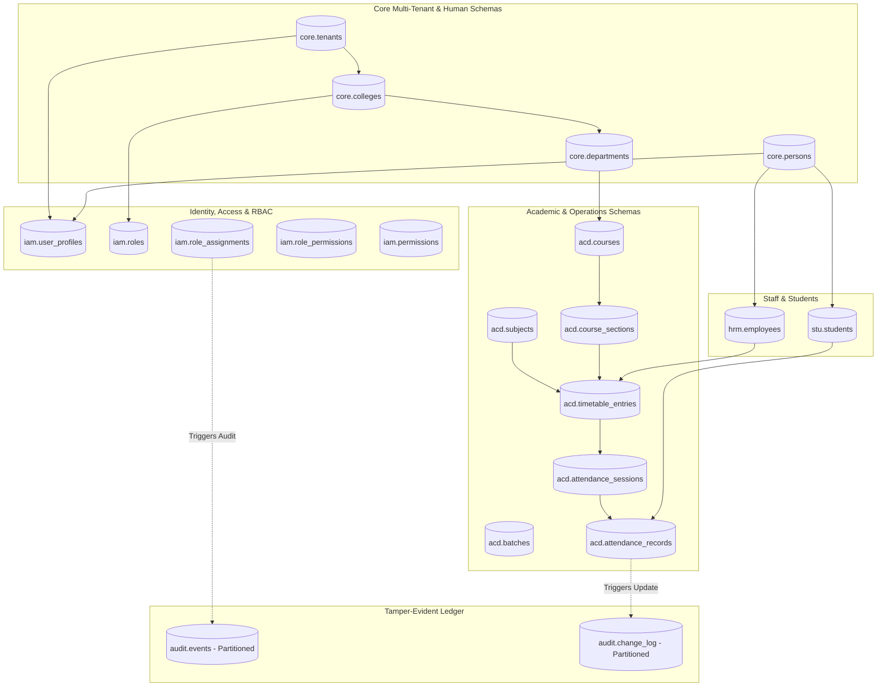

# CampXSync — Database Architecture, Schema Catalog & Migration History

**Document Identifier**: `docs/audit/CAMPXSYNC_DATABASE_AND_MIGRATION_HISTORY.md`  
**Audit Date**: October 19, 2026  
**Auditor**: Antigravity Autonomous Agent (Google DeepMind)  
**Governing Baseline**: Git HEAD (`ReviewBranch` commit `b307149`)  
**Target Staging Database**: Hosted Supabase PostgreSQL 17.11 (`kpwdvvcschankgggitnj` on AWS `ap-southeast-1`)  
**Cross-Reference Evidence Index**: [CAMPXSYNC_EVIDENCE_INDEX.md](file:///d:/CampXSync/CampXSync_V2.0/docs/audit/CAMPXSYNC_EVIDENCE_INDEX.md)

---

## 1. Executive Summary & Data Architecture Evolution

The CampXSync persistence architecture underwent a fundamental strategic pivot early in its lifecycle:
- **Initial Architecture (Inception to Mid-2026)**: Designed as a NoSQL document datastore using MongoDB (commits `0b6b0d4` to `7846b47`) with proposals for Kafka event streaming.
- **Strategic Pivot (`DEC-01`, Commit `d51264e`)**: Evaluated relational requirements for multi-tenant higher education governance (relational course prerequisite DAGs, financial accounting ledgers, immutable audit trails, and strict tenant isolation). Migrated entirely to a unified multi-schema PostgreSQL architecture hosted on Supabase.
- **Current Live Staging Baseline**: Supabase PostgreSQL 17.11 (`kpwdvvcschankgggitnj`) running on `aarch64-linux` in AWS region `ap-southeast-1` (Singapore).

---

## 2. PostgreSQL Catalog & Schema Architecture

The database architecture is partitioned across **20 dedicated application schemas** in PostgreSQL:

| Schema Name | Domain / Subsystem | Primary Entity Types & Tables Included | Table Count |
| :--- | :--- | :--- | :---: |
| `acd` | Academic Management | Courses, course sections, authoritative subjects, batches, batch students, timetable entries, attendance sessions, attendance records, attendance corrections, academic calendars. | 32 |
| `audit` | Institutional Audit Ledger | Access events, configuration change logs, entity mutation change logs, governance security events (6 parent and child partitioned tables). | 14 |
| `bud` | Budgeting & Allocations | Departmental fund allocations, budget ceilings, expense tracking line items. | 18 |
| `cam` | Campus Communications | Multichannel broadcasts, delivery receipts, delivery events (partitioned). | 8 |
| `cfg` | System Configuration | Feature flag overrides, institutional settings, number sequence generators. | 12 |
| `core` | Core Multi-Tenancy & Persons | Educational tenants, colleges, academic departments, physical rooms, human persons, address registries. | 24 |
| `doc` | Document Management | Institutional policies, governance documents, version attachments, verification logs. | 16 |
| `exm` | Examination Management | Examination terms, schedules, hall tickets, script valuations, marks cards, grade gazettes, SGPA calculations. | 42 |
| `fin` | Finance & Fee Accounting | Fee heads, fee structures, student fee invoices, payment receipts, bank reconciliation ledgers. | 38 |
| `hrm` | Human Resource Management | Faculty & employee master, employment contracts, leave balances, leave applications, attendance punches (partitioned). | 46 |
| `iam` | Identity & Access Control | User profiles, role templates, system roles, user role assignments, role permissions, canonical permissions, workspace preferences. | 18 |
| `lms` | Learning Management System | Online course delivery, syllabus modules, lessons, student progress events (partitioned), assignments, consolidated learning resources (`lms.resources`). | 36 |
| `obe` | Outcome-Based Education | Program educational objectives, course outcomes (CO), program outcomes (PO), attainment mapping matrices. | 22 |
| `pay` | Payroll Processing | Salary components, faculty compensation structures, monthly payroll runs, payslip generation. | 26 |
| `plat` | Platform Operations | Platform administrator credentials, multi-tenant subscription tiers, tenant onboarding saga states. | 12 |
| `rpt` | Reporting & Analytics | Normalized reporting marts, aggregated cohort metrics, analytical views. | 16 |
| `stu` | Student Lifecycle | Student academic profiles, admissions records, enrollment numbers, guardian links. | 20 |
| `sys` | System & Infrastructure | Outbox event propagation (`sys.outbox_events`), partition maintenance jobs, system locks. | 14 |
| `tax` | Statutory Tax Compliance | GST/TDS tax rate configurations, tax filing summaries, withholding schedules. | 16 |
| `wf` | Workflow State Machines | Approval workflow definitions, pending state transitions, approver delegation rules. | 29 |
| **Total** | **Full Relational Catalog** | **Exact Table Count Verified on Live Supabase Staging** | **458** |

### Verified Database Object Totals (From Staging Introspection `P3-03` to `P3-06`)
- **Total Schemas**: Exactly **20 ERP application schemas** (All returned `PRESENT`).
- **Total Tables**: Exactly **458 tables** (`relkind IN ('r', 'p')`).
- **Primary Key Constraints**: Exactly **458** (`pg_constraint.contype = 'p'`).
- **Unique Constraints**: Exactly **403** (`pg_constraint.contype = 'u'`).
- **Foreign Key Constraints**: Exactly **1,239** (`pg_constraint.contype = 'f'`).
- **Indexes**: Exactly **2,026 total indexes** (458 Primary Keys + 665 Unique Non-PK + 903 Regular Non-Unique Indexes).
- **Functions & Stored Procedures**:
  - 9 Foundational Platform Functions (`core.current_tenant_id()`, `sys.ensure_partitions()`, `iam.custom_access_token_hook()`, etc.)
  - 106 `sc_*` Scope Helper Functions in `iam`
  - 39 `own_*` and `vis_*` Helper Functions in `core`

---

## 3. Multi-Tenant Partitioning Architecture & Status

### 3.1 Partitioned Parent Tables
PostgreSQL declarative range partitioning (by month) is implemented across 6 high-volume transactional parent tables:
1. `audit.access_events` (Partition key: `created_at`)
2. `audit.change_log` (Partition key: `created_at`)
3. `audit.events` (Partition key: `created_at`)
4. `cam.delivery_events` (Partition key: `created_at`)
5. `hrm.attendance_punches` (Partition key: `created_at`)
6. `lms.progress_events` (Partition key: `created_at`)

### 3.2 Child Partition Configuration & Hardening
- **Default Partitions**: 6 default partitions (`_default`) catch out-of-range timestamps. All have `relrowsecurity = true` with deny-all access.
- **Monthly Partitions**: Pre-provisioned in 4-month ranges (`_p202610` through `_p202701`), producing **24 monthly partition child tables**.
- **Historical Security Finding (Finding 1 / CRIT-04)**: Initial catalog introspection revealed that while parent tables had RLS enabled, all 24 child partition tables had `relrowsecurity = false` and direct `SELECT`/`INSERT` privileges granted to `authenticated`.
- **Live Staging Remediation (`GO PARTITION-RLS-FIX`)**:
  - Executed migration `V20261014_01__enable_rls_on_monthly_partition_children.sql`.
  - Introspection verified: Exactly **24 of 24 child tables updated to `relrowsecurity = true`** and direct grants to `anon`/`authenticated` were revoked.
- **Partition Maintenance Beyond January 2027**:
  - Partitions currently cover dates up to **January 31, 2027**.
  - Maintenance function `sys.ensure_partitions()` exists in PostgreSQL to generate subsequent quarters.
  - **Open Operational Gap**: PostgreSQL extension `pg_cron` is available in Supabase but is **NOT installed** (`pg_available_extensions.installed_version = null`). Automatic monthly creation via `pg_cron` is unconfigured.

---

## 4. Migration History & Checkpoint Scripts

The database schema is managed via a two-tier migration pipeline: foundational bootstrap scripts in `Documentation/` and sequential migration files in `database/migrations/`:

```mermaid
graph LR
    subgraph Bootstrap [13 Bootstrap SQL Scripts - Documentation/DatabaseDesign/Supabase/Scripts_V3.0/]
        S00[00_extensions_schemas.sql] --> S10[10_early_helpers.sql]
        S10 --> S20[20_tables.sql]
        S20 --> S30[30_foreign_keys.sql]
        S30 --> S40[40_functions.sql]
        S40 --> S45[45_partitions.sql]
        S45 --> S50[50_triggers.sql]
        S50 --> S55[55_scope_functions.sql]
        S55 --> S60[60_rls.sql]
        S60 --> S70[70_views.sql]
        S70 --> S75[75_grants.sql]
        S75 --> S80[80_seed.sql]
        S80 --> S85[85_auth_hook.sql]
    end

    subgraph Migrations [database/migrations/]
        S85 --> M01[V20261011_01: Courses RLS Policies]
        M01 --> M02[V20261014_01: Partition Child RLS Fix]
        M02 --> M03[V20261014_02: Provision Test Tenant]
        M03 --> M04[V20261014_03: Provision College Admin Identity]
    end
```

### 4.1 Bootstrap Execution Baseline (13-Script Sequence)
1. `00_extensions_schemas.sql`: Installs `pgcrypto`, `pg_trgm`, `btree_gist`; creates all 20 schemas.
2. `10_early_helpers.sql`: Creates early utility functions (`is_valid_uuid`, `current_tenant_id`).
3. `20_tables.sql`: 482 KB DDL creating all 458 application tables, primary keys, and column defaults.
4. `30_foreign_keys.sql`: 203 KB DDL establishing all 1,239 relational foreign keys.
5. `40_functions.sql`: Core business functions and audit trigger procedures.
6. `45_partitions.sql`: Range partition definitions for 6 high-volume parent tables.
7. `50_triggers.sql`: Updated timestamp triggers, outbox triggers, and automatic tenant role seeder (`trg_seed_roles`).
8. `55_scope_functions.sql`: 106 `sc_*` scope validation procedures in `iam`.
9. `60_rls.sql`: 653 KB script applying Row-Level Security across 434 application base tables.
10. `70_views.sql`: Analytical rollup views, including `acd.v_attendance_summary`.
11. `75_grants.sql`: Role grants establishing least-privilege access for `authenticated` and `anon`.
12. `80_seed.sql`: 30 standard institutional role templates and 2,138 role-permission mappings.
13. `85_auth_hook.sql`: Custom access token hook function for Supabase GoTrue Auth.

### 4.2 In-Repository Migrations & Rollback Pairs

| Migration Version | Description | Target Object / Schemas | Rollback Script Available | Staging Execution Status |
| :--- | :--- | :--- | :---: | :---: |
| `V20261011_01` | Fix ACD-01 Course RLS Policies | Drops flawed policies; creates 6 tenant-isolated policies on `acd.courses` | `V20261011_01_rollback__revert_acd01_courses_rls_policies.sql` (248 lines) | **VERIFIED ACTIVE** (`P3-11`) |
| `V20261014_01` | Enable RLS on 24 Monthly Child Partitions | Enables RLS and revokes direct grants on `_p202610.._p202701` tables | `V20261014_01_rollback__safe_revert_partition_rls.sql` (68 lines) | **VERIFIED ACTIVE** (`GO PARTITION-RLS-FIX`) |
| `V20261014_02` | Provision Staging Test Tenant | Inserts test tenant `CAMPX_STAGING` (`11111111-1111-1111-1111-111111111111`) | `V20261014_02_rollback__revert_test_tenant_staging.sql` (48 lines) | **VERIFIED ACTIVE** (`GO PROVISION-TEST-TENANT`) |
| `V20261014_03` | Provision College Admin Staging Identity | Links `campxsync@gmail.com` to `iam.user_profiles` and binds `COLLEGE_ADMIN` | `V20261014_03_rollback__revert_staging_college_admin_identity.sql` (22 lines) | **VERIFIED ACTIVE** (`GO LINK-ADMIN-IDENTITY`) |

---

## 5. Live Staging Seed Data Inventory

Under approved write execution (`GO SEED-STAGING`, Step P3-23 in `docs/staging/05-execution-log.md`), dual-tenant realistic academic fixtures are active in Supabase Staging (`kpwdvvcschankgggitnj`):

### Tenant 1: College A — Demo Institute of Technology (`11111111-1111-1111-1111-111111111111`)
- **Tenant Code / Name**: `DIT` / "CampX Staging Tenant (Demo Institute of Technology)"
- **Colleges**: 1 (`DIT`)
- **Departments**: 2 (`CSE` - Computer Science & Engineering, `ECE` - Electronics & Communication)
- **Degree Programs**: 2 (`BTECH_CSE`, `BTECH_ECE`)
- **Cohorts / Batches**: 3 (`CSE_2024_A`, `CSE_2024_B`, `ECE_2024_A`)
- **Subjects**: 4 (`CS301` Data Structures, `CS302` Database Systems, `CS303` Operating Systems, `EC301` Digital Signals)
- **Faculty Roster**: 3 provisioned faculty members:
  - `FAC-CSE-001`: Dr. Rajesh Sharma (`faculty.campx@gmail.com` / `faculty.a1@demo.campxsync.test`)
  - `FAC-CSE-002`: Prof. Priya Venkatesh
  - `FAC-ECE-001`: Dr. Arun Kumar
- **Enrolled Student Body**: 40 students (`2024-CSE-001` through `2024-CSE-040`)
- **Published Timetable Slots**: 2 entries (CS301 Monday 10:00-11:00, CS302 Tuesday 11:00-12:00)
- **Attendance Sessions**: 2 sessions (1 CLOSED with 20 records, 1 OPEN)

### Tenant 2: College B — Test College of Science (`22222222-2222-2222-2222-222222222222`)
- **Tenant Code / Name**: `TCS` / "Test College of Science"
- **Departments**: 1 (`PCS` - Department of Physics)
- **Degree Programs**: 1 (`BSC_PHY`)
- **Batches**: 1 (`PCS_2024`)
- **Subjects**: 1 (`PH101` Classical Mechanics)
- **Faculty Roster**: 1 faculty member (`FAC-PCS-001`)
- **Enrolled Student Body**: 10 students (`2024-PCS-001` through `2024-PCS-010`)
- **Timetable Slots**: 1 entry (PH101 Wednesday 09:00-10:00)

### Idempotency & Tenant Boundary Verification
- Script: [database/seed-data/staging_seed_college_a_and_b.sql](file:///d:/CampXSync/CampXSync_V2.0/database/seed-data/staging_seed_college_a_and_b.sql)
- Verification Query (`P3-26`): A multi-table duplicate query across all 9 relational entities returned **0 duplicate rows**.
- Isolation: College Admin A cannot query, update, or resolve students or sessions belonging to College B.

---

## 6. Supabase Custom Access Token Hook Architecture

- **Function Name**: `iam.custom_access_token_hook(event jsonb)`
- **Security Mode**: Compiled with `SECURITY DEFINER` owned by `postgres`.
- **Privilege Grants**:
  - `supabase_auth_admin`: `EXECUTE = true`
  - `anon`, `authenticated`, `service_role`: `EXECUTE = false` (Zero public exposure)
- **Hook Logic**:
  - Dynamically inspects `event->>'user_id'`.
  - Queries `iam.user_profiles` to retrieve authoritative `tenant_id`.
  - Injects `app_metadata.tenant_id = v_tenant` into the issued JWT claims payload before returning to GoTrue.
- **Operational Reality Caveat**:
  - While enabled on staging, token generation was observed to omit `app_metadata.role` when role assignments were configured after token issuance.
  - To prevent authentication failures, `resolve-role.ts` implements an authoritative PostgreSQL query fallback directly verifying `plat.platform_admins`, `iam.user_profiles`, and `iam.role_assignments`.

---

## 7. Outstanding Database, RLS & Migration Gaps

1. **FORCE RLS Missing on Base Application Tables**:
   - Because `frontend/src/lib/db.ts` connects via the `postgres` superuser/table owner, RLS is bypassed on direct SQL queries.
   - Enforcing database-level tenant isolation for direct pooler connections requires either:
     - Applying `ALTER TABLE ... FORCE ROW LEVEL SECURITY` across application tables and executing `SET LOCAL ROLE authenticated;` inside pooled transactions, OR
     - Establishing a restricted non-superuser database role (`campx_app_server`) for frontend connection pooling.
2. **Automatic Partition Maintenance Beyond January 2027**:
   - Monthly partitions are only pre-created through January 31, 2027.
   - `pg_cron` must be enabled and a cron job scheduled to invoke `sys.ensure_partitions()` quarterly.
3. **Production Migration Deployment Pending**:
   - The verified migrations (`V20261011_01`, `V20261014_01`, `V20261014_02`, `V20261014_03`) exist and are active on Supabase Staging (`kpwdvvcschankgggitnj`).
   - They have **NOT been executed on Supabase Production (`ekspahbsbwdpraaqfqui`)**.
