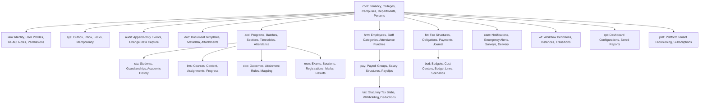

# CampXSync — Module Database Dependencies & Ordering
## Cross-Module Schema Topology, Foreign Key Graph & Execution Order

**Audit Date:** 2026-10-26  
**Auditor:** Antigravity Agentic AI (Read-Only Forensic Mode)  
**Target Architecture:** Multi-Schema PostgreSQL on Supabase (20 Schemas, 458 Tables, 1,239 Foreign Keys)  

---

## 1. Architectural Module Overview

The CampXSync database divides domain responsibilities across 20 specialized schemas. Each schema represents a functional sub-domain with clear ownership boundaries:



---

## 2. Service-to-Database Mapping

The 8 Java domain microservices, API Gateway, and Frontend interact with specific slices of the database:

| Java Service / Component | Port | Primary Database Schemas | Key Tables & Views Referenced | Foreign Dependencies |
| :--- | :--- | :--- | :--- | :--- |
| **`api-gateway`** | 8080 | `iam`, `core` | `iam.user_profiles`, `iam.role_assignments`, `iam.roles`, `core.tenants`, `core.colleges` | Read-only identity claims resolution |
| **`services/student-service`** (STU-01) | 8085 | `stu`, `core`, `acd`, `doc`, `sys`, `audit` | `stu.students`, `core.persons`, `stu.guardianships`, `acd.batch_students`, `doc.documents`, `sys.outbox_events`, `audit.events` | Requires `core.persons`, `core.departments`, `acd.batches` |
| **`services/timetable-management-service`** (ACD-05) | 8087 | `acd`, `core`, `sys`, `audit` | `acd.timetables`, `acd.timetable_versions`, `acd.timetable_entries`, `acd.subjects`, `acd.course_sections`, `sys.outbox_events`, `audit.events` | Requires `core.departments`, `acd.batches`, `hrm.employees` |
| **`services/attendance-service`** (ACD-06) | 8086 | `acd`, `stu`, `sys`, `audit` | `acd.attendance_sessions`, `acd.attendance_records`, `acd.attendance_corrections`, `sys.outbox_events`, `audit.events` | Requires `acd.timetable_entries`, `stu.students`, `hrm.employees` |
| **`services/analytics-service`** (ACD-10) | 8089 | `acd`, `stu`, `core` (Read Model) | `acd.attendance_sessions`, `acd.attendance_records`, `stu.students`, `core.departments`, `acd.batches`, `v_attendance_summary` | Read-only aggregation across academics |
| **`services/batch-management-service`** (ACD-04) | 8084 | `acd`, `core`, `sys`, `audit` | `acd.batches`, `acd.batch_students`, `acd.programs`, `core.academic_years`, `sys.outbox_events`, `audit.events` | Requires `core.departments`, `core.academic_years` |
| **`services/course-management-service`** (ACD-01) | 8082 | `acd`, `core`, `sys`, `audit` | `acd.courses`, `acd.course_versions`, `acd.course_prerequisites`, `acd.course_program_map`, `acd.programs` | Requires `core.departments`, `core.tenants` |
| **`services/college-admin-service`** (ADM-02) | 8083 | `core`, `acd`, `audit` | `core.colleges`, `core.departments`, `core.campuses`, `core.academic_years`, `acd.programs`, `audit.events`, `audit.change_log` | Core institutional organizational structures |
| **`services/institute-admin-service`** (ADM-01) | 8081 | `core`, `iam`, `plat`, `sys`, `audit` | `core.tenants`, `core.colleges`, `iam.user_profiles`, `iam.role_assignments`, `iam.roles`, `iam.permissions`, `plat.tenant_provisioning`, `sys.outbox_events`, `audit.events` | Root institutional onboarding saga |
| **`frontend` (Next.js 15)** | 3000 | N/A (Gateway Proxy) | 13 API routes cut over to API Gateway; direct DB queries retired in Wave 10 | Interacts exclusively via API Gateway reverse proxy |

---

## 3. Circular Dependencies & Foreign Key Resolution

The database contains circular reference chains between several core entities:
1. **Tenants vs. Colleges**: `core.colleges` references `core.tenants(id)`. Conversely, `core.tenants` includes metadata and profile settings that reference headquarter colleges.
2. **Persons vs. User Profiles**: `iam.user_profiles` references `core.persons(id)`. Conversely, `core.persons` references the creating `iam.user_profiles(id)`.
3. **Employees vs. Departments**: `core.departments` references `hrm.employees(id)` for the Head of Department (HOD). Conversely, `hrm.employees` references `core.departments(id)` for department assignment.
4. **Courses vs. Programs**: `acd.course_program_map` references both `acd.courses(id)` and `acd.programs(id)`.

### How Bootstrap Scripts Solved Circularity
The original bootstrap architecture (`Scripts_V3.0/`) cleanly decoupled table creation from constraint enforcement:
1. `20_tables.sql`: Creates all 458 tables with columns, Primary Keys, and Check constraints, but **zero foreign keys**.
2. `30_foreign_keys.sql`: Applies all 1,239 Foreign Keys in a single secondary pass once all referenced tables exist.

**Recommendation for New Migration Engine**: The new authoritative migration sequence must retain this decoupled two-pass architecture for baseline initialization to eliminate cyclic dependency errors.

---

## 4. Recommended Migration Dependency Ordering

To reconstruct an authoritative migration sequence that is deterministic, reproducible, and verifiable, database objects must be provisioned in the following strict topological order:

```text
Pass 01: Extensions & Schemas
  └── 00_extensions_schemas.sql (Extensions: uuid-ossp, pgcrypto, btree_gist, pg_trgm; 20 Schemas)

Pass 02: Early Context Helpers
  └── 10_early_helpers.sql (core.current_tenant_id, core.current_person_id)

Pass 03: Table Structure & Primary Keys (Zero Foreign Keys)
  └── 20_tables.sql (458 tables: core -> iam -> sys -> audit -> doc -> acd -> stu -> hrm -> fin -> pay -> bud -> tax -> lms -> obe -> exm -> cam -> wf -> rpt -> plat)

Pass 04: Relational Foreign Key Integrity
  └── 30_foreign_keys.sql (1,239 FK constraints linking all schemas)

Pass 05: Exclusion & Scheduling Constraints
  └── 35_exclusion_constraints.sql (3 GiST exclusion constraints on acd.timetable_entries)

Pass 06: Business Functions & Procedures
  └── 40_functions.sql (Domain guards, audit logging, sequence generators)

Pass 07: Partitioning Structure
  └── 45_partitions.sql (6 partitioned parents, 30 initial child partitions, sys.ensure_partitions with RLS hardening)

Pass 08: Database Triggers & CDC
  └── 50_triggers.sql (799 triggers: touch_row, audit capture, forbid_mutation, transition guards)

Pass 09: RBAC Functions & Helper Scope Procedures
  └── 55_scope_functions.sql (iam.perm_all, iam.perm_department_ids, iam.has_permission, core.is_active_course_in_tenant)

Pass 10: Row-Level Security & Policies
  └── 60_rls.sql (ENABLE RLS on 458 tables; FORCE RLS on Tier 1; 1,545 policies with acd01 fix & Option C asymmetric RLS)

Pass 11: Relational Views
  └── 70_views.sql (14 standard views)

Pass 12: Least-Privilege Grants & Roles
  └── 75_grants.sql (Provision campx_app_server role; USAGE on 20 schemas; table DML to authenticated; append-only audit grants)

Pass 13: System Seeds
  └── 80_seed.sql (547 permissions, 30 system roles template, iam.seed_system_roles procedure)

Pass 14: Authentication Hooks
  └── 85_auth_hook.sql (iam.custom_access_token_hook)
```
