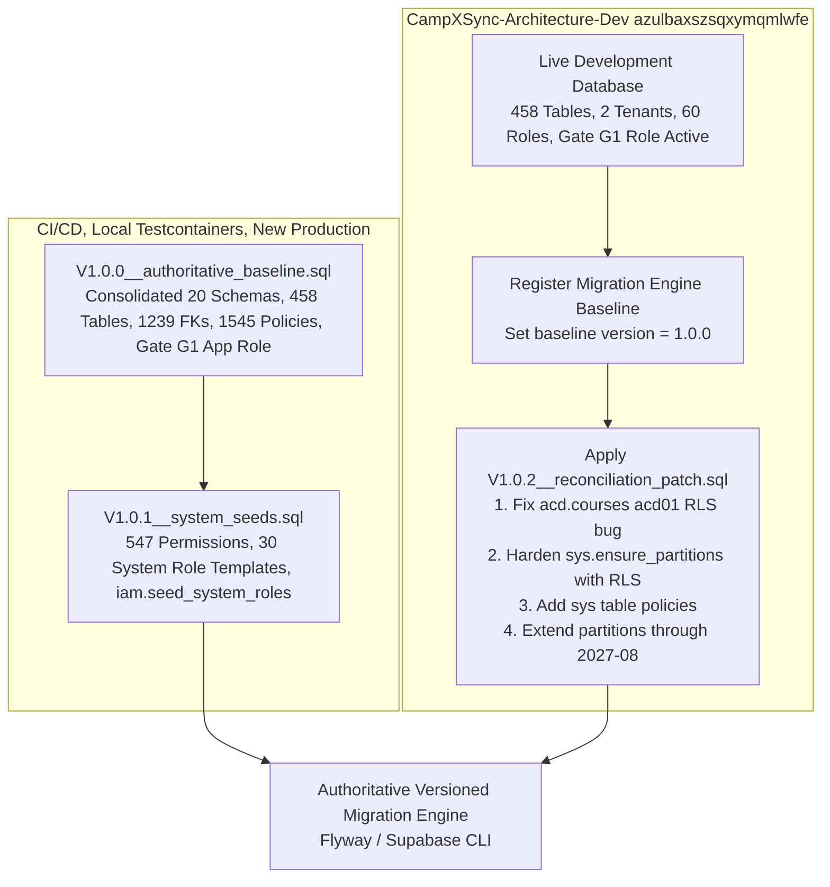

# CampXSync — Proposed Database Migration Strategy
## Authoritative Architecture for Fresh Baseline Initialization & Environment Reconciliation

**Audit Date:** 2026-10-26  
**Auditor:** Antigravity Agentic AI (Read-Only Forensic Mode)  
**Target Platform:** CampXSync Multi-Tenant Academic ERP  
**Recipient:** Chief Architect  

---

## 1. Evaluation of Strategic Options

To establish a permanent, reliable migration sequence for CampXSync, three architectural strategies were evaluated:

### Option 1: Fresh Baseline Followed by Incremental Migrations
* **Description**: Consolidate the entire verified catalog into a single monolithic baseline migration (`V1.0.0__authoritative_baseline.sql`), discarding historical patch scripts. All subsequent changes are applied as standard incremental versioned migrations (`V1.1.0`, `V1.2.0`, etc.).
* **Pros**: Cleanest possible start for new databases (CI/CD, local Docker, disaster recovery). Fast execution time (single pass). Zero risk of historical ordering bugs.
* **Cons**: Does not cleanly bridge existing environments (`CampXSync-Architecture-Dev`, future staging, production) where parts of the baseline have already been applied piecemeal. Requires manual baseline marking (`flyway baseline` or `supabase migration repair`) on live databases.

### Option 2: Ordered Reconstruction of Existing Migration History
* **Description**: Attempt to rewrite the 13 bootstrap scripts and 6 incremental migrations into a strictly sequential numbered migration timeline (e.g., `V1__bootstrap.sql` through `V19__asymmetric_rls.sql`).
* **Pros**: Preserves the illusion of historical continuity.
* **Cons**: **Extremely fragile**. As revealed by this audit, historical scripts contain target mismatches (hardcoded for legacy staging ref `kpwdvvcschankgggitnj`), unapplied bug fixes (`V20261011_01`), partial applications, and conflicting seed fixtures. Executing them sequentially against a clean database will fail on precondition checks and seed collisions.

### Option 3: Hybrid Two-Track Strategy (RECOMMENDED)
* **Description**: Decouple the database evolution into two synchronized tracks:
  1. **Track 1 (Fresh Baseline Initialization)**: Codify an authoritative, single-pass consolidated baseline snapshot (`V1.0.0__authoritative_baseline.sql`) that reflects the complete, verified, and bug-free schema (all 20 schemas, 458 tables, 1,239 FKs, 403 unique constraints, 3 GiST constraints, functions with `search_path = ''`, 1,545 RLS policies including all fixes, least-privilege roles, and system seeds).
  2. **Track 2 (Forward-Fix Reconciliation for Existing Environments)**: Package the missing fixes (`DIFF-01` acd01 bug, `DIFF-08` ensure_partitions RLS, `DIFF-09` sys policies, partition horizon extension) into a small, targeted, non-destructive forward migration (`V1.0.1__reconciliation_and_bugfixes.sql`).
  3. **Migration Engine Baselines**: For fresh environments, Track 1 runs directly. For existing environments (`CampXSync-Architecture-Dev`), Track 1 is registered as baseline (`baseline-version = 1.0.0`), and Track 2 applies the missing delta forward.

---

## 2. Comparative Evaluation Matrix

| Architectural Dimension | Option 1: Monolithic Reset | Option 2: Full History Replay | Option 3: Hybrid Two-Track (Recommended) |
| :--- | :--- | :--- | :--- |
| **Fresh Database Build Speed** | **Fast** (< 45s) | **Slow** (> 3m with multiple table rebuilds) | **Fast** (< 45s) |
| **Determinism & Reproducibility** | **High** | **Low** (Precondition collisions) | **Highest** |
| **Existing Dev Target Safety** | Medium (Requires baseline command) | Low (Risk of script collisions) | **Zero Data Loss** (Forward delta only) |
| **Staging & Production Parity** | **High** | Medium | **High** |
| **Historical Traceability** | Documented in audit report | Preserved in git | **Full Audit Register in Version Control** |
| **CI/CD Test Runner Integration**| **Trivial** | Complex | **Trivial** |

---

## 3. Recommended Hybrid Architecture Design



---

## 4. Key Architectural Subsystems

### 4.1 Migration Tooling Recommendation: Flyway
For the Java domain microservices architecture, **Flyway** (or Supabase CLI migrations wrapped in Flyway compatibility) is strongly recommended:
1. **JVM Native Integration**: Integrates directly with Maven (`flyway-maven-plugin`), Spring Boot / Standalone Java runtime, and JUnit test harnesses.
2. **Deterministic Checksumming**: Validates SHA-256 checksums on all applied scripts, guaranteeing drift detection across developer environments.
3. **Transaction Per Script**: Executes each migration in a dedicated PostgreSQL transaction with automatic rollback on error.
4. **Baseline Support**: Natively supports `flyway baseline -baselineVersion=1.0.0` to seamlessly adopt existing databases without wiping data.

---

### 4.2 Handling of Specific Database Domains

#### A. Least-Privilege Role & Grants (`campx_app_server`)
- The baseline migration must create `campx_app_server` (`LOGIN`, `NOBYPASSRLS`, `CONNECTION LIMIT 25`, member of `authenticated`).
- Password management: The password must NEVER be hardcoded in SQL files. It must be injected dynamically via environment variable (`CAMPX_APP_SERVER_PASSWORD`) or configured in Supabase Vault.

#### B. Row-Level Security & Policies
- Baseline includes all 1,545 policies with verified fixes:
  - `acd.courses`: Codify `acd01.view`, `acd01.write`, `acd01.manage` (resolving `DIFF-01`).
  - `acd.course_program_map`: Codify Option C asymmetric RLS + `core.is_active_course_in_tenant(uuid)` (resolving `DIFF-02` and `DIFF-03`).
  - `sys.outbox_events`: Codify the 4 tenant-scoped RLS policies (resolving `DIFF-04`).
  - `audit.events`: Codify `events_insert` policy and append-only privileges (resolving `DIFF-06`).
  - Tier 1 Core tables: Apply `FORCE ROW LEVEL SECURITY` (resolving `DIFF-07`).

#### C. Partition Maintenance & Expiration Prevention
- Extend the initial partition provisioning to cover **12 months rolling ahead** (through 2027-10).
- Update `sys.ensure_partitions()` to include `ALTER TABLE nm ENABLE ROW LEVEL SECURITY`.
- Establish an automated cron trigger: Since `pg_cron` is absent from Supabase, schedule a GitHub Action or Supabase Edge Function to execute `SELECT sys.ensure_partitions(6);` on the 1st of every month.

#### D. Seed Data Architecture
- Separate **System Metadata** from **Test Fixtures**:
  - `V1.0.1__system_seeds.sql`: Contains immutable platform permissions (547) and role templates (30). Uses `ON CONFLICT (id) DO NOTHING`.
  - `environment_seeds/dev_seed.sql`: Contains `DEV_TEST_TENANT` and test identity. Run conditionally via test runners, never as an un-gated production migration.

---

## 5. Phased Execution Roadmap for Chief Architect

```text
Phase 1: Verification & Audit Approval (Current Task)
  └── Complete read-only forensic audit and publish audit reports under docs/audit/.
  └── Chief Architect reviews findings and approves Hybrid Two-Track Strategy.

Phase 2: Authoritative Baseline Preparation (Next Task)
  └── Codify V1.0.0__authoritative_baseline.sql consolidating the verified 14-pass schema.
  └── Codify V1.0.1__system_seeds.sql for universal permissions and system roles.
  └── Codify V1.0.2__reconciliation_patch.sql containing the delta fixes.
  └── Verify baseline reproducibility in an isolated test environment.

Phase 3: Development Database Reconciliation (Zero Data Loss)
  └── Baseline CampXSync-Architecture-Dev at version 1.0.0.
  └── Execute V1.0.2__reconciliation_patch.sql on CampXSync-Architecture-Dev.
  └── Re-run Java live test suites to verify 100% pass rate.

Phase 4: Staging & Production Cutover Readiness (Wave 11)
  └── Configure Flyway / migration runner in CI/CD pipeline.
  └── Verify fresh baseline creation in automated GitHub Actions workflow.
  └── Execute reconciliation runbook on staging project.
```
