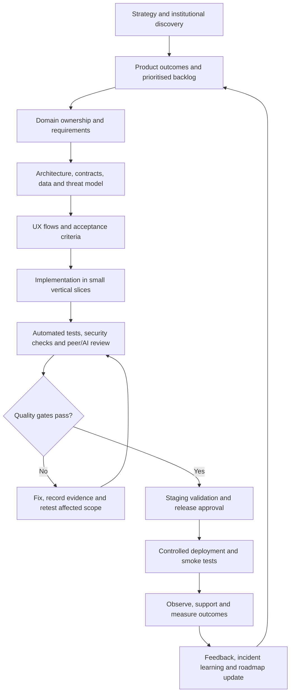

# CampXSync Product Lifecycle

**Document type:** Product and Engineering Lifecycle Baseline  
**Product:** CampXSync — multi-tenant college/institute operating platform  
**Status:** Consolidated lifecycle baseline derived from the supplied `AllModules.zip` design package; decisions marked **Baseline**, **Requires decision**, or **Release gate** are intended to govern delivery.  
**Audience:** Product owner, engineering, architecture, security, UX/design, QA, implementation, support, institutional administrators and AI-agent teams.

> **Interpretation rule:** The supplied files are design specifications, not proof that every described service has been implemented or deployed. This document defines the end-to-end lifecycle and reconciles the design package into a delivery baseline. A feature is not “done” merely because its specification exists. Implementation status must be established from the repository, migration history, tests and target environment evidence.

## 1. Product purpose and operating principles

CampXSync is intended to support institutional operations across academic administration, teaching and learning, examinations, finance, human resources, administration, communication and reporting. It should reduce fragmented workflows while preserving institutional control, auditability and domain ownership.

### Product principles

1. **Institution-owned decisions:** AI may propose, explain, compare, detect, draft and recommend; authorised people remain accountable for consequential institutional decisions unless a specific, approved policy explicitly delegates a low-risk action.
2. **One authoritative owner per business fact:** Each domain owns its records and lifecycle. Other domains use stable identifiers, published contracts and read models—not direct writes into another domain’s tables or collections.
3. **Tenant isolation by construction:** Every tenant-scoped request, record, event, job, cache key, file and report must be tenant-scoped and authorised. A client-supplied tenant identifier is not proof of authority.
4. **Secure defaults:** Deny by default, least privilege, explicit permission checks, validated inputs, auditable privileged actions, and safe failure behaviour.
5. **Lifecycle and history:** Important records move through explicit state transitions, retain actor/time/reason history, and preserve immutable published or legally significant versions where required.
6. **Contract-first integration:** APIs, events, schemas and permissions are versioned, documented and tested before dependent services rely on them.
7. **Operational resilience:** Retries are bounded, commands are idempotent where appropriate, events are deduplicated, and asynchronous work can be retried or dead-lettered safely.
8. **Evidence-based completion:** No release claim without traceable requirements, test results, security evidence, deployment evidence and a named owner for remaining risks.
9. **Parallel progress without unsafe shortcuts:** MVP work that does not require a blocked staging/database write should continue in parallel. A blocked migration must not silently become a production change.
10. **No ritual repetition:** Do not rerun completed checks or scripts without a concrete new reason, changed code/configuration, a new failure, or a release gate that requires fresh evidence. Record results and proceed to the next actionable item.

## 2. Product lifecycle at a glance

The lifecycle is continuous. Discovery, delivery, security, operations and customer feedback overlap, but no phase may bypass its required gates.

## 3. Product strategy, discovery and validation

### 3.1 Define the customer and problem

For each target institution and user segment, document:

- Institutional type, size, operating model, academic calendar and regulatory/accreditation needs.
- Personas and jobs-to-be-done: platform operator, institution administrator, department/HOD, faculty, student, parent/guardian where applicable, examination team, finance team, HR team, auditor and support operator.
- Current workflow, pain, frequency, failure cost, existing system and migration constraints.
- Decision owner, data owner, approver and operational fallback for every consequential workflow.
- Required language, accessibility, device/connectivity and local policy needs.

Do not infer all institutions share the same rules. Make legitimate differences configurable and versioned rather than scattering institution-specific conditions through code.

### 3.2 Define measurable outcomes

Every initiative must specify a baseline, target, measurement method, owner and review date. Suggested measures include:

- Time to configure and activate an institution.
- Completion rate and elapsed time for critical workflows.
- Data-quality errors and duplicate master records.
- Examination scheduling conflicts and result correction rate.
- Payment reconciliation exceptions and overdue fee visibility.
- Attendance capture timeliness and correction audit completeness.
- Support ticket volume, severity, resolution time and repeat incidence.
- Availability, latency, error rate, queue lag, recovery time and recovery-point achievement.
- Adoption by role and task success—not logins alone.
- AI suggestion acceptance, override, error and escalation rates, where AI is enabled.

### 3.3 Validate before expanding scope

Use workflow walkthroughs, prototypes, pilot institutions and representative data. Validate exceptional paths—not only the happy path—including correction, rejection, cancellation, late submission, duplicate request, network failure, unauthorised access, tenant switching, approval delegation, rollback and data export.

**Gate G1 — Product problem validated:** target user, pain, desired outcome, success metric, scope, non-goals, policy owner and pilot acceptance are recorded.

## 4. Portfolio and requirements management

### 4.1 Product hierarchy

Maintain traceable links among:

`Product outcome → capability → domain/module → service → user journey → requirement → API/event/data change → test → release → metric`.

Each backlog item must include:

- Stable ID, title, user/actor and business value.
- In-scope behaviour and explicit non-goals.
- Preconditions, normal flow, alternate/error flows and state transitions.
- Permission and tenant scope requirements.
- Validation rules, concurrency expectations and audit requirements.
- API/event/data implications and migration/compatibility plan.
- Acceptance criteria written so they can be tested.
- Observability, support and rollout requirements.
- Dependencies, risk, priority, owner and evidence links.

### 4.2 Prioritisation

Prioritise the smallest end-to-end workflow that creates user value while reducing security and delivery risk. Score value, urgency, confidence, effort, dependency and risk. Do not use “number of services completed” as the primary measure of MVP progress.

Keep two coordinated tracks:

- **Track A — Platform readiness:** staging isolation, tenant/security controls, migrations, auth hooks, seed/provisioning safeguards and release infrastructure.
- **Track B — MVP delivery:** UI journeys, service behaviour, API contracts, test coverage, demo/pilot readiness and product feedback that can proceed without unsafe database writes.

A blocker in Track A only blocks work that depends on it. Record the dependency explicitly and continue independent Track B tasks.

**Gate G2 — Ready for implementation:** requirements, acceptance tests, domain owner, threat/privacy assessment, dependencies and rollout approach are reviewed.

## 5. Domain and module catalogue

The archive specifies the following capability groups. This catalogue records design intent, not verified implementation status.

### 5.1 Academic Management — ACD

| Service | Primary ownership / purpose | Boundary notes |
|---|---|---|
| ACD-01 | Course/programme master, lifecycle and versioning | Does not own curriculum, subject, student, faculty, examination or finance records. |
| ACD-02 | Curriculum/syllabus structure, semester/subject mappings, credits, outcomes references and curriculum versions | References course and subject masters; does not duplicate them. |
| ACD-03 | Reusable subject master and subject lifecycle | Other domains consume subject identity and published facts. |
| ACD-04 | Academic batches/sections, academic-year context, capacity and roster references | Student identity remains owned by Student Management; avoid creating a shadow student master. |
| ACD-05 | Timetable versions, slots, faculty/room/batch assignments and conflict validation | Consumes calendar, batch, subject and faculty references. |
| ACD-06 | Attendance sessions and per-student attendance outcomes | Must align with valid timetable/session context; corrections are auditable. |
| ACD-07 | Academic terms, working days, holidays and academic events | Supplies calendar facts to scheduling, attendance and examination workflows. |
| ACD-08 | Academic resource metadata/lifecycle in the original ACD design | **Requires decision:** reconcile with LMS-07 and the current database decision to consolidate learning resources under `lms.resources`; do not create duplicate resource masters. |
| ACD-09 | Academic assessment-component mapping to subjects and outcomes | Does not own examination execution, marks or results. |
| ACD-10 | Reporting and analytics | Read-optimised, asynchronously updated; never a synchronous dependency for operational academic transactions. |

### 5.2 Platform and institution administration — ADM

The archive contains two distinct administration designs:

- **Platform-level administration:** manages the CampXSync platform and institutional/tenant lifecycle, platform-level controls and operations.
- **College/tenant-level administration:** manages one institution’s configuration, users, roles/permissions and institutional setup.

These scopes must remain distinct. Platform operators must not automatically gain unrestricted access to institutional academic or financial content. Institution administrators must not manage other tenants. Define separate permissions, audit trails, UI entry points and support-access rules. The archive includes institutional-management, user-management and role/permission-management diagrams.

### 5.3 Learning Management System — LMS

| Service | Primary ownership / purpose | Boundary notes |
|---|---|---|
| LMS-01 | LMS course management | The archive has both `LMS-01.docx` and `LMS-01-v2.0.docx`; establish one canonical, approved specification before implementation changes. Reconcile overlap with ACD-01 explicitly. |
| LMS-02 | Course content management | Owns content structure/content lifecycle, not academic course identity. |
| LMS-03 | LMS subject management | **Requires decision:** reconcile with ACD-03 subject master; choose one authoritative subject identity and document whether LMS-03 is a projection/learning-specific extension or a separate bounded concept. |
| LMS-04 | Lesson planning | Owns lesson/teaching plan lifecycle, not course or subject masters. |
| LMS-05 | Assignment management | Owns assignment creation, submission and relevant assessment workflow; define boundaries with EXM and ACD-09. |
| LMS-06 | Virtual classroom management | Owns classroom/session operations and integrations; isolate provider credentials and attendance/event reconciliation. |
| LMS-07 | Learning-resource management | **Requires decision:** reconcile with ACD-08 and the existing `lms.resources` consolidation; avoid two sources of truth. |
| LMS-08 | Learning-progress tracking | Consumes activity events and calculates progress; does not own the source learning activities. |
| LMS-09 | Certifications, badges, eligibility evidence, issue/expiry/revocation and verification | Consumes progress/evidence; does not calculate the underlying learning progress. |
| LMS-10 | OBE outcome definitions/mappings/attainment for CO, TLO, PO and PSO | Owns outcome measurement and reporting, not the underlying course/content/assignment/progress entities. |

### 5.4 Examination Management — EXM

| Service | Primary ownership / purpose |
|---|---|
| EXM-01 | Student exam registration and eligibility workflow |
| EXM-02 | Examination scheduling and conflict control |
| EXM-03 | Secure, versioned hall-ticket generation |
| EXM-04 | Answer-script valuation and marks entry |
| EXM-05 | Marks approval/finalisation using maker-checker controls |
| EXM-06 | Marks cards, transcripts and print/publication documents |
| EXM-07 | Script valuation tracking/counting and barcode/QR/RFID or external valuation integration where used |
| EXM-08 | Result processing, controlled finalisation and publication |
| EXM-09 | Examination reporting and analytics, preferably using event-fed read models |

Examination records and results are high-impact. Enforce eligibility, role separation, controlled amendments, immutable version history, explicit publication authority and auditable re-publication/correction. No analytics/reporting service may become a hidden dependency for result finalisation.

### 5.5 Finance and Accounts — FIN

| Service | Primary ownership / purpose |
|---|---|
| FIN-01 | Fee structures and applicable fee rules |
| FIN-02 | Fee collection and payment lifecycle/reconciliation |
| FIN-03 | Expense management |
| FIN-04 | Tax management and tax reporting |
| FIN-05 | Fee receipts and receipt lifecycle |
| FIN-06 | Scholarship management |
| FIN-07 | Finance-domain payroll service as specified in the archive |
| FIN-08 | Finance reports and analytics |
| FIN-09 | Finance audit/compliance |
| FIN-10 | Budgeting and planning/allocation |

**Requires decision:** FIN-07 overlaps with HRM-05 payroll. Choose one authoritative payroll transaction owner; if finance requires a payroll view, use a projection/integration rather than duplicate payroll processing. Define accounting periods, currency precision, reconciliation, refund/chargeback, receipt numbering, approval limits, tax rules and segregation of duties. Never treat a successful payment-provider callback alone as complete reconciliation without validating amount, currency, institution, reference and idempotency.

### 5.6 Human Resource Management — HRM

| Service | Primary ownership / purpose |
|---|---|
| HRM-01 | Employee information/master |
| HRM-02 | Leave management |
| HRM-03 | Employee attendance |
| HRM-04 | Employee performance management |
| HRM-05 | Compensation and payroll management |
| HRM-06 / HRM-07 | Recruitment/onboarding content appears under both IDs; the archive’s HRM-07 opening describes recruitment/onboarding again. **Requires decision:** determine canonical service ID and the intended distinct purpose of HRM-07 before implementation. |
| HRM-08 | HR analytics/workforce intelligence |
| HRM-09 | Employee training, learning and development |

HR records are sensitive. Apply purpose limitation, field-level access where appropriate, retention schedules, access logging, export controls and restricted support access. Analytics must not leak identifiable HR details to roles that only need aggregates.

### 5.7 Communication and announcements — CAM

The archive contains an empty `Communication&AnnnouncementModule` directory and no CAM service specifications. Communication is referenced by other domain specifications, but its end-to-end service design is not present in this package.

**Release planning requirement:** define announcement composition, audience/tenant scoping, approval, scheduling, delivery channels, templates, preferences/consent where relevant, provider callbacks, retries, suppression, delivery status, retention, attachment safety and audit. Communication must not be assumed complete because other services mention it.

### 5.8 Cross-cutting capabilities still requiring explicit ownership

The module archive does not establish complete specifications for all platform-wide concerns. Assign named owners and canonical contracts for:

- Identity, user profiles, authentication, tenant provisioning and lifecycle.
- Authorisation/RBAC/ABAC, permission evaluation and policy administration.
- Student master/enrolment and parent/guardian relationships.
- Faculty identity/employment cross-domain references.
- API gateway, service discovery/configuration, secrets, event platform and schema registry.
- Workflow/approval engine, audit/event ledger and notification delivery.
- File/object storage, malware scanning, signed access and retention.
- Search, reporting/analytics platform, data warehouse and export governance.
- Integration connectors, import/migration, reconciliation and external-provider health.
- Support tooling, incident management, backup/restore and disaster recovery.

Do not invent ownership by placing missing capabilities into whichever service is easiest to change.

## 6. Architecture and technology governance

The module documents commonly describe domain-driven microservices, REST/JSON APIs, event-driven integration, MongoDB, Redis, Kafka or RabbitMQ, object storage, search, OAuth/OIDC, RBAC/ABAC and container orchestration. These are design proposals in the source package—not a mandate to deploy every technology in every service.

The active CampXSync implementation has also moved toward **Supabase/PostgreSQL**, with 21 schemas and a consolidated `lms.resources` design. Therefore, the architecture baseline must explicitly reconcile the older MongoDB-centric specifications with the implementation rather than silently mixing incompatible assumptions.

### Architecture decision rules

1. Maintain a versioned Architecture Decision Record (ADR) for each consequential choice: database, tenancy, service boundary, event delivery, authentication, resource ownership, workflow, reporting and deployment.
2. Treat the actual repository migrations and application code as implementation evidence; treat this lifecycle document and module design files as design intent.
3. Avoid database-per-microservice dogma if the current Supabase architecture intentionally uses one PostgreSQL project with schemas and tenant scoping. Instead, enforce schema ownership, least-privilege grants, RLS and service-level boundaries. Cross-domain writes must still use an explicit contract.
4. If using event-driven integration, specify event ID, tenant ID, aggregate ID/version, occurred-at timestamp, schema version, producer, correlation/causation IDs and data classification. Do not place secrets or unnecessary personal data in events.
5. Use transactional outbox or an equivalently reliable pattern where a database change must reliably emit an event. Consumers must be idempotent and tolerate duplicates and out-of-order delivery where relevant.
6. Define cache keys with tenant and authorisation context where needed; never let a shared cache or in-memory fallback serve one tenant’s records to another.
7. Define API pagination, filtering, sorting, validation, error format, idempotency, optimistic concurrency, rate limits, deprecation and version compatibility consistently.
8. Use immutable version records for published curricula, courses, exam results, marks cards, fee structures and other governed artefacts where business/legal reconstruction requires it.

**Gate G3 — Architecture approved:** domain boundaries, canonical data owner, tenancy model, ADRs, API/event contracts, migration/rollback, threat model, operational dependencies and cost envelope are accepted.

## 7. Data lifecycle and ownership

### 7.1 Data classification

Classify every entity and field as public, institutional/internal, confidential, sensitive personal, financial, authentication/security, or legally/academically significant. Define collection purpose, lawful basis where applicable, authorised roles, retention, deletion/anonymisation, export and audit policy.

### 7.2 Data invariants

- Tenant-owned rows must carry a trustworthy tenant scope and be protected by server-side authorisation and database policies where supported.
- Tenant identity and user identity are not interchangeable. Verify that authenticated identities have a valid, unambiguous institutional profile and membership before allowing tenant actions.
- Use stable primary keys; use human-readable codes as separate unique business identifiers where appropriate. Define uniqueness scope (global, tenant, academic year or entity-specific) explicitly.
- Foreign references must point to authoritative owners; validate references at command boundaries and handle deletion/retirement without destroying historical meaning.
- Define soft deletion versus hard deletion per entity. Soft-deleted records must not reappear through search, reports, caches or exports. Hard deletion must follow approved retention and legal rules.
- Published records need version, effective date, actor, reason and audit history where applicable.
- Import jobs must validate, preview, report row-level errors, support safe retries and reconcile counts before activation.
- Backups are not a substitute for tested restore procedures.

### 7.3 Retention and deletion

Each data category needs an approved retention schedule, legal hold behaviour, archival format, deletion/anonymisation process and evidence of execution. Define policies for audit events, authentication logs, exam scripts, marks/results, financial records, HR records, learning submissions, recordings, certificates, exports and backups. Do not claim compliance until applicable requirements are reviewed by a qualified owner.

## 8. Security, identity and tenant safety

Security is a release criterion, not a later hardening sprint.

### 8.1 Authentication and identity lifecycle

- Use the selected identity provider’s supported OIDC/OAuth flow and validate issuer, audience, signature, expiry and relevant claims server-side.
- A valid login does not automatically mean the user has an institution profile, active membership or permission to access a tenant.
- Provisioning must be explicit, idempotent and auditable. Handle orphaned auth users, disabled users, revoked memberships and tenant suspension.
- Custom access-token hooks and claims must fail safely and be tested against real staging identities before activation.
- Never expose service-role secrets or privileged database credentials in browser code, logs, screenshots, source control or AI prompts.

### 8.2 Authorisation and RLS

- Default deny; evaluate permissions on every protected command and sensitive read.
- Apply both tenant scope and domain scope. When an operation requires access to multiple related scopes (for example, both a programme and a course), enforce the intended logical combination explicitly; do not accidentally weaken AND constraints to OR.
- RLS policies must be tested with multiple tenants, roles, inactive memberships, missing profiles, forged tenant IDs, unauthorised related records and service roles.
- Validate policy helper functions such as `iam.perm_all`, `iam.perm_department_ids` and `iam.has_permission` against intended semantics, including null/empty values and privilege escalation cases.
- Avoid client-controlled claims or metadata as the sole source of authorisation truth.
- Separate platform administration, tenant administration, support access, maker/checker roles and audit access.

### 8.3 Database and migration safety

- **Never connect to or modify the production project while a task is authorised for staging.** Verify the project reference and target environment from independently checked runtime configuration before every approved write step.
- A staging database write requires the exact step-specific approval phrase defined by the active execution plan (for example, `GO <STEP-NAME>`). A tenant-provisioning step requires its separate approval phrase. Approval is scoped to that step only.
- Read-only checks may be performed only against the intended environment and must not be mistaken for write approval.
- Do not run seed scripts, destructive statements, schema changes or data repair without the required explicit approval and target verification.
- Every migration must have a forward script, preconditions, postconditions, expected impact, backup/restore or rollback plan, and evidence log. Test the rollback where feasible; do not assume a rollback is safe merely because a script exists.
- If only production credentials are available, stop the write path, document the blocker and continue independent MVP work. Do not “test carefully” against production.
- Avoid rerunning already completed scripts. First inspect recorded execution evidence and current state; rerun only when there is a concrete reason.

### 8.4 Security operations

Threat-model account takeover, broken tenant isolation, privilege escalation, insecure direct object references, injection, file upload abuse, SSRF, secret leakage, replay, webhook forgery, mass assignment, excessive data exposure, audit tampering, unsafe exports and AI prompt/data exfiltration. Define vulnerability response, dependency scanning, secret rotation, incident severity, notification obligations and post-incident remediation.

**Gate G4 — Security ready:** identity-to-profile mapping, authorisation/RLS, tenant boundary, secrets, audit, sensitive data handling, threat tests and environment isolation are evidenced.

## 9. User experience and workflow lifecycle

Every key capability must have a complete UI journey, not only APIs or schema.

For each role, define entry point, context, list/search, details, create/edit, validation, approval/rejection, cancellation, exception handling, empty/loading/error states, success feedback and audit/history view. Ensure keyboard access, readable errors, responsive layouts and accessible forms.

### Workflow state model

Use domain-specific state machines, not generic status fields that permit arbitrary transitions. A typical governed artefact may move through:

`Draft → Submitted → In Review → Approved → Published/Active → Suspended/Retired/Archived`.

Not every entity needs every state. Each transition must define:

- Allowed source and target states.
- Required role/permission and separation of duties.
- Preconditions and required fields/evidence.
- Side effects and emitted events.
- Whether the action is reversible and how it is corrected.
- Audit actor, timestamp, reason and correlation ID.
- Behaviour on concurrent edits, duplicate commands and downstream failure.

Never let the UI alone enforce security or state validity; the server/domain layer must enforce it.

**Gate G5 — Journey ready:** role-based UI walkthrough passes for normal, invalid, denied, retry, concurrent and recovery cases.

### Role-specific dashboards, professional design system and preserved preferences

CampXSync must present a distinct, permission-aware workspace for every supported role. “Different dashboards” means role-specific priorities, data, actions, navigation and terminology—not merely changing the page title or colour. The dashboard catalogue must cover the full product role catalogue as modules are delivered, while each MVP release implements only the roles and workflows in its frozen scope.

#### Dashboard contract

For every role and module, define a dashboard specification with: purpose and top tasks; authorised KPI definitions and source; actionable widgets; default widget order; filters and date range; quick actions; drill-down destinations; empty/loading/error/partial-data states; refresh/freshness expectations; mobile layout; keyboard and screen-reader behaviour; and the permission required for each widget/action. Examples of role families to design for include platform operations, institution administration, department/HOD, faculty, student, parent/guardian where approved, examination staff, finance staff, HR staff, auditor and support operator. This is a design catalogue, not permission to expose these roles or implement their modules in the MVP.

- Platform Admin: platform-level tenant lifecycle, onboarding progress, institution status, aggregate operational health and platform audit. Never expose tenant-level student/faculty rows merely because an aggregate dashboard is available.
- College Admin: institution-scoped operational KPIs, onboarding/setup completeness, attendance and shortage exceptions, staff/student management shortcuts and tenant audit where permitted.
- Faculty: today’s timetable, sessions needing attendance, recent submissions, upcoming classes and permitted course/roster context.
- Student (when enabled): own timetable, attendance, coursework and notices only; never cohort-wide private records.
- Other roles: dashboards must be defined from their approved responsibilities and data permissions when their module enters scope. Do not invent access based on job title.

Widgets must use authorised server-side queries/read models. Hide unavailable actions in navigation for clarity, but enforce all permissions on the server/API/RLS as applicable. A widget must not leak information through counts, labels, chart axes, autocomplete, cached responses, exports, browser storage or error messages. Platform-wide aggregates must have an explicitly approved aggregation contract.

#### Professional, coherent UI/UX across modules

Use one versioned design system and reusable component library across the product: typography, spacing, colour and semantic tokens, responsive breakpoints, focus/hover/disabled/loading states, icon style, chart conventions, form validation, tables, drawers, confirmations, notifications, date/number formats and status badges. Module-specific workflows may have their own layouts, but must not invent a separate visual language. Every screen should feel intentional, polished, accessible and consistent—not like a collection of unrelated generated pages.

For each role/module journey, design for the actual task and context. Use information hierarchy, restrained visual density, meaningful whitespace, clear page titles and next actions, readable tables, actionable empty states, helpful errors and responsive behaviour. Avoid decorative charts without decisions to support, meaningless KPI cards, dead controls, fake data, generic placeholder copy, excessive gradients/shadows, and motion that distracts. Use real product branding/assets only when supplied or approved; do not invent institutional logos. Validate with realistic data and browser screenshots at desktop, tablet and mobile widths.

Accessibility is a functional requirement: keyboard access and visible focus, semantic landmarks/headings, labelled controls, non-colour status cues, contrast, screen-reader names, reduced-motion support, and usable zoom/reflow. Meet WCAG 2.2 AA as the target; document any exception with evidence and remediation.

#### User preference model and persistence

Preferences are a product capability, not incidental component state. Preserve each signed-in user’s choices across reloads and subsequent sessions, and across devices when the approved backend persistence path exists. Do not rely solely on localStorage for preferences that the product promises to preserve. Do not create a new table or alter schema without the normal migration proposal and exact approval gate.

Use a typed, versioned preference model with explicit scope and precedence:

1. **System/accessibility and security constraints** always win; user settings cannot weaken permissions, tenant boundaries, audit or mandatory safety notices.
2. **Tenant policy/defaults** apply where the institution centrally controls a setting.
3. **User + role preferences** hold the user’s personal workspace choices for a role (so switching roles does not overwrite another role’s layout).
4. **User + module preferences** hold module-specific choices, optionally further scoped to a role where the same module behaves differently for different roles.
5. **Built-in defaults** apply when no saved preference exists.

Tenant identity and role must come from the trusted server-side identity context; never accept a client-provided tenant or role as authority. Preferences are presentation/workflow convenience only and never grant data access. Validate keys and values against an allowlist/schema, enforce tenant ownership, handle stale versions and concurrent updates safely, and use safe defaults when preferences cannot be loaded. Do not store secrets, authentication tokens, sensitive personal data or permission decisions in preference blobs.

The preference inventory should support, when relevant to the role/module: light/dark/system theme; compact/comfortable table density; sidebar collapsed state; dashboard widget visibility/order and supported layout; default date range; table visible columns, sort and page size; saved non-sensitive filter presets; locale, timezone and date/number display; reduced motion and accessibility display choices; and module-specific non-security defaults. Preferences must be responsive-safe: layouts cannot hide mandatory alerts, required fields, compliance content or critical actions. On small screens, fall back to an accessible layout.

Provide a clear Preferences experience with preview where practical, per-category reset and reset-to-defaults. Explain when a preference is device-only versus account-synced. Define a schema version and migration/defaulting strategy so upgrades do not break saved settings. If storage is unavailable, keep the current interaction usable with an explicit non-persistent fallback warning; never imply a save succeeded before the persistence layer confirms it. A preference reset must not delete business records. Define export/deletion handling consistently with the product’s privacy and account lifecycle policies.

#### Preference and dashboard acceptance tests

- Each implemented role lands on its own correct dashboard after login; navigation, widgets, counts, drill-downs and actions are role- and tenant-scoped.
- Direct URL, API, forged IDs and manipulated preference payloads cannot reveal another role’s or tenant’s data.
- A user’s dashboard widget order/visibility, table settings and selected supported defaults persist after reload and re-login; where account sync is claimed, verify on a second device/browser.
- Preferences for one role do not overwrite preferences for another role; module-specific settings do not leak across tenants or users.
- Missing, malformed, obsolete-version or unavailable preference storage falls back safely and does not block core tasks.
- Defaults, tenant-enforced values, accessibility constraints and user choices follow the documented precedence; reset restores defaults without changing business data.
- Dashboard KPIs reconcile to their documented source and filters; loading, empty, stale, partial and error states are meaningful and never fabricate values.
- Visual QA covers representative screens for each implemented role at desktop, tablet and mobile widths, with screenshot evidence and accessibility checks.

**Gate G5 — Journey and workspace ready:** role-specific dashboard and navigation walkthroughs pass for normal, invalid, denied, retry, concurrent, preference persistence/reset and recovery cases. Preference persistence is labelled implemented/tested/staging-verified only when the relevant evidence exists.

## 10. API, event and integration lifecycle

### API contract checklist

For every endpoint, document purpose, owner, method/path, authentication, permission, tenant scope, request/response schema, validation, pagination, idempotency, concurrency, error codes, audit events, rate limit, data classification and deprecation policy. Generate or validate OpenAPI where practical. Contract tests must protect compatibility.

### Event contract checklist

For every event, document producer/consumer, business meaning, schema version, tenant scope, sensitivity, ordering needs, delivery semantics, retry policy, deduplication key, replay strategy, dead-letter ownership and compatibility rules. Consumers must not assume exactly-once delivery.

### External integrations

Use adapter boundaries for payment gateways, virtual classroom/video providers, messaging/email/SMS, identity, file storage, accounting and other external systems. Store credentials in a secret manager, verify webhooks, rotate keys, use timeouts/circuit breakers, apply bounded retries and reconcile asynchronous callbacks. Record provider reference IDs and correlation IDs without logging sensitive payloads.

**Gate G6 — Contract ready:** API/event contracts, compatibility tests, permission matrix, idempotency, failure/replay behaviour and integration sandbox evidence are approved.

## 11. AI and agent governance

AI is an assistance and orchestration layer, not a substitute for data ownership or accountable institutional authority.

### Permitted default behaviour

- Summarise authorised information, draft content, explain workflows, identify anomalies and suggest next actions.
- Compare independent agent/model proposals and show evidence, uncertainty, assumptions and trade-offs.
- Prepare proposed changes for human review without committing them automatically.
- Execute only explicitly allowlisted low-risk actions within the caller’s verified tenant and permissions, with bounded tools and audit logging.

### Prohibited by default

- Autonomous finalisation of marks/results, financial transfers/refunds, payroll changes, disciplinary actions, hiring decisions, sensitive student/employee judgements or access-policy changes.
- Bypassing approval, RLS, business rules, environment guards or step-specific write approval.
- Treating generated text, retrieved documents or tool output as trusted instructions.
- Using another tenant’s data to answer, train, retrieve or cache unless a separately approved, lawful and technically isolated process explicitly permits it.
- Concealing uncertainty or fabricating sources, test results, completion status or external actions.

### AI control requirements

- Use least-privilege tools, scoped credentials, tenant-aware retrieval, input/output validation and explicit human approval for consequential writes.
- Maintain provenance: source IDs, timestamps, model/agent version, tool actions, approval actor and outcome where appropriate.
- Evaluate accuracy, groundedness, refusal behaviour, prompt injection, data leakage, bias, reproducibility and latency/cost against task-specific test sets.
- Keep deterministic policy and calculation logic in testable application code, not solely in prompts.
- Provide users with a way to inspect evidence, compare suggestions, reject or edit them, and understand when human approval is required.
- If multiple agents disagree, present the disagreement and supporting evidence; do not automatically assume the majority or most confident answer is correct.

**Gate G7 — AI ready:** threat model, evaluation results, tool permissions, audit/provenance, fallback, human-approval policy and user-facing uncertainty are approved.

## 12. Implementation lifecycle

Deliver small vertical slices through UI, API/domain logic, data, authorisation, audit and tests. Avoid large batches of unverified changes across many modules.

### Definition of Ready

A task can start when its outcome and acceptance criteria are clear, domain ownership is settled, dependencies are known, data/permission impacts are identified, test strategy exists, and any environment or write approvals are explicit.

### Definition of Done

A task is done only when all applicable items are satisfied:

- Acceptance criteria implemented and demonstrated.
- Code formatted, reviewed and free of unresolved critical/high findings or explicitly accepted risks.
- Unit and integration tests pass; relevant regression tests cover the defect class.
- Tenant-isolation, authorisation and RLS tests pass for the affected path.
- Migrations are reviewed, environment-targeted and have pre/post checks and recovery instructions.
- API/event contracts and documentation are updated.
- Logs, metrics, traces, alerts and audit events are sufficient for support.
- UI workflow and error states are verified where relevant.
- No unintended fallback to shared/in-memory state can leak data across tenants.
- No duplicate seed/role creation or unsafe implicit provisioning.
- Evidence is recorded in the execution log and the next action is identified.

### Module-by-module delivery protocol

1. Select one module or bounded vertical slice and state the scope.
2. Inspect the current repository and execution checkpoint; do not repeat completed work without a reason.
3. Compare implementation against its canonical spec and dependencies.
4. Implement only the agreed scope; preserve unrelated work and do not commit/push unless explicitly requested.
5. Run targeted tests first, then relevant regression/security/contract suites.
6. Run CodeRabbit or the configured code review tool; classify findings by severity and fix or explicitly document accepted non-blocking items.
7. Report changed files, behaviour, commands/tests and exact results, migration status, risks/blockers and next recommended step.
8. Move to the next module only after the current module’s acceptance gate is met or the blocker is clearly isolated.

## 13. Verification and test strategy

Test at multiple levels:

- **Unit:** state machines, validation, calculations, policy helpers, mapping and error handling.
- **Repository/data:** constraints, transactions, optimistic locking, soft deletion, tenant filters and migrations.
- **Integration:** identity, database, event broker, storage, payment/messaging/video providers and external adapters.
- **Contract:** API schemas, event schemas, backwards compatibility and consumer expectations.
- **Security:** cross-tenant reads/writes, privilege escalation, IDOR, RLS bypass, missing profile/membership, forged claims, sensitive exports, upload abuse and secrets.
- **Workflow/UI:** browser-based end-to-end flows with realistic roles and seeded staging identities.
- **Resilience:** timeout, provider outage, duplicate delivery, out-of-order event, retry exhaustion, dead-letter replay, concurrency, partial failure and recovery.
- **Performance:** realistic tenant and data distributions, query plans, hot paths, queue lag, large reports and batch operations.
- **Accessibility/usability:** keyboard, screen reader semantics where applicable, validation clarity and responsive behaviour.
- **Backup/restore:** restore a representative environment and verify data consistency and application recovery.

For high-impact workflows, test both positive and negative cases. A passing unit suite does not establish RLS correctness or live integration readiness. A skipped test is not a pass; record why it was skipped and what environment is needed to run it.

## 14. Environment, migration and release lifecycle

### Environment separation

Use distinct development, test/CI, staging and production environments, projects/credentials and data policies. Production data must not be copied into lower environments without approved minimisation/anonymisation. Environment names alone are insufficient: verify project reference, database host, credential identity and deployment target.

### Migration runbook

For each database change:

1. Confirm canonical migration order and current checkpoint.
2. Review target environment and project reference using an approved read-only verification method.
3. Review SQL, permissions, locks, impact, data transformation, idempotency and recovery plan.
4. Confirm required step-specific approval phrase before writes.
5. Execute only the approved step against the verified non-production target.
6. Run defined postconditions and inspect relevant logs/results.
7. Record exact script/version, target identity, timestamp, outcome and evidence.
8. If failure occurs, stop dependent writes, preserve evidence and follow the approved recovery path; do not improvise against production.
9. After staging validation, require a separate production release decision and production-specific approval process. Staging approval does not authorise production changes.

Do not rerun completed migrations simply to “make sure.” Inspect migration history and recorded results first, then perform only the verification needed to answer a specific uncertainty.

### Release stages

`Local/CI → Integration test → Staging deployment → Staging acceptance → Release approval → Production canary/controlled rollout → Smoke tests → Monitoring → Close or rollback`.

A release must have a changelog, migration plan, backup/restore or rollback strategy, feature-flag plan where relevant, owner, support notes, alert checks and explicit rollback criteria. Roll back application code only when database/data compatibility makes that safe; otherwise use a forward-fix or pre-approved data recovery procedure.

**Gate G8 — Release approved:** no open critical/high unresolved defect, security evidence accepted, migration target verified, required approvals present, smoke/rollback plan ready and operational owner on call.

## 15. Operations, support and incident management

### Service objectives

Set service-specific SLOs for availability, latency, error rate, queue/event lag and recovery. Define RTO/RPO based on institutional impact; do not publish a target until it is measured and agreed.

### Minimum observability

- Structured logs with correlation/request IDs and tenant-safe metadata; exclude secrets and unnecessary personal data.
- Metrics for request rates, latency, errors, database performance, connection pool, queue lag, retries, dead letters, integration failures and key business outcomes.
- Distributed traces across service and integration boundaries where supported.
- Alerts with actionable runbooks, severity and owner.
- Audit records for security-sensitive and business-significant transitions.

### Incident lifecycle

`Detect → Triage/severity → Contain → Communicate → Restore → Verify integrity → Root-cause analysis → Corrective actions → Review`.

Incidents involving tenant leakage, unauthorised access, marks/results, payments, payroll, identity or sensitive records require immediate containment and preservation of evidence. Never resolve an incident by suppressing logs or deleting audit evidence.

Support access must be time-bound, permissioned, logged and limited to the minimum data needed. Customer-visible status must distinguish confirmed facts from hypotheses.

## 16. Adoption, implementation and customer lifecycle

For each institution define:

1. Contract, scope, implementation owner and success measures.
2. Tenant creation through the approved provisioning workflow.
3. Identity/domain setup, admin assignment and least-privilege role review.
4. Data inventory, mapping, cleansing, import preview and reconciliation.
5. Academic year/calendar, departments, courses, curricula, users, fee rules and other approved master configuration.
6. Integration setup, credential custody, callback verification and test transactions where relevant.
7. Role-based training, help content, support escalation and accessibility checks.
8. Pilot/UAT sign-off, go-live readiness review and cutover plan.
9. Post-go-live monitoring, adoption review, defect triage and feedback loop.
10. Renewal, plan/entitlement change, tenant suspension or offboarding with data export/retention/deletion handled under policy.

Provisioning must be idempotent. Re-running a provisioning request must not create duplicate roles, memberships or institutional records. A user’s authentication account without a valid tenant profile/membership must not be treated as a successfully onboarded tenant user.

## 17. Product analytics and continuous improvement

Measure outcomes by tenant and role with appropriate privacy protections. Keep operational analytics separate from authoritative transaction paths. Document metric definitions and avoid comparing institutions without accounting for legitimate differences in size, programme and policy.

Use feedback and incidents to update the backlog. For each improvement, record observed evidence, affected users, severity/value, proposed fix, regression test and release measurement. After rollout, compare actual outcomes with the original success metric; roll back or revise if the change causes harm or fails to deliver value.

## 18. Governance and decision rights

| Decision | Accountable owner | Required contributors/evidence |
|---|---|---|
| Product scope and priority | Product owner | User evidence, value, cost, dependencies, acceptance metrics |
| Domain ownership and contract | Domain/architecture owner | ADR, data flow, API/event contract, consumer impact |
| Security/RLS policy | Security and data/domain owners | Threat model, negative tests, policy review |
| Sensitive workflow approval | Designated institutional policy owner | Maker-checker, audit and correction rules |
| Database write/migration | Named technical owner plus required approver | Verified target, step approval, pre/post checks, recovery plan |
| Production release | Release owner/authorised approver | Staging evidence, security/QA sign-off, rollback and monitoring plan |
| AI action policy | Product owner plus security/domain owner | Evaluation, tool scope, human-approval boundary and auditability |
| Incident closure | Incident commander/service owner | Recovery evidence, integrity checks, RCA and corrective actions |

Keep decisions in version-controlled ADRs, issue records or the project’s established execution logs. A chat statement or AI-generated report is not a substitute for evidence from the actual environment.

## 19. Current consolidation issues and decisions required

These issues are visible from the supplied specifications and must be resolved explicitly; this document does not silently invent answers.

| ID | Issue | Required resolution / release impact |
|---|---|---|
| DEC-01 | Many service specs describe MongoDB, Redis and Kafka, while the active implementation uses Supabase/PostgreSQL and a consolidated schema model. | Publish an implementation architecture ADR and map each spec’s persistence/event assumptions to the actual architecture. No module implementation should blindly copy an outdated persistence design. |
| DEC-02 | ACD-08 and LMS-07 both describe learning resources; current implementation consolidates resources into `lms.resources`. | Keep one canonical resource owner/table model. Treat any other domain representation as a reference/projection unless an ADR justifies separation. |
| DEC-03 | ACD-01 course/programme management overlaps conceptually with LMS-01 course management. | Define official academic course identity versus LMS delivery-course configuration and document canonical IDs and synchronisation. |
| DEC-04 | ACD-03 and LMS-03 both describe subject management. | Choose one authoritative subject master; document any learning-specific extension/projection and enforce no duplicate identity. |
| DEC-05 | FIN-07 payroll and HRM-05 payroll overlap. | Select one payroll transaction owner; define read-only finance/HR projections and reconciliation. |
| DEC-06 | HRM-06 and HRM-07 specifications both describe recruitment/onboarding in their opening sections. | Inspect full intended scope, rename/renumber as approved, update references and preserve a migration/compatibility plan. |
| DEC-07 | The communication/announcement folder is empty in the supplied archive. | Create a proper CAM specification and backlog or explicitly defer it with an MVP fallback. Do not mark CAM complete based on references alone. |
| DEC-08 | Admin is split into platform-level and college-level designs. | Define role hierarchy, tenant boundaries, support impersonation/access rules, provisioning and audit requirements. |
| DEC-09 | Several design files include duplicate/older versions (notably LMS-01). | Maintain a source-of-truth register with canonical filename, version, owner, approval date and superseded files. |
| DEC-10 | Service specs describe capabilities that may not yet exist in the product. | Maintain an implementation traceability matrix separating specified, implemented, tested, staging-verified and production-released states. |
| DEC-11 | Student Management is referenced as an external/other domain but its specification is absent from this archive. | Assign an owner and define the authoritative student identity/enrolment contract before dependent workflows go live. |
| DEC-12 | Global shared capabilities (IAM, workflow, audit, file storage, integration, event platform, support) are not fully specified as a complete platform baseline. | Define owners, contracts, operational controls and MVP scope before depending on them in production. |

## 20. Delivery roadmap and sequencing

This is a dependency-based sequence, not a claim that any item is complete.

### Phase 0 — Establish a trustworthy baseline

- Inventory repository, migrations, environment configuration, existing tests, module specs and checkpoint documents.
- Establish canonical specification register and architecture ADRs.
- Confirm staging project identity and credentials without production writes.
- Resolve identity-to-tenant-profile mapping and role/permission semantics.
- Define release evidence format and implementation status vocabulary.

**Exit:** development and staging targets are distinguishable; no write path can accidentally target production; blockers and independent work are recorded.

### Phase 1 — Secure platform foundation

- Authentication/profile/membership lifecycle and tenant provisioning.
- RBAC/ABAC, RLS, permission helper validation and cross-tenant regression tests.
- Audit, error conventions, migrations, secrets and observability foundations.
- Safe seed/provisioning and rollback procedures.

**Exit:** negative tenant/security tests pass in staging; provisioning is idempotent; release gates are usable.

### Phase 2 — MVP vertical workflows

Select the smallest coherent institutional workflow that demonstrates real user value. Complete its UI-to-database path, authorization, audit, tests and support evidence before broadening. Continue independent UI/domain work while staging blockers are resolved; do not perform prohibited writes.

**Exit:** a real role-based browser walkthrough succeeds in staging with representative data and documented limitations.

### Phase 3 — Expand academic and learning operations

Sequence course/programme, curriculum, subject, batch/section, calendar, timetable, attendance, resources, learning content, lessons, assignments, progress and outcome reporting according to the resolved domain contracts. Add examinations only when prerequisite academic identities and eligibility contracts are reliable.

**Exit:** module contracts are consistent, versioned, and tested across boundaries; duplicate master ownership is eliminated.

### Phase 4 — High-impact examination and finance workflows

Implement registration, scheduling, hall tickets, valuation, maker-checker approval, marks finalisation, result publication, receipts, payment reconciliation, scholarships, expenses, tax and reporting with strong audit, reconciliation and correction controls.

**Exit:** end-to-end exception and recovery scenarios pass; all high-impact actions have explicit authority and audit evidence.

### Phase 5 — HR, communications, analytics and AI assistance

Resolve payroll and recruitment ownership; add sensitive HR workflows, communication delivery, reporting and governed AI capabilities with separate acceptance/security gates.

**Exit:** privacy/role boundaries, integration failure handling and human approval controls are proven.

### Phase 6 — Institutional scale and optimisation

Run load/soak tests, restore drills, operational readiness reviews, tenant onboarding rehearsals, cost reviews and adoption analysis. Optimise based on measured bottlenecks, not assumptions.

**Exit:** agreed SLO/RTO/RPO targets are evidenced; support, security and release operations can sustain the intended tenant scale.

## 21. Product lifecycle status vocabulary

Use these exact meanings in reports and dashboards:

- **Specified:** design/requirements exist.
- **Planned:** accepted backlog item, not yet implemented.
- **Implemented:** code exists, but verification may be incomplete.
- **Tested:** named tests passed against a stated commit/build and environment; skipped tests are separately disclosed.
- **Staging-verified:** the relevant workflow was verified against the intended staging target with evidence.
- **Production-released:** deployment and post-deploy checks were completed under the production release process.
- **Blocked:** a specific dependency, permission, environment or decision prevents the next action; name the unblock condition.
- **Deferred:** intentionally moved out of the current scope, with owner and revisit trigger.
- **Retired:** no longer supported; migration and removal effects are addressed.

Never collapse these statuses into a single “complete” checkbox.

## 22. Required execution report for every module or release

Every completion report should answer, concisely and with evidence:

1. What exact scope was attempted and what changed?
2. Which files, migrations, APIs, policies, UI routes or events changed?
3. Which tests/commands ran, against which commit/build and environment, and what were the exact results?
4. Which tests were skipped and why?
5. Was any database write performed? If yes, what approved step, verified target, evidence and postconditions apply?
6. Did code review identify findings? Which were fixed, accepted or remain blocking?
7. What security, data, compatibility or operational risks remain?
8. What is now demonstrably complete versus merely implemented or specified?
9. What is the single next action, and what exact condition/approval is needed to proceed?

## 23. Final product release checklist

A release is eligible only when all applicable boxes are checked:

- [ ] Product value and acceptance criteria are measurable and signed off.
- [ ] Canonical domain owner and specification version are known.
- [ ] UI, API, event and data contracts are consistent and compatible.
- [ ] Each implemented role has a permission-aware dashboard and navigation; cross-role and cross-tenant leakage tests pass.
- [ ] A coherent design system is used across implemented modules; responsive, accessibility and real-browser visual evidence is recorded.
- [ ] Preference scopes, precedence, persistence, safe defaults, versioning and reset behaviour are documented and tested; no unsupported persistence claims are made.
- [ ] Tenant isolation and authorisation/RLS tests pass, including negative tests.
- [ ] Identity/profile/membership and provisioning paths are valid and idempotent.
- [ ] Migrations target the verified environment; write approval and recovery evidence are present.
- [ ] Unit, integration, contract, browser, regression and relevant performance/security tests pass or have formally accepted exceptions.
- [ ] No unresolved critical/high issue remains without an explicitly authorised risk acceptance.
- [ ] Sensitive workflows have maker-checker/approval, correction and audit controls where required.
- [ ] Observability, alerting, runbooks, support ownership and incident response are ready.
- [ ] Backup/restore and rollback/forward-fix strategy is appropriate and tested where required.
- [ ] Data retention, export, deletion and privacy requirements have an owner and implementation plan.
- [ ] AI capabilities, if present, obey permission boundaries and human-approval rules.
- [ ] Staging user journey and post-deployment smoke tests pass.
- [ ] Release notes, known limitations, rollout plan and rollback criteria are recorded.
- [ ] Remaining work is visible in the backlog and does not masquerade as completed functionality.

## Appendix A — Source-package coverage

This lifecycle consolidates the documents in the supplied archive, including:

- `ACDModule/ACD-01.docx` through `ACD-10.docx` and `ACD-10-extracted.txt`.
- `ADMModule/CampSync_Admin_Module_Microservice_Architecture_plarform.docx`, `CampSync_College_Admin_Module_Microservice_Architecture.docx`, and the three institutional/user/role-permission diagrams.
- `ExaminationModule/EXM-01.docx` through `EXM-09.docx` and their corresponding diagrams.
- `Finance&Accounts/FIN-01.docx` through `FIN-10.docx` and their corresponding diagrams.
- `HRMS/HRM-01.docx` through `HRM-09.docx` and their corresponding diagrams.
- `LearningManagementSystemModule/LMS-01.docx`, `LMS-01-v2.0.docx`, `LMS-02.docx` through `LMS-10.docx`, and their corresponding diagrams.
- The empty `Communication&AnnnouncementModule` directory, which is recorded as a source gap rather than treated as a completed module.

The diagrams are included in the source package as module-level visual design references. Where diagram text and written specifications conflict, record the conflict as a decision item and resolve it against the canonical architecture and actual implementation evidence; do not silently choose one.

## Appendix B — Authority order when sources disagree

Resolve conflicts using this order, while recording the decision:

1. Explicit current safety/environment approval and production-isolation rules.
2. Current approved architecture decision and security/data ownership policy.
3. Current repository implementation, migration history and test evidence for what exists today.
4. Canonical, approved service specification and contract.
5. Superseded/duplicate design documents and diagrams.
6. AI-generated interpretation or unverified status claims.

This order distinguishes “what was designed,” “what the code does,” and “what was actually verified.” Those are related, but not interchangeable.
