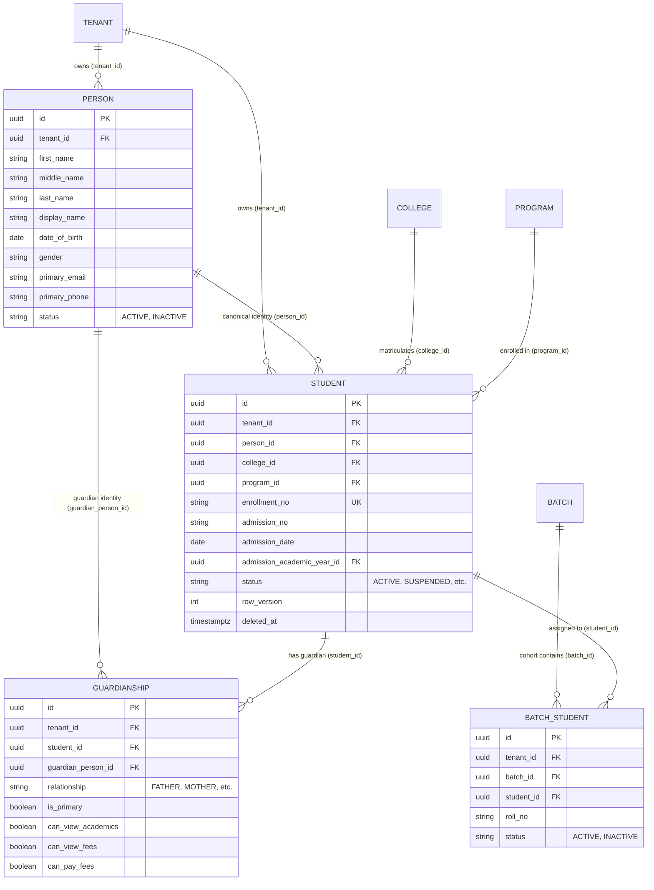
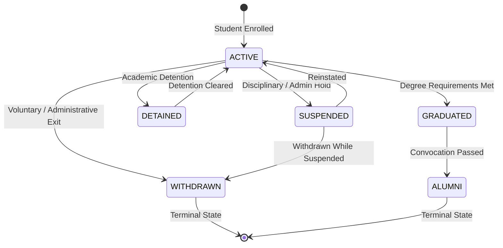

# CampXSync — Wave 4 Phase 2: Student Domain Model & Architecture Proposal

**Repository:** `D:\CampXSync\CampXSync_V2.0`  
**Branch:** `feature/java-backend-integration`  
**Phase:** Wave 4, Phase 2 (Student Domain Model Approval Checkpoint)  
**Governing Documents:** `docs/project-control/WAVE_IMPLEMENTATION_PLAN.md` (Section 5), `docs/reports/wave-4/STUDENT_DATABASE_RLS_AUDIT.md`, `docs/reports/wave-4/G1_SECURITY_REMEDIATION_PROPOSAL.md`  
**Prerequisite Gate G1 Status:** **PASSED** on development target `azulbaxszsqxymqmlwfe` (Role `campx_app_server` active, `FORCE ROW LEVEL SECURITY` verified on Tier 1 tables, least-privilege grants applied, audit append-only enforced).  
**Database Writes Authorized:** **NONE** (Proposal & Decision Gate only).

---

## 1. Executive Summary & Context

This proposal establishes the canonical Student Domain Model, identity linkage graph, lifecycle state transitions, cross-module ownership boundaries, API Gateway routing contracts, and transactional outbox event envelopes before implementing Java persistence in `services/student-service`.

The design is strictly grounded in the verified database schema (`20_tables.sql`, `60_rls.sql`, `75_grants.sql`) and reuses existing Wave 1 shared infrastructure (`campx-logger`), Wave 2-3 service patterns (`UserSecurityContext`, `DatabaseConnectionManager`), and PostgreSQL Row-Level Security rules.

---

## 2. Decision Matrix & Approval Tokens

| Decision Token | Decision Item | Proposed Canonical Specification | Rationale & Catalog Alignment | Approval Status |
|---|---|---|---|---|
| **`APPROVE-STUDENT-MODEL-CORE`** | **Entity Mapping & Linkage** | Composite Aggregate Root: `stu.students` (academic record) + `core.persons` (bio-demographics) + `stu.guardianships` (family relationships). | 1:1 alignment with PostgreSQL foreign key graph `stu.students.person_id -> core.persons.id`. Avoids duplicating person identity or contact details. | **PENDING OWNER APPROVAL** |
| **`APPROVE-STUDENT-IDENTIFIERS`** | **Identifier Hierarchy** | 1. `enrollment_no` (mandatory, institution-scoped roll/registration number, unique per tenant).<br>2. `admission_no` (optional, administrative application reference).<br>3. `roll_no` (cohort-scoped roll number stored in `acd.batch_students`). | Aligned with unique constraint `uq_students_tenant_id_enrollment_no` and academic batch roster structure. | **PENDING OWNER APPROVAL** |
| **`APPROVE-STUDENT-LIFECYCLE`** | **State Machine & Transitions** | Valid states: `ACTIVE`, `SUSPENDED`, `DETAINED`, `WITHDRAWN`, `GRADUATED`, `ALUMNI`.<br>Permitted transitions enforced in Java domain service prior to DB update. | Strictly enforces database check constraint `ck_students_status`. Terminal states (`WITHDRAWN`) prevented from silent reactivation. | **PENDING OWNER APPROVAL** |
| **`APPROVE-STUDENT-OWNERSHIP`** | **Module Ownership Matrix** | `student-service` is the SOLE canonical writer for `stu.students` and `stu.guardianships`. `core.persons` shared-write for student demographics. IAM, Academics, and Exams are read-only references. | Prevents circular writes, duplicate credential tables, and uncoordinated admissions pipelines. | **PENDING OWNER APPROVAL** |
| **`APPROVE-STUDENT-API-CONTRACTS`** | **Gateway API Contracts** | Endpoints: `GET /api/v1/students` (cursor-paginated roster), `GET /api/v1/students/{id}`, `POST /api/v1/students` (enrollment), `PATCH /api/v1/students/{id}/status` (lifecycle), `POST /api/v1/students/{id}/guardians`. | Follows standard gateway HMAC path (`UI -> Gateway:8080 -> Java -> Supabase`). Enables frontend migration. | **PENDING OWNER APPROVAL** |

---

## 3. Domain Model Specifications

### 3.1 Entity Relationship Diagram



### 3.2 Canonical Identifiers Specification
- **`enrollment_no` (Institutional Registration ID):**
  - Scope: Institution-wide unique identifier within tenant (`UNIQUE (tenant_id, enrollment_no) WHERE deleted_at IS NULL`).
  - Immutability: Once issued upon matriculation, `enrollment_no` cannot be modified by routine update.
  - Format: Alphanumeric string (3 to 30 characters), case-insensitive unique.
- **`admission_no` (Administrative Application / Docket Number):**
  - Scope: Scalar reference on `stu.students` referencing external physical admission docket or application file.
  - Nullable: Optional at creation time.
- **`roll_no` (Cohort / Section Roll Number):**
  - Scope: Specific to an academic batch assignment in `acd.batch_students(tenant_id, batch_id, student_id, roll_no)`.
  - Mutability: Can be updated or re-sequenced upon batch migration or term advancement.

### 3.3 Lifecycle State Machine



#### Transition Validation Rules:
1. **`ACTIVE -> SUSPENDED`**: Requires supervisor authorization; revokes portal access while preserving course registrations.
2. **`SUSPENDED -> ACTIVE`**: Requires reinstatement approval; restores active status.
3. **`ACTIVE -> DETAINED`**: Retains student identity; blocks progression to subsequent term batch.
4. **`ACTIVE -> GRADUATED`**: All program credit requirements fulfilled; transitions student to non-enrolled graduate standing.
5. **`GRADUATED -> ALUMNI`**: Automatically links record to institutional alumni directory.
6. **`ACTIVE | SUSPENDED -> WITHDRAWN`**: Soft-deletes active batch memberships; marks student record as terminal. Cannot be transitioned back to `ACTIVE` without formal re-admission audit event.

---

## 4. Cross-Module Ownership & Boundary Matrix

| Domain Module | Authoritative Data Owned | Foreign References Consulted | Prohibited Cross-Writes |
|---|---|---|---|
| **Student Domain** (`student-service`) | `stu.students`<br>`stu.guardianships`<br>`core.persons` (demographic sync) | `core.colleges`<br>`acd.programs`<br>`core.academic_years`<br>`acd.batches` | Cannot alter `acd.programs`, `acd.batches` capacity, or issue authentication tokens. |
| **Academic Domain** (`course-management`, `batch-management`) | `acd.programs`<br>`acd.batches`<br>`acd.batch_students`<br>`acd.section_enrollments` | `stu.students.id` (foreign key anchor) | Cannot modify student bio-demographics or alter student matriculation status. |
| **IAM Domain** (`identity-service`) | `iam.user_profiles`<br>`iam.role_assignments`<br>`auth.users` | `core.persons.id`<br>`stu.students.id` | Student service does NOT create login credentials or store passwords. |
| **Exams Domain** (`examination-service`) | `exm.exam_registrations`<br>`exm.results` | `stu.students.id` | Results are owned solely by Exams tier. |
| **Finance Domain** | Invoices, fee receipts, payment links | `stu.students.id`<br>`stu.guardianships` | Student service does NOT process payments or alter fee balances. |
| **Audit & Outbox** (`campx-logger`) | `audit.events`<br>`audit.change_log`<br>`sys.outbox_events` | Published by `student-service` inside atomic transaction | Student service only writes its own domain event types. |

---

## 5. API Gateway Ingress Contracts (`/api/v1/students`)

All requests flow through the shared versioned API Gateway (`port 8080`) which strips untrusted headers, verifies JWT claims, and injects HMAC-signed `X-User-Id`, `X-Tenant-Id`, `X-User-Role`, and `X-College-Id`.

### 5.1 Endpoints Specification

#### 1. Roster List & Search
- **Route:** `GET /api/v1/students`
- **Query Parameters:**
  - `limit`: Integer (1-100, default 20).
  - `cursor`: Base64 opaque cursor containing `(enrollment_no, id)`.
  - `search`: String (prefix/match on `enrollment_no`, `display_name`, `primary_email`).
  - `programId`: UUID (filter by degree program).
  - `batchId`: UUID (filter by cohort batch).
  - `status`: Enum (`ACTIVE`, `SUSPENDED`, `DETAINED`, `WITHDRAWN`, `GRADUATED`, `ALUMNI`).
- **Response `200 OK`:**
  ```json
  {
    "items": [
      {
        "id": "uuid",
        "enrollmentNo": "CS2026001",
        "admissionNo": "ADM-2026-992",
        "status": "ACTIVE",
        "collegeId": "uuid",
        "programId": "uuid",
        "programName": "B.Tech Computer Science",
        "batchId": "uuid",
        "batchName": "2026-2030 Batch A",
        "rollNo": "101",
        "displayName": "Aarav Sharma",
        "firstName": "Aarav",
        "lastName": "Sharma",
        "primaryEmail": "aarav.sharma@institution.edu",
        "createdAt": "2026-10-21T10:00:00Z"
      }
    ],
    "nextCursor": "ZXlKaGJHY2lPaUpTVXp...",
    "hasMore": true,
    "totalCount": 150
  }
  ```

#### 2. Student Profile Detail
- **Route:** `GET /api/v1/students/{id}`
- **Response `200 OK`:** Full student aggregate, including person bio-demographics, active batch enrollment, and guardianship array.

#### 3. Single Student Enrollment
- **Route:** `POST /api/v1/students`
- **Payload:**
  ```json
  {
    "firstName": "Priya",
    "middleName": "K",
    "lastName": "Patel",
    "displayName": "Priya Patel",
    "primaryEmail": "priya.patel@institution.edu",
    "primaryPhone": "+919876543210",
    "gender": "F",
    "dateOfBirth": "2006-05-15",
    "enrollmentNo": "CS2026045",
    "admissionNo": "ADM-2026-1045",
    "admissionDate": "2026-08-01",
    "programId": "3fa85f64-5717-4562-b3fc-2c963f66afa6",
    "batchId": "4ba85f64-5717-4562-b3fc-2c963f66afa7",
    "rollNo": "145",
    "guardian": {
      "firstName": "Rajesh",
      "lastName": "Patel",
      "relationship": "FATHER",
      "primaryPhone": "+919876543211",
      "primaryEmail": "rajesh.patel@example.com",
      "isPrimary": true
    }
  }
  ```
- **Transaction Guarantee:** Atomic single-transaction insertion of `core.persons` (student), `core.persons` (guardian if provided), `stu.students`, `stu.guardianships`, `acd.batch_students` (if batch provided), and `sys.outbox_events` (`student.enrolled.v1`).

#### 4. Lifecycle State Transition
- **Route:** `PATCH /api/v1/students/{id}/status`
- **Payload:** `{"status": "SUSPENDED", "reason": "Academic probation review"}`
- **Response `200 OK`:** Updated student record with outbox event `student.status_changed.v1`.

---

## 6. Intelligence Layer & Outbox Event Registration

All student mutations emit transaction-scoped events using the Wave 1 standard outbox envelope (`com.campx.platform.outbox.OutboxEvent`):

| Event Type | Schema Version | Domain Owner | Privacy Classification | Trigger Condition |
|---|---|---|---|---|
| `student.enrolled.v1` | `1.0.0` | `student-service` | `PII_CONFIDENTIAL` | New student record inserted and batch assigned |
| `student.status_changed.v1` | `1.0.0` | `student-service` | `INTERNAL` | Lifecycle status transition (`ACTIVE -> SUSPENDED`, etc.) |
| `student.batch_assigned.v1` | `1.0.0` | `student-service` | `INTERNAL` | Student assigned to or transferred between cohorts |
| `student.withdrawn.v1` | `1.0.0` | `student-service` | `PII_CONFIDENTIAL` | Student withdrawal finalized |

### Standard Envelope Structure:
```json
{
  "eventId": "uuid",
  "eventType": "student.enrolled.v1",
  "schemaVersion": "1.0.0",
  "tenantId": "uuid",
  "collegeId": "uuid",
  "occurredAt": "2026-10-21T16:50:00Z",
  "correlationId": "uuid",
  "causationId": "uuid",
  "idempotencyKey": "tenantId:enrollmentNo:CS2026045",
  "data": {
    "studentId": "uuid",
    "personId": "uuid",
    "enrollmentNo": "CS2026045",
    "programId": "uuid",
    "batchId": "uuid",
    "status": "ACTIVE"
  }
}
```

---

## 7. Frontend Roster Migration Plan

| Phase | Current State | Target State | Cutover Action |
|---|---|---|---|
| **Phase A (Current)** | `frontend/src/app/api/college/students/route.ts` runs direct SQL queries via `lib/db.ts` using superuser `postgres`. | No changes until Java Gateway endpoints are running and validated. | Prevent regressions on active frontend roster UI (`student-roster.tsx`). |
| **Phase B (Cutover)** | Direct SQL in Next.js API route. | Next.js API route delegates to `http://localhost:8080/api/v1/students` with signed gateway headers. | Migrate `GET`, `POST`, `DELETE` away from `lib/db.ts`. Verify read-back and error mapping. |
| **Phase C (Retirement)** | Direct database access for student roster completely removed. | Frontend UI consumes gateway-backed Next.js route exclusively. | Verify zero SQL statements executed in `frontend/src/app/api/college/students/`. |

---

## 8. Summary of Approval Gates Required to Proceed

To proceed to Wave 4 Phase 3 (Java backend implementation and unit testing in `services/student-service`), the following written approvals are required:

1. **`APPROVE-STUDENT-MODEL-CORE`**: Approve composite aggregate mapping (`stu.students` + `core.persons` + `stu.guardianships`).
2. **`APPROVE-STUDENT-IDENTIFIERS`**: Approve identifier hierarchy (`enrollment_no` institutional roll vs. `roll_no` batch roll).
3. **`APPROVE-STUDENT-LIFECYCLE`**: Approve state machine (`ACTIVE`, `SUSPENDED`, `DETAINED`, `WITHDRAWN`, `GRADUATED`, `ALUMNI`).
4. **`APPROVE-STUDENT-OWNERSHIP`**: Approve cross-module boundary matrix (`student-service` sole canonical writer).
5. **`APPROVE-STUDENT-API-CONTRACTS`**: Approve API Gateway surface (`/api/v1/students`).

*(Note: Owner can approve all simultaneously via: `APPROVE-WAVE4-STUDENT-MODEL-ALL`)*
