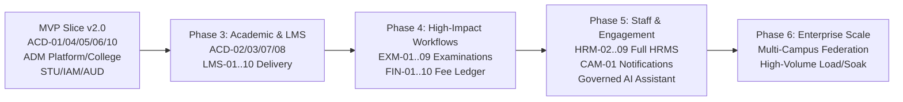

# CampXSync — Post-Trial Product Backlog & Engineering Roadmap

**Document**: `docs/trial/POST_TRIAL_BACKLOG.md`  
**Governance Baseline**: `docs/reference/product_lifecycle.md` Section 20  
**Target Environment**: Supabase PostgreSQL & Next.js Enterprise Frontend  

---

## 1. Roadmap Sequencing Overview

In accordance with `docs/reference/product_lifecycle.md` Section 20, product capabilities following the MVP trial are sequenced by business criticality, dependency order, and risk profile:

---

## 2. Phase 3: Academic Expansion & LMS Operations

### Academic Management (ACD)
| Backlog ID | Module | Feature Title & User Journey | Priority | Target Schema | Prerequisites & Governance |
| :--- | :--- | :--- | :---: | :--- | :--- |
| **BL-ACD-01** | ACD-02 | **Curriculum Structure & Syllabus Versioning**: Department heads define semester course structures, credit schemes, prerequisite chains, and publish versioned syllabus PDFs. | P1 | `acd.curricula`, `acd.curriculum_courses` | Requires immutable version snapshot upon publication. |
| **BL-ACD-02** | ACD-07 | **Institutional Calendar & Working Day Rules**: College Admin configures academic terms, instructional working days, statutory holidays, and examination breaks. | P1 | `acd.academic_calendars`, `acd.calendar_events` | Feeds scheduling and timetable conflict checks. |
| **BL-ACD-03** | ACD-08 / LMS-07 | **Consolidated Learning Resource Library**: Faculty upload lecture slides, lab manuals, and syllabus reading materials bound to subjects with virus-scanning and pre-signed URLs. | P2 | `lms.resources` | Consolidates ACD-08 and LMS-07 per DEC-02. |
| **BL-ACD-04** | ACD-09 | **Continuous Assessment Component Mapping**: Faculty map internal assessment components (quizzes, midterms, lab practicals) to course learning outcomes. | P2 | `acd.assessment_components` | Bridge between academic courses and examination marks. |

### Learning Management System (LMS)
| Backlog ID | Module | Feature Title & User Journey | Priority | Target Schema | Prerequisites & Governance |
| :--- | :--- | :--- | :---: | :--- | :--- |
| **BL-LMS-01** | LMS-01 | **Delivery Course Provisioning**: Automated provisioning of LMS course shells mapped to timetable sections, inheriting faculty and student roster bindings. | P1 | `lms.courses`, `lms.course_enrollments` | Uses canonical spec `LMS-01-v2.0.docx` per DEC-09. |
| **BL-LMS-02** | LMS-02 | **Hierarchical Course Content Builder**: Faculty structure course modules, lecture notes, video embeds, and rich-text reading material with conditional release rules. | P2 | `lms.modules`, `lms.content_items` | Content isolated strictly by tenant boundary. |
| **BL-LMS-03** | LMS-04 | **Lesson Planning & Completion Milestones**: Faculty maintain weekly lesson delivery logs against syllabus targets with departmental progress tracking. | P2 | `lms.lesson_plans`, `lms.lesson_logs` | Provides institutional syllabus coverage visibility. |
| **BL-LMS-04** | LMS-05 | **Student Assignment Lifecycle**: Faculty publish assignments with rubrics and deadlines; students upload submissions; faculty grade with inline annotations. | P1 | `lms.assignments`, `lms.submissions` | File upload storage policy and deadline enforcement. |
| **BL-LMS-05** | LMS-08 | **Learner Progress & Completion Tracking**: Real-time student learning velocity metrics, module completion percentages, and automated academic intervention alerts. | P2 | `lms.learner_progress` | Event-driven updates via PostgreSQL outbox. |
| **BL-LMS-06** | LMS-10 | **Outcome-Based Education (OBE) Attainment Engine**: Calculation of Course Outcome (CO) and Program Outcome (PO) direct and indirect attainment for NAAC/NBA accreditation. | P1 | `lms.obe_outcomes`, `lms.attainment_calculations` | Critical statutory accreditation requirement for Indian engineering/higher ed institutes. |

---

## 3. Phase 4: High-Impact Examination & Finance Workflows

### Examination Management (EXM)
| Backlog ID | Module | Feature Title & User Journey | Priority | Target Schema | Prerequisites & Governance |
| :--- | :--- | :--- | :---: | :--- | :--- |
| **BL-EXM-01** | EXM-01 | **Exam Registration & Statutory Eligibility Engine**: Automatic verification of semester fees clearance (FIN) and statutory 75% attendance threshold (ACD-10) before permitting exam enrollment. | P1 | `exm.registrations`, `exm.eligibility_rules` | Consumes ACD-10 statutory shortage flag. |
| **BL-EXM-02** | EXM-02 | **Conflict-Free Exam Scheduling & Seating Planner**: Controller of Examinations schedules exam timetables, allocates exam halls, and generates student seating matrices without student or room overlap. | P1 | `exm.schedules`, `exm.hall_allocations` | Hard room capacity and student gap constraints. |
| **BL-EXM-03** | EXM-03 | **Cryptographically Signed Admit Cards (Hall Tickets)**: Batch generation of downloadable PDF hall tickets with QR code identity validation and security watermarks. | P1 | `exm.hall_tickets` | QR code verifies authenticity on exam hall check-in. |
| **BL-EXM-04** | EXM-04 / 05 | **Blind Answer Script Valuation & Maker-Checker Marks Approval**: Anonymous marks entry with dummy barcode mapping; dual-signoff maker-checker workflow before finalization. | P1 | `exm.script_evaluations`, `exm.marks_ledger` | Strict segregation of duties: evaluators cannot approve their own ledger entries. |
| **BL-EXM-05** | EXM-08 | **Result Processing & Publication Engine**: Computation of SGPA, CGPA, grade point conversions, and official gazette publication with student grade card release. | P1 | `exm.results`, `exm.grade_cards` | Immutable publication snapshot; corrections require formal syndicate approval. |

### Finance & Accounts (FIN)
| Backlog ID | Module | Feature Title & User Journey | Priority | Target Schema | Prerequisites & Governance |
| :--- | :--- | :--- | :---: | :--- | :--- |
| **BL-FIN-01** | FIN-01 | **Institutional Fee Structure Configuration**: Tuition, laboratory, examination, and hostel fee rule matrices configured per degree program, academic year, and admission quota. | P1 | `fin.fee_structures`, `fin.fee_components` | Supports installment schedules and late fee penalties. |
| **BL-FIN-02** | FIN-02 | **Payment Gateway Integration & Automated Reconciliation**: Students pay fees online via payment aggregators (Razorpay / BillDesk / Cashfree); webhook callbacks verify idempotency and settlement. | P1 | `fin.payments`, `fin.reconciliations` | Never trust client callback without backend signature verification (DEC-01). |
| **BL-FIN-03** | FIN-05 | **Audited Fee Receipt Numbering & PDF Generation**: Instant generation of sequential, immutable institutional receipts with GST breakdown and signature stamp. | P1 | `fin.receipts` | Gapless receipt numbering per financial compliance laws. |
| **BL-FIN-04** | FIN-06 | **Scholarship & Financial Aid Administration**: Application, verification, and disbursement of government (NSP/State) and institutional merit/means concessions against outstanding fee balances. | P2 | `fin.scholarships`, `fin.disbursements` | Maker-checker approval required for concessions. |

---

## 4. Phase 5: HRMS, Communication & Governed AI

### Human Resource Management (HRM)
| Backlog ID | Module | Feature Title & User Journey | Priority | Target Schema | Prerequisites & Governance |
| :--- | :--- | :--- | :---: | :--- | :--- |
| **BL-HRM-01** | HRM-02 | **Faculty Leave Management & Substitute Delegation**: Faculty apply for Casual/Earned/Duty leaves; HODs approve; timetable system prompts for lecture substitute assignment. | P2 | `hrm.leave_applications`, `hrm.leave_balances` | Integrates with ACD-05 timetable reassignment. |
| **BL-HRM-02** | HRM-05 | **Authoritative Payroll Processing**: Salary calculation based on attendance, statutory deductions (PF, ESI, TDS), allowance structures, and direct bank disbursement export. | P1 | `hrm.payroll_cycles`, `hrm.payslips` | Authoritative owner of salary computation per DEC-05. |
| **BL-HRM-03** | HRM-06 / 07 | **Recruitment Pipeline & Staff Onboarding**: Faculty vacancy publication, applicant screening, interview scorecards, and onboarding document verification. | P2 | `hrm.job_openings`, `hrm.applicants` | Numbering and scope split ratified under DEC-06. |

### Communication & Announcements (CAM)
| Backlog ID | Module | Feature Title & User Journey | Priority | Target Schema | Prerequisites & Governance |
| :--- | :--- | :--- | :---: | :--- | :--- |
| **BL-CAM-01** | CAM-01 | **Campus Announcement Broadcast Engine**: Administrators broadcast circulars targeted by department, batch, or role with priority flags (Urgent / Info) and push notifications. | P1 | `cam.announcements`, `cam.announcement_audiences` | Resolves archive empty directory gap per DEC-07. |
| **BL-CAM-02** | CAM-02 | **Automated SMS & WhatsApp Academic Notifications**: Critical alerts (attendance shortage warnings, exam schedules, emergency closures) dispatched via SMS and WhatsApp gateways. | P2 | `cam.notifications`, `cam.notification_deliveries` | Rate-limited and logged with provider message IDs. |

### Governed AI Assistance
| Backlog ID | Module | Feature Title & User Journey | Priority | Target Schema | Prerequisites & Governance |
| :--- | :--- | :--- | :---: | :--- | :--- |
| **BL-AI-01** | AI-Core | **Academic Policy Assistant & Syllabus Query**: RAG-based natural language Q&A for faculty and students over institutional bylaws, academic regulations, and course syllabi. | P2 | `ai.query_audit_log` | Strict tenant isolation; zero cross-tenant retrieval (DEC-08). |
| **BL-AI-02** | AI-Audit | **Predictive Attendance Shortage & At-Risk Early Warning**: Machine learning identification of attendance deterioration patterns, alerting faculty advisors before statutory cutoff. | P2 | `acd.v_at_risk_students` | Advisory only; human advisors retain accountable authority per Principle 1. |

---

## 5. Phase 6: Institutional Scale & Multi-Campus Federation

| Backlog ID | Feature Title & User Journey | Target Milestone | Governance & Risk Control |
| :--- | :--- | :---: | :--- |
| **BL-FED-01** | **Multi-Campus University Federation**: Support for parent universities governing 50+ affiliated autonomous colleges with shared academic curricula and federated examinations. | Phase 6 | Multi-tier tenant hierarchy (`university -> campus -> college`). |
| **BL-OPS-01** | **High-Throughput Load & Disaster Recovery Drills**: Automated simulation of 25,000 concurrent attendance marks at 9:00 AM IST; verification of recovery-point objective (RPO < 5 min). | Phase 6 | Performance testing against staging read-replicas. |
