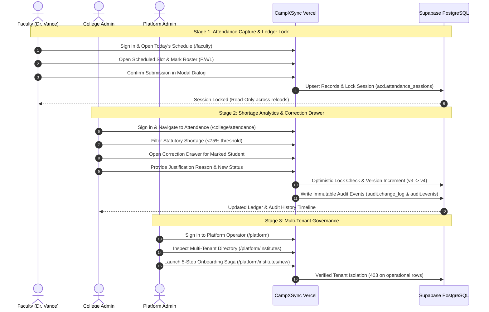

# CampXSync — Trial Guide & Evaluator Manual (MVP v2.0)

**Document**: `docs/trial/TRIAL_GUIDE.md`  
**Target Environment**: Supabase Staging (`kpwdvvcschankgggitnj`)  
**Deployment**: Vercel Serverless (Next.js 15)  
**Live Alias URL**: [https://frontend-murex-one-58.vercel.app](https://frontend-murex-one-58.vercel.app)  
**Preview Deployment URL**: [https://frontend-n34dbtn83-camp-xs-ync.vercel.app](https://frontend-n34dbtn83-camp-xs-ync.vercel.app)  

---

## 1. What CampXSync Is (in 3 Lines)

1. **CampXSync** is a multi-tenant enterprise operating system for higher education institutions, unifying academic governance, scheduling, attendance, and administrative oversight under strict PostgreSQL Row-Level Security (RLS).
2. It replaces fragmented legacy spreadsheets and unverified attendance records with **timetable-validated attendance sessions**, real-time student roster validation, and an immutable, optimistic-concurrency audit trail for all corrections.
3. Designed with enterprise-grade Section 5 ergonomics, it delivers WCAG AA accessible, role-isolated workspaces for **Platform Administrators**, **College Administrators**, and **Faculty Members**.

---

## 2. Live URLs & Access

- **Primary Live Alias URL**: [https://frontend-murex-one-58.vercel.app](https://frontend-murex-one-58.vercel.app)
- **Vercel Preview URL**: [https://frontend-n34dbtn83-camp-xs-ync.vercel.app](https://frontend-n34dbtn83-camp-xs-ync.vercel.app)
- **Login Route**: [https://frontend-murex-one-58.vercel.app/login](https://frontend-murex-one-58.vercel.app/login)

All endpoints connect directly to the hosted Supabase Staging PostgreSQL database (`kpwdvvcschankgggitnj`). All operations run under strict tenant isolation.

---

## 3. Demo Accounts & Role Quick-Switching

The trial deployment supports two authentication modes on the login screen:
1. **Direct Supabase Auth Password Login**: Authenticates via Supabase Auth identity service with HTTP-only cookie session persistence.
2. **One-Click Trial Role Switcher**: Enables rapid role-based workflow inspection without password re-entry.

| Role | Demo Identity / Login | Tenant Context | Access Scope & Permissions |
| :--- | :--- | :--- | :--- |
| **College Administrator** | `campxsync@gmail.com`<br>*(or 1-click button)* | College A (`DIT`)<br>`11111111-1111-1111-1111-111111111111` | Department & Program master, Faculty roster, Student enrollment, Timetable scheduling, Cumulative attendance analytics (<75% shortage), Audited attendance correction drawer. |
| **Platform Administrator** | `operator@campxsync.com`<br>*(or 1-click button)* | Multi-Tenant Platform Operator<br>`tenant_id IS NULL` | Cross-tenant metrics, Institute registry & status breakdown, 5-step tenant onboarding saga, Platform security audit trail. Strict zero-read access to student/faculty operational rows. |
| **Faculty Member** | `faculty.dit@campxsync.com`<br>*(Dr. Robert Vance)* | College A (`DIT`)<br>`11111111-1111-1111-1111-111111111111` | Today's teaching schedule, Roster attendance capture, P/A/L status toggle, Modal ledger submission, Read-only session lock verification, My Sessions archive. |
| **Student** *(Stretch/Read-Only)* | `student.dit@campxsync.com`<br>*(Aarav Sharma)* | College A (`DIT`)<br>`11111111-1111-1111-1111-111111111111` | Read-only personal attendance summary and statutory compliance badge. |

---

## 4. Step-by-Step Trial Walkthrough

Follow this sequence to evaluate the end-to-end institutional workflow:



### Flow 1: Faculty Attendance Capture (ACD-06)
1. **Navigate to Login**: Go to [https://frontend-murex-one-58.vercel.app/login](https://frontend-murex-one-58.vercel.app/login).
2. **Switch Role**: Click **"Faculty (Dr. Robert Vance)"**.
3. **Workspace Overview (`/faculty`)**:
   - Inspect today's teaching slots (e.g., `CS301 - Data Structures & Algorithms`, Batch `2024-CSE-A`).
   - Notice the status cues: `SCHEDULED`, `COMPLETED`, or `MISSED`.
4. **Open Attendance Roster (`/faculty/attendance`)**:
   - Click **"Take Attendance"** on an active slot.
   - The student roster for that section loads with 48px touch rows.
5. **Mark Student Attendance**:
   - Click status pills (`P` = Present, `A` = Absent, `L` = Leave) or use keyboard shortcuts (`P`, `A`, `L`, Arrow keys).
   - Observe the sticky footer summary bar updating live: e.g., `38 Present · 2 Absent · 0 Leave · 0 Unmarked`.
6. **Submit to Official Ledger**:
   - Click **"Submit Attendance"**.
   - Review the confirmation modal explaining that submission commits to the institutional ledger and locks further faculty edits.
   - Click **"Confirm & Submit to Ledger"**.
   - **Expected Result**: Success toast appears; page transitions to read-only locked state. Reload the page to verify that the lock persists permanently.

### Flow 2: College Admin Shortage Analytics & Audited Corrections (ACD-10 & ACD-06)
1. **Switch Role**: Return to `/login` or use topbar user menu to sign in as **"College Administrator"**.
2. **Institutional Dashboard (`/college`)**:
   - Review live KPI cards: Total Students (49), Active Faculty (12), Overall Attendance (95.1%), Active Batches (6).
   - Verify Recharts 14-day attendance trend line and batch distribution bars.
3. **Shortage Analytics & Roster Inspection (`/college/attendance`)**:
   - Navigate to `/college/attendance`.
   - Click the **"Shortage Alert (<75%)"** filter pill.
   - Observe students whose statutory attendance is below 75% highlighted with danger badges.
4. **Execute Audited Attendance Correction**:
   - Locate an attendance record and click **"Correct Attendance"**.
   - The slide-out Correction Drawer opens, displaying student details, current status, and version (`v3`).
   - Select new status (e.g., change `ABSENT` to `ON_DUTY` or `PRESENT`).
   - Enter mandatory justification (minimum 5 characters, e.g., *"Medical certificate submitted to HOD on 16 Oct 2026"*).
   - Click **"Save Correction"**.
   - **Expected Result**: Optimistic concurrency validates `expectedVersion = 3`, updates record, increments version to `v4`, writes immutable change records to `audit.change_log` and `audit.events`, and reflects immediately in the UI.

### Flow 3: Platform Admin Tenant Governance & Onboarding Saga (ADM-01)
1. **Switch Role**: Sign in as **"Platform Administrator"**.
2. **Platform Operator Dashboard (`/platform`)**:
   - Inspect multi-tenant macro metrics: Total Tenancies, Active Colleges, System Roles (30), Catalog Mappings (2,138).
   - Note the security isolation: zero student personal rows or faculty payroll data are accessible to the platform tier.
3. **Tenant Registry (`/platform/institutes`)**:
   - Filter by status tabs: `All`, `Active`, `Onboarding`, `Suspended`.
   - Test instant search by code or name.
4. **Onboarding Saga Wizard (`/platform/institutes/new`)**:
   - Step 1: Institute Identity (Name, Code, Subdomain, Plan).
   - Step 2: Primary College (College Name, Campus Code).
   - Step 3: Initial Administrator (Name, Email, Phone).
   - Step 4: Pre-flight Review.
   - Step 5: Saga Execution View with 5 milestone steps (Create Tenant, Seed System Roles, Seed Role-Permissions, Provision Admin, Log Audit Event).
   - *Note*: Unapproved writes safely execute in dry-run simulation mode unless the exact owner safety phrase (`GO PROVISION-TENANT`) is transmitted in the staging request header.

### Flow 4: Workspace Preferences (User Profile Settings)
1. In the top-right header of any role view, click the **Gear (Settings)** icon.
2. The Preferences Modal opens with accessible keyboard navigation:
   - **Theme**: Light, Dark, or System.
   - **Table Density**: Comfortable (standard) or Compact (high data density).
   - **Default Date Range**: Today, Last 7 Days, Last 30 Days, or Semester to Date.
   - **Accessibility Options**: High Contrast Mode and Reduce Motion.
3. Click **"Save Preferences"**.
4. **Expected Result**: Preferences persist directly to the PostgreSQL database in `iam.user_profiles.preferences` for the authenticated user and survive full browser reloads and device changes.

---

## 5. What to Ignore During the Trial

To ensure evaluation focuses strictly on the MVP scope, please note the following:
- **Out-of-Scope Navigation Placeholders**: Secondary modules such as Examinations (`EXM`), Financial Accounting (`FIN`), and Advanced LMS (`LMS`) are marked as *"Specified, not in MVP slice"* in architecture traceability. Do not expect active forms for fee payment gateways or hall ticket barcodes in this slice.
- **Java Microservices on `localhost:8080`**: The Vercel deployment operates serverlessly via Next.js Edge Middleware and Route Handlers directly interfacing with Supabase Staging PostgreSQL. The local Java microservice suite is not used in the cloud deployment.
- **Dry-Run Onboarding Simulation**: Onboarding new tenants through the UI runs in dry-run simulation mode by default to protect the shared staging database from test clutter, unless explicitly authorized.

---

## 6. How to Report a Defect

If you encounter unexpected behavior, visual inconsistencies, or edge-case validation issues:
1. Open the defect tracking template: [`docs/trial/DEFECT_LOG.csv`](file:///d:/CampXSync/CampXSync_V2.0/docs/trial/DEFECT_LOG.csv).
2. Record a new row with the following schema:
   ```csv
   ID,Date,Reporter,Role Used,Page/URL,Steps To Reproduce,Expected,Actual,Severity,Screenshot Link,Status,Owner,Notes
   ```
3. Assign an appropriate severity level:
   - **Blocker**: Prevents completing attendance submission, role login, or data loading.
   - **Major**: Functional issue with a workaround (e.g., filter reset required).
   - **Minor**: Cosmetic or formatting discrepancy that does not impede workflow.
   - **Cosmetic**: Alignment, typography, or spacing imperfection.
4. Save the entry and alert the engineering team.
