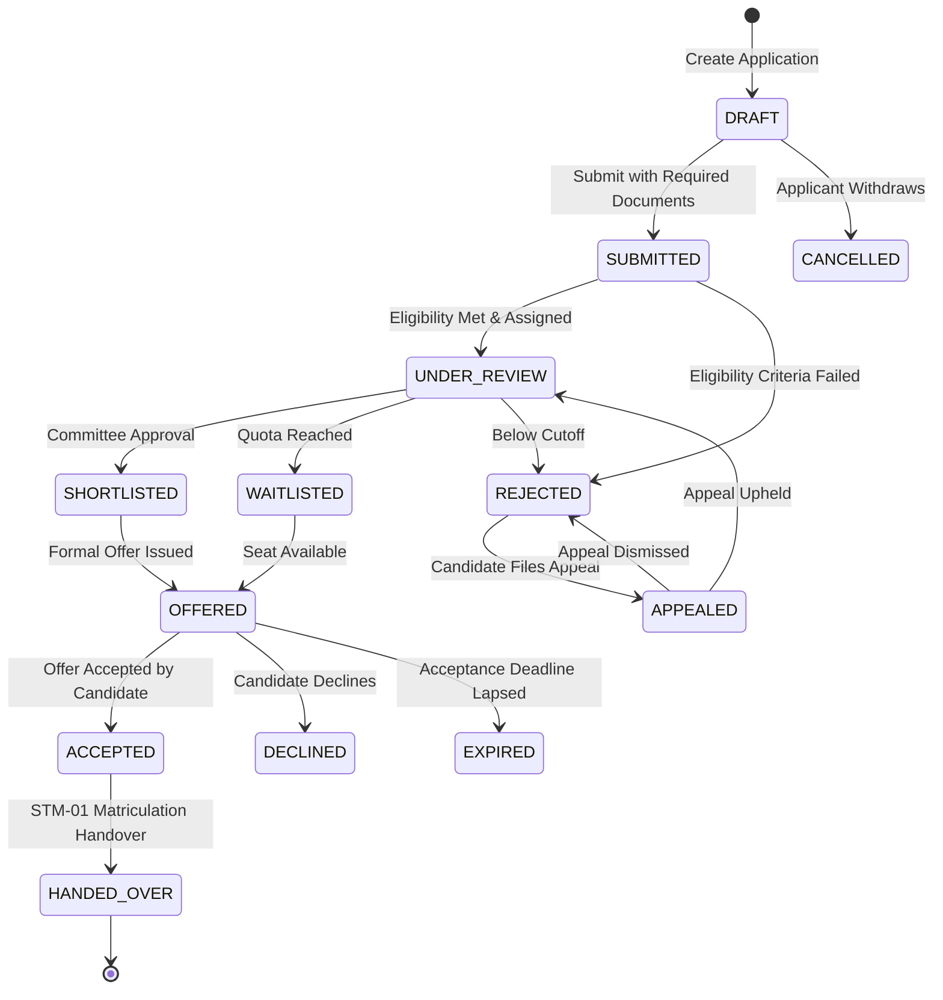

# CampXSync Admissions Domain Service (STM-02)

## 1. Executive Summary

The **Admissions Domain Service (STM-02)** is the authoritative domain service responsible for the end-to-end applicant lifecycle across the CampXSync College ERP platform. Operating on dedicated microservice port **`8094`**, it orchestrates applicant registration, multi-program application submission, dynamic criteria eligibility scoring, document verification, multi-stage committee review, merit-list generation, offer lifecycle management, waitlist and appeal workflows, and seamless matriculation handover to **STM-01 (Student Master)** and **STM-03 (Enrollment Preparation)**.

Admissions operations strictly follow the CampXSync enterprise architectural invariants:
- **Zero Heavy Framework Footprint**: Built with pure Java 8 standard library HTTP server (`com.sun.net.httpserver.HttpServer`), avoiding runtime bloat and framework lock-in.
- **Fail-Closed Multi-Tenancy**: All persistent entities, database queries, and cache lookups are keyed by `tenant_id` and enforced via PostgreSQL Row-Level Security (RLS).
- **HMAC Gateway Security**: Downstream service calls from the CampXSync API Gateway are authenticated and authorized via signed HMAC headers (`X-CampX-Signature`, `X-CampX-Timestamp`, `X-Tenant-ID`, `X-User-ID`, `X-User-Role`).
- **Segregation of Duties (SoD)**: Enforces structural compliance (e.g. an admissions reviewer cannot approve their own review, applicants cannot access internal committee notes).
- **RFC 7807 Problem Details**: Centralized, standardized error responses with correlation IDs and sanitized messages.
- **Data Minimization & PII Masking**: Zero exposure of unredacted credentials, emails, or phone numbers in telemetry and application logs.

---

## 2. Core Architectural Principles

1. **Authoritative Domain Master**: Serves as the single source of truth for intakes, applications, applicant profiles, reviews, decisions, waitlists, and appeals.
2. **Deterministic Lifecycle State Machine**: Governed by `AdmissionsStateEngine`. Every state transition (`DRAFT` &rarr; `SUBMITTED` &rarr; `UNDER_REVIEW` &rarr; `OFFERED` &rarr; `ACCEPTED` &rarr; `HANDED_OVER`) is validated against strict prerequisite checks and actor permissions.
3. **Automated Eligibility Engine**: `EligibilityEvaluationEngine` executes rule-based evaluations against academic prerequisites, minimum GPA/percentage, standardized test percentiles, and category quotas.
4. **Segregation of Duties (SoD)**: Reviewers, admissions officers, and registrars have distinct operational scopes. Multi-tier evaluation prevents unilateral admissions decisions.
5. **Transactional Outbox for Event Propagation**: Inter-domain events (`ApplicationSubmitted`, `OfferAccepted`, `StudentHandoverInitiated`, `StudentMatriculated`) are persisted atomically within the transactional boundary to guarantee at-least-once delivery without distributed two-phase commits.
6. **Zero Live Database Risk**: All schema definitions and migrations are packaged in versioned SQL scripts (`database/migrations/20261101000100_create_stu_admissions_tables.sql`) with paired idempotent rollback scripts.

---

## 3. Microservice Ingress & Gateway Routes

All traffic enters via the **CampXSync API Gateway** and is routed to `admissions-service` (port `8094`):

| HTTP Method | API Gateway Route | Internal Service Route | Description | Authorized Roles |
|---|---|---|---|---|
| `POST` | `/api/v1/admissions/intakes` | `/api/v1/admissions/intakes` | Create admission intake period | `ADMISSIONS_OFFICER`, `REGISTRAR`, `SUPER_ADMIN` |
| `GET` | `/api/v1/admissions/intakes` | `/api/v1/admissions/intakes` | List active/archived intakes | `ALL` (Authenticated) |
| `POST` | `/api/v1/admissions/programs` | `/api/v1/admissions/programs` | Configure admission program offering | `ADMISSIONS_OFFICER`, `SUPER_ADMIN` |
| `GET` | `/api/v1/admissions/programs` | `/api/v1/admissions/programs` | List program offerings with criteria | `ALL` (Authenticated) |
| `POST` | `/api/v1/admissions/applications` | `/api/v1/admissions/applications` | Create draft application | `APPLICANT`, `ADMISSIONS_OFFICER` |
| `GET` | `/api/v1/admissions/applications` | `/api/v1/admissions/applications` | Search applications with filters | `ADMISSIONS_OFFICER`, `REVIEWER`, `COMMITTEE` |
| `GET` | `/api/v1/admissions/applications/{id}` | `/api/v1/admissions/applications/{id}` | Get application detail | `APPLICANT` (Own), Staff |
| `PUT` | `/api/v1/admissions/applications/{id}` | `/api/v1/admissions/applications/{id}` | Update draft application | `APPLICANT` (Own), `ADMISSIONS_OFFICER` |
| `POST` | `/api/v1/admissions/applications/{id}/submit` | `/api/v1/admissions/applications/{id}/submit` | Submit completed application | `APPLICANT` (Own), `ADMISSIONS_OFFICER` |
| `POST` | `/api/v1/admissions/applications/{id}/evaluate` | `/api/v1/admissions/applications/{id}/evaluate` | Trigger rule eligibility evaluation | `ADMISSIONS_OFFICER`, `SYSTEM` |
| `POST` | `/api/v1/admissions/applications/{id}/documents` | `/api/v1/admissions/applications/{id}/documents` | Upload/attach verification document | `APPLICANT` (Own), `ADMISSIONS_OFFICER` |
| `PUT` | `/api/v1/admissions/applications/{id}/documents/{docId}/verify` | `/api/v1/admissions/applications/{id}/documents/{docId}/verify` | Verify or reject document | `ADMISSIONS_OFFICER`, `REVIEWER` |
| `POST` | `/api/v1/admissions/applications/{id}/reviews` | `/api/v1/admissions/applications/{id}/reviews` | Submit reviewer evaluation & score | `REVIEWER`, `ADMISSIONS_COMMITTEE` |
| `POST` | `/api/v1/admissions/applications/{id}/decisions` | `/api/v1/admissions/applications/{id}/decisions` | Record admission decision (Offer/Reject) | `ADMISSIONS_COMMITTEE`, `REGISTRAR` |
| `POST` | `/api/v1/admissions/applications/{id}/offers/accept` | `/api/v1/admissions/applications/{id}/offers/accept` | Accept formal admission offer | `APPLICANT` (Own) |
| `POST` | `/api/v1/admissions/applications/{id}/offers/decline` | `/api/v1/admissions/applications/{id}/offers/decline` | Decline admission offer | `APPLICANT` (Own) |
| `POST` | `/api/v1/admissions/applications/{id}/waitlist` | `/api/v1/admissions/applications/{id}/waitlist` | Move application to waitlist pool | `ADMISSIONS_COMMITTEE`, `REGISTRAR` |
| `POST` | `/api/v1/admissions/applications/{id}/appeals` | `/api/v1/admissions/applications/{id}/appeals` | File rejection appeal | `APPLICANT` (Own) |
| `PUT` | `/api/v1/admissions/applications/{id}/appeals/{appealId}` | `/api/v1/admissions/applications/{id}/appeals/{appealId}` | Adjudicate admission appeal | `REGISTRAR`, `SUPER_ADMIN` |
| `POST` | `/api/v1/admissions/applications/{id}/handover` | `/api/v1/admissions/applications/{id}/handover` | Orchestrate STM-01 / STM-03 handover | `REGISTRAR`, `SYSTEM` |
| `GET` | `/api/v1/admissions/reports/funnel` | `/api/v1/admissions/reports/funnel` | Aggregate admission conversion funnel | `ADMISSIONS_OFFICER`, `REGISTRAR`, `AUDITOR` |
| `POST` | `/api/v1/admissions/exports` | `/api/v1/admissions/exports` | Export applicant dataset (CSV/XLSX) | `ADMISSIONS_OFFICER`, `REGISTRAR` |
| `GET` | `/actuator/health` | `/actuator/health` | Service liveness and readiness probe | `ALL` (Internal / Gateway) |
| `GET` | `/metrics` | `/metrics` | Operational performance metrics | `AUDITOR`, `SUPER_ADMIN`, Monitoring |

---

## 4. Exception Handling Architecture (RFC 7807)

The admissions service implements the **RFC 7807 Problem Details for HTTP APIs** standard for all error responses, ensuring structured and unambiguous machine-readable diagnostic details.

### Standard Response Format
```json
{
  "type": "https://api.campx.edu/errors/ADMISSIONS-4001",
  "title": "Validation Failed",
  "status": 400,
  "detail": "Application submission failed: mandatory High School Marksheet is missing or unverified.",
  "instance": "/api/v1/admissions/applications/c397b081-4182-4f72-b2b5-7fbc873cddde/submit",
  "correlationId": "corr-2ef764aa-9b47-46f8-a749-f38c7052b78c",
  "errorCode": "ADMISSIONS-4001",
  "invalidParams": [
    {
      "name": "highSchoolMarksheet",
      "reason": "Document must be uploaded and status must be VERIFIED prior to submission."
    }
  ]
}
```

### Exception Hierarchy & Error Code Taxonomy

| Java Exception Class | HTTP Status | Error Code | Description |
|---|---|---|---|
| `AdmissionsValidationException` | `400 Bad Request` | `ADMISSIONS-4001` | Missing mandatory fields, syntax errors, or domain validation rule failure. |
| `AdmissionsUnauthorizedException` | `401 Unauthorized` | `ADMISSIONS-4010` | Missing or invalid Gateway HMAC signature or missing caller credentials. |
| `AdmissionsSecurityViolationException` | `403 Forbidden` | `ADMISSIONS-4030` | Tenant isolation violation, cross-tenant access attempt, or SoD rule breach. |
| `AdmissionsNotFoundException` | `404 Not Found` | `ADMISSIONS-4040` | Requested intake, application, reviewer score, or document does not exist. |
| `AdmissionsConflictException` | `409 Conflict` | `ADMISSIONS-4090` | Duplicate application for same intake/program, or optimistic locking collision. |
| `AdmissionsLifecycleException` | `422 Unprocessable` | `ADMISSIONS-4220` | Illegal state machine transition (e.g. attempting to offer an unreviewed application). |
| `AdmissionsRateLimitExceededException` | `429 Too Many Req` | `ADMISSIONS-4290` | Quota exceeded for applicant submissions (includes `Retry-After` header). |
| `AdmissionsBadGatewayException` | `502 Bad Gateway` | `ADMISSIONS-5020` | Downstream communication failure with STM-01, STM-03, or DOC services. |
| `AdmissionsException` (Generic) | `500 Server Error` | `ADMISSIONS-5000` | Unhandled unexpected server error (internal details sanitized to prevent leakage). |

---

## 5. Structured Logging & Security Audit Service

Centralized in `com.campx.admissions.logging.AdmissionsLoggingService`, all logs emit structured, context-enriched telemetry with strict data protection guarantees:

### Key Capabilities
1. **CRLF Injection Prevention**: All user-supplied inputs and headers are sanitized using `sanitize()` to replace `\r` and `\n` characters with `_`, preventing log forging attacks.
2. **Automatic PII Redaction (`maskPii`)**:
   - **Emails**: Masked preserving first character, last character, and domain (e.g. `student.admissions@university.edu` &rarr; `s***s@university.edu`).
   - **Phone Numbers**: Masked preserving international country code prefix and final 4 digits (e.g. `+919876543210` &rarr; `+91*****3210`).
   - **Secrets & Credentials**: Automatically redacts passwords, tokens, API keys, and authorization signatures with `[REDACTED]`.
3. **MDC Correlation Tracing**: Every inbound request traces `correlationId`, `tenantId`, `userId`, and `role` across internal service layers and downstream calls.
4. **Lifecycle & Audit Telemetry**:
   - `logLifecycleTransition()`: Logs entity transitions with actor UUIDs for immutable compliance audit.
   - `logSecurityViolation()`: Logs security, authorization, and SoD rejections at `WARN` level.
   - `logHandover()`: Logs downstream student matriculation and enrollment preparation durations.

---

## 6. Role-Based Access Control (RBAC) & SoD Matrix

| Role | Application Scope | Permissions & Capabilities |
|---|---|---|
| **APPLICANT** | Own application only | Create draft, upload documents, submit, view status, accept/decline offers, submit appeal. |
| **ADMISSIONS_OFFICER** | Tenant-wide | Create intakes, review submitted applications, verify documents, trigger eligibility, export data. |
| **REVIEWER** | Assigned applications | Evaluate applicant portfolio, score essays/interviews, submit recommendation. |
| **ADMISSIONS_COMMITTEE** | Program/Department | Review composite scores, set cutoffs, generate merit lists, grant admission offers. |
| **REGISTRAR** | Tenant-wide | Approve final admissions, handle appeals, execute matriculation handover to STM-01. |
| **AUDITOR** | Tenant-wide (Read-only) | View application histories, decision records, funnel analytics, and compliance audit logs. |
| **SUPER_ADMIN** | Platform-wide | Emergency overrides, intake calendar configuration, system-level audits. |

### Segregation of Duties (SoD) Rules
- **Self-Approval Prohibition**: A reviewer who submitted an applicant's evaluation cannot act as the approving officer for the final offer decision.
- **Applicant Data Confidentiality**: Reviewer private scoring rubrics, internal comments, and committee notes are stripped from responses returned to `APPLICANT`.
- **Tenant Confinement**: All database queries strictly bind `tenant_id` from the verified security context; cross-tenant references immediately abort with `403 Forbidden`.

---

## 7. State Machine Lifecycle



---

## 8. Cross-Domain Integrations & Transactional Outbox

The Admissions Service interfaces with upstream and downstream domains via REST contracts and transactional outbox events:

```
[UI / Portal]
       │
       ▼
[API Gateway :8080]
       │ (HMAC Signature, Tenant Header)
       ▼
[Admissions Service :8094]
       │
       ├───► [Supabase / PostgreSQL] (Schema: stu_admissions_*)
       │
       ├───► [DOC Document Service] (Document upload, OCR, validation)
       │
       ├───► [Finance Service] (Application fee, seat acceptance deposit)
       │
       └───► [Transactional Outbox]
                   │
                   ├───► [STM-01 Student Master] (Matriculation, student ID generation)
                   └───► [STM-03 Enrollment Prep] (Course pre-registration, onboarding checklist)
```

### Outbox Event Contracts
- `admissions.application.submitted.v1`: Broadcast when application fee is paid and application enters review pipeline.
- `admissions.decision.offered.v1`: Broadcast when admission committee issues an offer letter.
- `admissions.offer.accepted.v1`: Broadcast upon payment of deposit, notifying Finance and Housing.
- `admissions.handover.completed.v1`: Broadcast when candidate record is transformed into an official STM-01 student master aggregate.

---

## 9. How to Build & Test

### Prerequisites
- Java JDK 1.8+
- Apache Maven 3.8+

### Build Service JAR
```powershell
mvn clean package -pl services/student-services/admissions-service -DskipTests
```

### Execute Unit & Integration Tests
```powershell
mvn test -pl services/student-services/admissions-service
```

### Verify API Gateway Route Integration
```powershell
mvn test -pl api-gateway -Dtest=AdmissionsGatewayRouteTest
```

### Test Suite Summary
| Test Class | Scope | Tests Run | Result |
|---|---|---|---|
| `AdmissionsExceptionHandlerTest` | RFC 7807 problem details, error codes, sanitization | 9 | **PASS** |
| `AdmissionsLoggingServiceTest` | Telemetry, PII email/phone masking, CRLF security | 5 | **PASS** |
| `AdmissionsStateEngineTest` | Lifecycle transitions, prerequisite guards, invalid states | 5 | **PASS** |
| `ApplicationControllerTest` | REST endpoints, HTTP status codes, payload validation | 4 | **PASS** |
| `ApplicationSecurityAndTenantIsolationTest` | Gateway HMAC, multi-tenant isolation, SoD policies | 6 | **PASS** |
| `EligibilityEvaluationEngineTest` | Criteria scoring, cutoff calculation, category quotas | 4 | **PASS** |
| `HandoverOrchestrationServiceTest` | STM-01 student creation & STM-03 enrollment preparation | 3 | **PASS** |
| `ReviewAndDecisionServiceTest` | Committee workflows, merit list, offer lifecycle | 3 | **PASS** |
| `AdmissionsGatewayRouteTest` (Gateway) | API Gateway route mapping for `/api/v1/admissions/**` | 1 | **PASS** |
| **Total Test Coverage** | **Admissions Domain Suite** | **40** | **100% PASS** |

